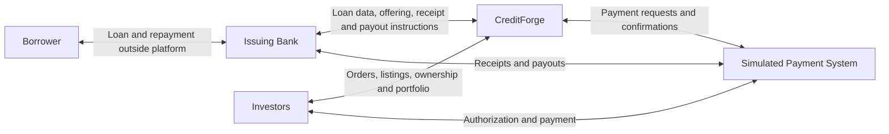

# CreditForge — Business Requirements Document (BRD)

**Version:** 0.1 — Draft for review  
**Baseline:** [Project Idea Specification v2.1](./PROJECT_IDEA_SPECIFICATION.md) (commit bbad1873c7d8221ea0d328035dfbf26237cacc65)  
**Phase:** 2 — Business Analysis  
**Coverage:** 2.1 Business Context & Objectives; 2.2 Stakeholder Analysis. Remaining sections pending.

Confirmed = inherited from approved baseline; Proposed = recommendation awaiting review. This draft does not change the approved baseline.

## 2.1 Business Context & Objectives

### 2.1.1 Context and scope

CreditForge is an independent, single-issuer credit investment marketplace. The issuer originates and disburses secured corporate loans outside CreditForge, registers eligible loans, and sells Senior rights. The issuer retains Junior and unsold Senior. Investors trade rights via the primary and fixed-price secondary markets. Money moves through simulated banking systems, never through a CreditForge cash wallet. Automatic bank payouts distribute actual available cash under the financial rules.

| Outside | Inside |
|---|---|
| Loan origination, credit assessment, valuation, contract, disbursement | Asset registration, eligibility review, tokenization, offerings |
| Borrower repayment and physical recovery | Repayment/default/recovery recording, waterfall, loss allocation |
| Bank account management and monetary transfers | Payment orchestration, verification, ownership settlement, payout tracking and reconciliation |

Borrower is not a direct user. One issuer does not imply only one payment bank. No actual funds or banking integration.

The diagram represents business interactions, not custody. Actual cash routes are Investor to Issuer, Buyer to Seller, Issuer to Investor, and authorized refund to original payer. CreditForge never receives these funds.

### 2.1.2 Business objectives

| ID | Objective | Beneficiary | Baseline mapping |
|---|---|---|---|
| BO-001 | Tái huy động vốn từ khoản vay đã giải ngân | Issuer | BR-001, 011, 027 |
| BO-002 | Số hóa và phân chia quyền lợi tín dụng | Issuer, Investor | BR-002–004 |
| BO-003 | Tiếp cận sản phẩm không phụ thuộc cùng ngân hàng thanh toán | Investor | BR-029 |
| BO-004 | Chuyển nhượng trước đáo hạn | Investor | BR-012–022 |
| BO-005 | Phân lớp và phân bổ rủi ro | Issuer, Investor | BR-005–010, 024 |
| BO-006 | Tự động tính dòng tiền và tổn thất | Issuer, Investor | BR-023–024, 038 |
| BO-007 | Điều phối thanh toán không giữ tiền | All | BR-032–037, 042–044 |
| BO-008 | Toàn vẹn tài chính và truy vết | All | BR-025–026, 037, 045 |
| BO-009 | Tự động chi trả qua ngân hàng | Investor | BR-039–041 |

BO-007 replaces the old loan-origination objective; BO-009 is added. IDs otherwise preserve the earlier analysis where practical.

### 2.1.3 Proposed success criteria

| ID | Observable result | Objective |
|---|---|---|
| SC-001 | Only eligible, uniquely referenced assets are issued; tranche principal equals issued principal | BO-002 |
| SC-002 | Confirmed primary proceeds match completed purchases; unsold Senior remains with issuer | BO-001 |
| SC-003 | Investor can purchase using a supported mock bank different from issuer | BO-003 |
| SC-004 | Secondary payment goes to seller; ownership changes exactly once after valid settlement | BO-004,007 |
| SC-005 | Concurrent orders do not oversell or over-reserve | BO-008 |
| SC-006 | Distribution does not exceed available receipts; no duplicated allocation | BO-006 |
| SC-007 | Junior absorbs loss first; total allocated loss equals confirmed loss | BO-005 |
| SC-008 | No customer cash wallet or funds held by CreditForge | BO-007 |
| SC-009 | Duplicate payment confirmation cannot complete a second transfer | BO-008 |
| SC-010 | Failed settlement remains traceable and is resolved or escalated without double-sale | BO-007,008 |
| SC-011 | Payout goes to verified mock bank account; failed payout remains outstanding | BO-009 |
| SC-012 | Full repayment and default/recovery demo scenarios reconcile independently | BO-005,006,008 |

These are product verification criteria, not validated market KPIs. No commercial ROI, demand, legal compliance or grade claim.

### 2.1.4 Constraints and assumptions

Confirmed: one issuer, independent operator, loan-centric, post-funding, limited-recourse, Senior/Junior, direct bank settlement, automatic bank payout, no borrower portal, no cash wallet, simulation only, TypeScript stack. Proposed: one collateral per active loan, one initial issuance per loan, no prior principal repayments at registration, detailed Maker–Checker scope. Exact financial conventions, eligibility, payment finality and role assignments remain open. Time, team and grading rubric not confirmed.

## 2.2 Stakeholder Analysis

### 2.2.1 Stakeholder register

| ID | Stakeholder | Interest | Influence (qualitative) |
|---|---|---|---|
| ST-001 | Issuing Bank | Refinance principal, retain residual, manage loan risk | High |
| ST-002 | Investor | Understand risk, acquire/transfer rights, receive payouts | High |
| ST-003 | CreditForge Operator | Market integrity, operations, traceability | High |
| ST-004 | Borrower | Existing loan obligations and confidentiality | Indirect |
| ST-005 | Payment Bank | Valid authorized account transfers | External dependency |
| ST-006 | Payment System | Reliable confirmation, reconciliation, payout/refund | External dependency |

Influence ratings are analyst assessments, not stakeholder interview results.

### 2.2.2 Proposed human roles

| ID | Role | Organization | Responsibilities |
|---|---|---|---|
| ACT-001 | Investor | Investor | Browse, buy, list/cancel own holdings, manage verified receiving account, monitor portfolio |
| ACT-002 | Issuer Officer | Issuing Bank | Register existing loan, evidence, propose tranche/terms, submit offering, record repayment/recovery facts |
| ACT-003 | Issuer Approver | Issuing Bank | Approve issuer submissions and sensitive financial facts; return/reject with reason |
| ACT-004 | Marketplace Reviewer | CreditForge | Independent publication eligibility review; approve/reject/suspend offering within policy |
| ACT-005 | Settlement Operator | CreditForge | Monitor payment/settlement/payout exceptions, reconcile, initiate permitted retry or refund request |
| ACT-006 | System Admin | CreditForge | Account, role, access and permitted configuration; no default financial authority |
| ACT-007 | Auditor (optional) | Authorized organization | Read-only, scoped financial and approval audit |

Payment System is an external system actor (ACT-008), not a human role. Borrower and bank credit-underwriting staff are not required direct actors. Financial Engine is an internal automated component, not an external actor.

Proposed MVP: combine Marketplace Reviewer and Settlement Operator in one Marketplace Operator role if necessary, preserve action permissions and separation from issuer; Auditor can be a scoped read-only permission. Issuer Approver separation adds control but also scope; do not claim independent internal review if omitted. Three portals can share code and layout.

### 2.2.3 Responsibility matrix (proposed)

| Operation | Responsible | Approval / control |
|---|---|---|
| Register existing loan and propose terms | Issuer Officer | Issuer Approver; Marketplace eligibility checks |
| Publish offering | Marketplace Reviewer or automated release after approval | Approved terms; no editing by reviewer |
| Record repayment/recovery facts | Issuer Officer | Issuer Approver for sensitive facts; unique external reference |
| Confirm default | Authorized issuer role | Evidence and policy; not arbitrary Marketplace decision |
| Create listing/order | Investor (issuer for primary offering) | Ownership, quantity and trading eligibility |
| Confirm external payment | Payment System | CreditForge verification; no manual paid-status override |
| Transfer ownership | Automated CreditForge settlement | Valid payment, reservation, eligibility and idempotency |
| Calculate distribution/loss | Financial Engine | Approved rules and confirmed inputs; no manual output override |
| Execute bank payout | Simulated Payment System on issuer instruction | Authorized instruction, confirmation, reconciliation |
| Resolve exceptions | Settlement Operator | Scoped authority, audit, no unilateral bank debit |
| Manage users/roles | System Admin | No implicit financial permissions or self-grant bypass |
| Audit | Authorized Auditor | Read-only, organization/record scope |

Approval of an offering is not approval of a loan. Marketplace checks consistency, eligibility and disclosure; cannot guarantee underlying data is true. Financial Engine and settlement cannot be bypassed by administrators.

### 2.2.4 Conflicts and controls

| Conflict | Risk | Proposed mitigation |
|---|---|---|
| Issuer vs Investor | Adverse selection; lower-quality assets distributed | Junior retention, verified input references, disclosure, eligibility review |
| Issuer vs Marketplace | Issuer seeks rapid publication; operator needs integrity | Separate submit/review permissions; record reasons and approved version |
| Seller vs Buyer | Seller may conceal worsening credit; liquidity asymmetry | Canonical loan data, no seller editing, trading suspension policy |
| Buyer vs Seller | Money transferred but ownership not transferred, or refund unavailable | Reservation, external confirmation, exception workflow and reconciliation |
| Operator vs Investor | Unilateral override or hidden correction | Automated rules, least privilege, audit, append-only corrections |
| Payout recipient vs operator | Wrong account or duplicate payout | Verified account, authorized instruction, confirmation and idempotency |

Junior retention reduces but does not eliminate moral hazard. Direct payment does not eliminate settlement risk.

### 2.2.5 Information visibility (proposed)

Investor sees approved asset summary, issuer, borrower business information permitted for publication, collateral summary, LTV, terms, tranche, status, risk, available listings and own transactions. Not full credit files, internal review notes, unrelated investor holdings or full bank details. Payment routing data is limited to necessary authorized participants. Seller cannot edit canonical loan data. Issuer accesses its assets and necessary servicing/payout information. Operator accesses records required for its assigned duties. Auditors have scoped read-only access. No real personal/bank data in public repo or demo.

### 2.2.6 Review Gate 02-R1 — pending decisions

| ID | Question | Recommendation | Trade-off |
|---|---|---|---|
| BD-006-R1 | Who approves offerings? | Issuer submits approved proposal; independent CreditForge reviewer approves publication | More workflow, but meaningful separation; simpler variant uses one issuer officer and Marketplace reviewer as maker/checker |
| BD-007-R1 | Can collateral secure multiple active registered loans? | Exclusive within simulated marketplace | Avoid priority and shared recovery complexity; cannot verify external liens |
| BD-013 | How is external repayment recorded? | Issuer records confirmed receipt; mock external reference and duplicate check; approval for sensitive records | Less integration scope than full mock Core Banking event system; still automatic waterfall/payout |
| BD-014 | How to scope operator roles? | One Marketplace Operator for review and exception monitoring, distinct System Admin, optional read-only auditor | Reduces screens; action permissions and financial controls remain separate |

BD-008 is superseded: agreement acceptance happens outside the platform. Decisions above are not confirmed.

## 2.3–2.8 Pending

- 2.3 Business Domain Modeling
- 2.4 Business Process Modeling
- 2.5 Business Use Cases
- 2.6 Business Rules Analysis
- 2.7 Financial Model Research (primary-source verification required)
- 2.8 BRD Consolidation & Review

No final MVP commitment, database schema or validated financial formulas in this draft.

## Revision history

| Version | Change |
|---|---|
| 0.1 | Re-baseline Business Context and Stakeholder Analysis against Idea Specification v2.1; Review Gate 02-R1 pending |
