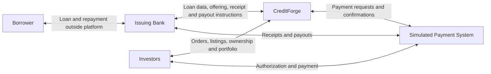
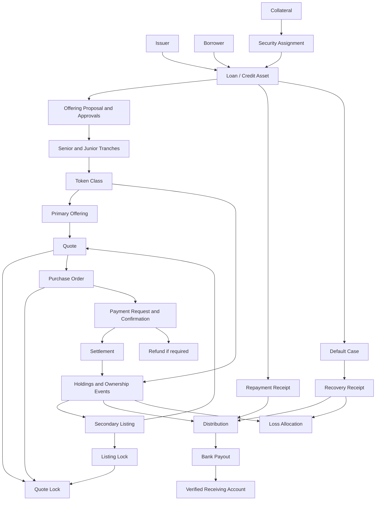
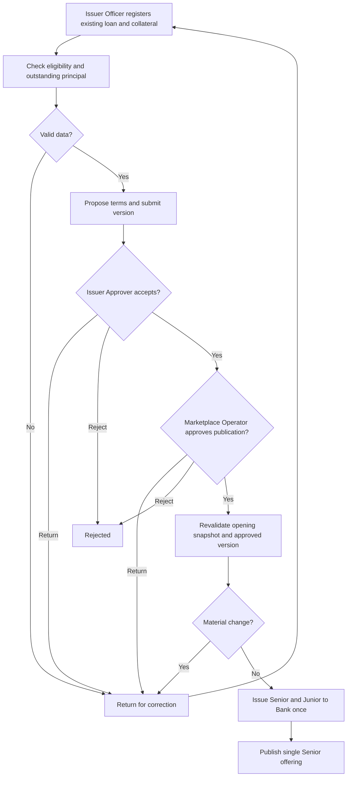
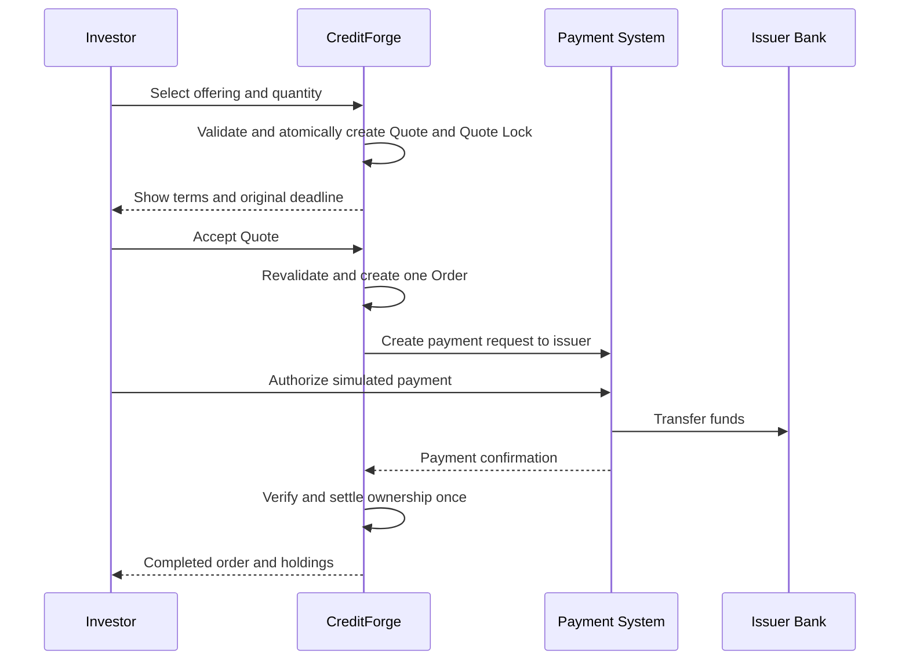
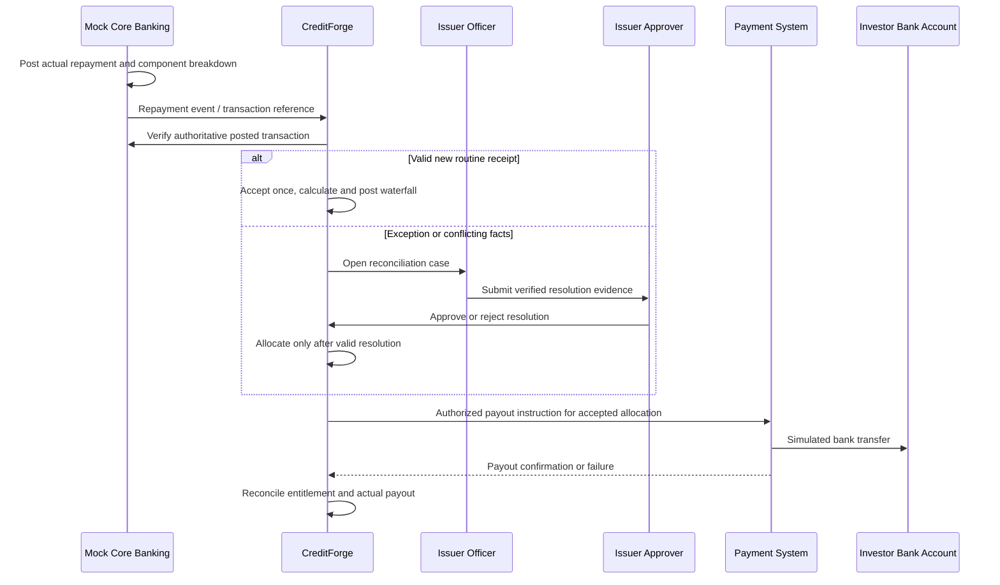

# CreditForge — Business Requirements Document (BRD)

**Version:** 1.3 — approved baseline; repayment window and transparency revision  
**Baseline:** [Project Idea Specification v2.1](./PROJECT_IDEA_SPECIFICATION.md) (commit bbad1873c7d8221ea0d328035dfbf26237cacc65)  
**Phase:** 2 — Business Analysis  
**Coverage:** 2.1 Business Context & Objectives; 2.2 Stakeholder Analysis; 2.3 Business Domain Modeling; 2.4 Business Process Modeling; 2.5 Business Use Cases; 2.6 Business Rules Analysis; 2.7 Financial Model Research; 2.8 BRD Consolidation & Review.

Confirmed = inherited from approved baseline or explicitly approved review gate; Proposed = recommendation awaiting review. Idea Specification v2.1 is historical. Latest explicitly confirmed BRD decisions supersede conflicting historical text; proposals do not.

## 2.1 Business Context & Objectives

### 2.1.1 Context and scope

CreditForge is an independent, single-issuer credit investment marketplace. The issuer originates and disburses secured corporate loans outside CreditForge, registers eligible loans, and sells Senior rights. The issuer retains Junior and unsold Senior. Investors trade rights via the primary and fixed-price secondary markets. Money moves through simulated banking systems, never through a CreditForge cash wallet. Automatic bank payouts distribute actual available cash under the financial rules.

| Outside | Inside |
|---|---|
| Loan origination, credit assessment, valuation, contract, disbursement | Asset registration, eligibility review, tokenization, offerings |
| Borrower repayment and physical recovery | Repayment/default/recovery recording, waterfall, loss allocation |
| Bank account management and monetary transfers | Payment orchestration, verification, ownership settlement, payout tracking and reconciliation |

Borrower is not a direct user. One issuer does not imply only one payment bank. No actual funds or banking integration.

The diagram represents business interactions, not custody. Actual cash routes are Investor to Issuer, Buyer to Seller, Issuer to Investor, and authorized refund to original payer. CreditForge never receives these funds.

### 2.1.2 Business objectives

| ID | Objective | Beneficiary | Baseline mapping |
|---|---|---|---|
| BO-001 | Tái huy động vốn từ khoản vay đã giải ngân | Issuer | BR-001, 011, 027 |
| BO-002 | Số hóa và phân chia quyền lợi tín dụng | Issuer, Investor | BR-002–004 |
| BO-003 | Tiếp cận sản phẩm không phụ thuộc cùng ngân hàng thanh toán | Investor | BR-029 |
| BO-004 | Chuyển nhượng trước đáo hạn | Investor | BR-012–022 |
| BO-005 | Phân lớp và phân bổ rủi ro | Issuer, Investor | BR-005–010, 024 |
| BO-006 | Tự động tính dòng tiền và tổn thất | Issuer, Investor | BR-023–024, 038 |
| BO-007 | Điều phối thanh toán không giữ tiền | All | BR-032–037, 042–044 |
| BO-008 | Toàn vẹn tài chính và truy vết | All | BR-025–026, 037, 045 |
| BO-009 | Tự động chi trả qua ngân hàng | Investor | BR-039–041 |

BO-007 replaces the old loan-origination objective; BO-009 is added. IDs otherwise preserve the earlier analysis where practical.

### 2.1.3 Proposed success criteria

| ID | Observable result | Objective |
|---|---|---|
| SC-001 | Only eligible, uniquely referenced assets are issued; tranche principal equals issued principal | BO-002 |
| SC-002 | Settled primary proceeds match completed purchases; confirmed but unsettled cash reconciled separately; unsold Senior remains with issuer | BO-001 |
| SC-003 | Investor can purchase using a supported mock bank different from issuer | BO-003 |
| SC-004 | Secondary payment goes to seller; ownership changes exactly once after valid settlement | BO-004,007 |
| SC-005 | Concurrent orders do not oversell or over-reserve | BO-008 |
| SC-006 | Distribution does not exceed available receipts; no duplicated allocation | BO-006 |
| SC-007 | Junior absorbs loss first; total allocated loss equals confirmed loss | BO-005 |
| SC-008 | No customer cash wallet or funds held by CreditForge | BO-007 |
| SC-009 | Duplicate payment confirmation cannot complete a second transfer | BO-008 |
| SC-010 | Failed settlement remains traceable and is resolved or escalated without double-sale | BO-007,008 |
| SC-011 | Payout goes to verified mock bank account; failed payout remains outstanding | BO-009 |
| SC-012 | Full repayment and default/recovery demo scenarios reconcile independently | BO-005,006,008 |

These are product verification criteria, not validated market KPIs. No commercial ROI, demand, legal compliance or grade claim.

### 2.1.4 Constraints and assumptions

Confirmed: one issuer, independent operator, loan-centric, post-funding, limited-recourse, Senior/Junior, direct bank settlement, automatic bank payout, no borrower portal, no cash wallet, simulation only, TypeScript stack. Confirmed at Gate 02-R1: exclusive collateral, dual offering approval, original manual repayment recording (superseded by BD-013-R1), combined Marketplace Operator. Confirmed at Gate 03: one issuance and offering per loan, one collateral per loan, eligibility based on outstanding principal including partially repaid loans, partial listing fill. Confirmed at Gate 04: original dual approval of all repayment/recovery receipts (superseded for routine repayment by BD-019-R1), allow trading on verified overdue with risk disclosure; stop new trading on default or maturity, honor eligible existing orders at offering closure, cancellation of unreserved listing remainder. Confirmed at Gate 05: prohibit self-purchase; cancel/relist to change price; snapshot verified receiving accounts for existing instructions; dual approval of loan status; explicit overdue-risk acknowledgement. Confirmed at Gate 06: reapprove material changes, revalidate changing credit risk, 10-minute checkout, retry failed payout to newly verified destination after definitive nonpayment. Revised during Phase 3: BD-013-R1/019-R1 automate verified routine repayment ingestion and reserve maker-checker for exceptions, corrections and recovery. Exact remaining financial conventions, payment finality and detailed eligibility remain open. Time, team and grading rubric not confirmed.

## 2.2 Stakeholder Analysis

### 2.2.1 Stakeholder register

| ID | Stakeholder | Interest | Influence (qualitative) |
|---|---|---|---|
| ST-001 | Issuing Bank | Refinance principal, retain residual, manage loan risk | High |
| ST-002 | Investor | Understand risk, acquire/transfer rights, receive payouts | High |
| ST-003 | CreditForge Operator | Market integrity, operations, traceability | High |
| ST-004 | Borrower | Existing loan obligations and confidentiality | Indirect |
| ST-005 | Payment Bank | Valid authorized account transfers | External dependency |
| ST-006 | Payment System | Reliable confirmation, reconciliation, payout/refund | External dependency |

Influence ratings are analyst assessments, not stakeholder interview results.

### 2.2.2 Proposed human roles

| ID | Role | Organization | Responsibilities |
|---|---|---|---|
| ACT-001 | Investor | Investor | Browse, buy, list/cancel own holdings, manage verified receiving account, monitor portfolio |
| ACT-002 | Issuer Officer | Issuing Bank | Register existing loan, evidence, propose tranche/terms, submit offering, review repayment exceptions and record recovery facts |
| ACT-003 | Issuer Approver | Issuing Bank | Approve issuer submissions and sensitive financial facts; return/reject with reason |
| ACT-004 | Marketplace Reviewer | CreditForge | Independent publication eligibility review; approve/reject/suspend offering within policy |
| ACT-005 | Settlement Operator | CreditForge | Monitor payment/settlement/payout exceptions, reconcile, initiate permitted retry or refund request |
| ACT-006 | System Admin | CreditForge | Account, role, access and permitted configuration; no default financial authority |
| ACT-007 | Auditor (optional) | Authorized organization | Read-only, scoped financial and approval audit |

Payment System is an external system actor (ACT-008), not a human role. Mock Core Banking (ACT-009) is the simulated issuer-side authoritative source of posted repayment transactions; it may share infrastructure with the existing payment simulator but has a distinct business responsibility. Borrower and bank credit-underwriting staff are not required direct actors. Financial Engine is an internal automated component, not an external actor.

Confirmed at Gate 02-R1: ACT-004 and ACT-005 are capability groups assigned to one Marketplace Operator role, with distinct action permissions and separation from issuer; ACT-003 remains separate from ACT-002. Auditor remains optional scoped read-only permission. Three portals can share code and layout.

### 2.2.3 Responsibility matrix (proposed)

| Operation | Responsible | Approval / control |
|---|---|---|
| Register existing loan and propose terms | Issuer Officer | Issuer Approver; Marketplace eligibility checks |
| Publish offering | Marketplace Reviewer or automated release after approval | Approved terms; no editing by reviewer |
| Import routine repayment / review exceptions and recovery | Mock Core Banking and CreditForge automation; Issuer Officer for exceptions/recovery | Verified authoritative posted transaction for routine repayment; distinct Issuer Approver for exceptions/corrections/recovery; unique external reference |
| Confirm overdue/cure/default | Issuer Officer submits; distinct Issuer Approver confirms | Evidence and policy; no automatic default or arbitrary Marketplace decision (BD-026) |
| Create listing/order | Investor (issuer for primary offering) | Ownership, quantity and trading eligibility |
| Confirm external payment | Payment System | CreditForge verification; no manual paid-status override |
| Transfer ownership | Automated CreditForge settlement | Valid payment, Quote Lock, eligibility and idempotency |
| Calculate distribution/loss | Financial Engine | Approved rules and confirmed inputs; no manual output override |
| Execute bank payout | Simulated Payment System on issuer instruction | Authorized instruction, confirmation, reconciliation |
| Resolve exceptions | Settlement Operator | Scoped authority, audit, no unilateral bank debit |
| Manage users/roles | System Admin | No implicit financial permissions or self-grant bypass |
| Audit | Authorized Auditor | Read-only, organization/record scope |

Approval of an offering is not approval of a loan. Marketplace checks consistency, eligibility and disclosure; cannot guarantee underlying data is true. Financial Engine and settlement cannot be bypassed by administrators.

### 2.2.4 Conflicts and controls

| Conflict | Risk | Proposed mitigation |
|---|---|---|
| Issuer vs Investor | Adverse selection; lower-quality assets distributed | Junior retention, verified input references, disclosure, eligibility review |
| Issuer vs Marketplace | Issuer seeks rapid publication; operator needs integrity | Separate submit/review permissions; record reasons and approved version |
| Seller vs Buyer | Seller may conceal worsening credit; liquidity asymmetry | Canonical loan data, no seller editing, trading suspension policy |
| Buyer vs Seller | Money transferred but ownership not transferred, or refund unavailable | Quote Lock, external confirmation, exception workflow and reconciliation |
| Operator vs Investor | Unilateral override or hidden correction | Automated rules, least privilege, audit, append-only corrections |
| Payout recipient vs operator | Wrong account or duplicate payout | Verified account, authorized instruction, confirmation and idempotency |

Junior retention reduces but does not eliminate moral hazard. Direct payment does not eliminate settlement risk.

### 2.2.5 Information visibility (proposed)

Investor sees approved asset summary, issuer, borrower business information permitted for publication, collateral summary, LTV, terms, tranche, status, risk, available listings and own transactions. Not full credit files, internal review notes, unrelated investor holdings or full bank details. Payment routing data is limited to necessary authorized participants. Seller cannot edit canonical loan data. Issuer accesses its assets and necessary servicing/payout information. Operator accesses records required for its assigned duties. Auditors have scoped read-only access. No real personal/bank data in public repo or demo.

### 2.2.6 Review Gate 02-R1 — confirmed decisions

| ID | Question | Recommendation | Trade-off |
|---|---|---|---|
| BD-006-R1 | Who approves offerings? | Issuer submits approved proposal; independent CreditForge reviewer approves publication | More workflow, but meaningful separation; simpler variant uses one issuer officer and Marketplace reviewer as maker/checker |
| BD-007-R1 | Can collateral secure multiple active registered loans? | Exclusive within simulated marketplace | Avoid priority and shared recovery complexity; cannot verify external liens |
| BD-013 | Historical decision (superseded by BD-013-R1) | Manual confirmed receipt entry | Replaced by automatic integration during Phase 3 |
| BD-014 | How to scope operator roles? | One Marketplace Operator for review and exception monitoring, distinct System Admin, optional read-only auditor | Reduces screens; action permissions and financial controls remain separate |

BD-008 is superseded: agreement acceptance happens outside the platform. All four decisions in this table were confirmed by the project owner on 2026-11-27. The simpler alternatives are not the selected model.

Dual approval applies to the same version of offering terms. Confirmed BD-028: material changes invalidate prior approvals; reviewers return rather than edit submitted terms. BD-013-R1 replaces manual repayment entry with automatic ingestion of authoritative posted Mock Core Banking transactions; unique reference and verification precede allocation. Combined Marketplace Operator cannot approve issuer proposals on behalf of issuer or override calculated entitlements. BD-019-R1 retains distinct Issuer Approver review for repayment exceptions, corrections and recovery; routine verified transactions require no manual approval.

### 2.2.7 Collateral reuse research and rationale

Vietnamese Civil Code 2015 (Law 91/2015/QH13), Article 296 permits one asset to secure multiple obligations subject to value conditions and exceptions by agreement or law; disclosure to subsequent secured parties is required. Enforcement can affect other secured obligations. Article 308 governs payment priority, including effectiveness against third parties and possible agreements on priority. Sources: [Civil Code 2015](https://btllang.mod.gov.vn/van-ban/vbpq-do-nha-nuoc-ban-hanh/5001-bo-luat-dan-su-2015.html), [Article 308 text](https://thuvienphapluat.vn/van-ban/Quyen-dan-su/Bo-luat-Dan-su-2015-296215.aspx).

Public bank evidence checked 2026-11-27:
- [Hong Leong Bank Vietnam](https://www.hlbank.com.vn/vi/personal-banking/blog/vay-tieu-dung-co-tai-san-dam-bao.html): consumer lending guidance acknowledges concurrent use under value conditions.
- [Techcombank TOP UP](https://techcombank.com/thong-tin/thong-bao/top-up-da-tien-ich-nay-con-nhieu-uu-dai-hon): historical programme permitted reuse and additional collateral where needed; page marked expired. Not proof of current corporate policy.
- [Vietcombank loan FAQ](https://www.vietcombank.com.vn/vi-VN/KHCN/Lien-he-va-Ho-tro/Danh-sach-cau-hoi-theo-chu-de-Vay): insufficient public evidence for current corporate collateral reuse policy. Individual bank approval/contract conditions remain unknown.

BD-007-R1 is a CreditForge eligibility restriction, not Vietnamese law: each collateral asset may secure at most one registered loan with an outstanding secured obligation at a time. Sequential reuse after confirmed release is allowed in principle. Gate 03 additionally limits each registered loan to one collateral asset. The platform must reject overlapping active pledges of the same asset and require issuer evidence of exclusivity; it cannot discover undisclosed external liens. If external shared security becomes known, flag for review and suspend new issuance/trading as appropriate; do not silently assume full recovery.

Example: asset 10bn secures Loan A 4bn and Loan B 2bn. Combined principal-to-value is 60%, but recovery 4bn cannot be counted twice. A cross-loan priority allocation would be needed before each loan's Senior/Junior waterfall. This complexity is excluded; cross-default and shared recovery are not modeled.

## 2.3 Business Domain Modeling — reviewed; detailed model remains proposed

### 2.3.1 Ubiquitous language

| Domain concept | Meaning and responsibility |
|---|---|
| Issuer | Single originating and issuing bank; organization, not a staff account |
| Borrower | External company reference, not a platform login |
| Credit Asset / Loan | Registered existing loan; authoritative contractual terms and outstanding principal reference |
| Collateral | Identified physical asset and dated valuation evidence, not a tokenized ownership interest |
| Security Assignment | Association between collateral and loan with effective/released status; enforces exclusive active use |
| Offering Proposal / Approval | Versioned investment terms and decision evidence from issuer and marketplace |
| Tranche | Senior or Junior priority and outstanding principal rights |
| Token Class | Fungible units for one loan and tranche; face value, supply and contractual coupon/residual rule |
| Offering | Issuer primary sale of available Senior units |
| Holding | Owner's quantity and remaining principal rights in a token class |
| Ownership Event | Issuance, transfer or retirement with effective time; supports historical accrual |
| Listing | Seller's fixed-price offer backed by locked holdings |
| Listing Lock | Seller holdings locked for one listing; includes its Quote Locks |
| Quote | Immutable server-generated transaction terms, Buyer, source and deadline; single-use |
| Quote Lock | Temporary quantity held for one Quote, continues through accepted Order and payment reconciliation; subset of Listing Lock on Secondary |
| Purchase Order | Buyer acceptance of one Quote; tracks transaction through payment and settlement |
| Payment Request | Authorized external money movement instruction/reference |
| Payment Confirmation | Evidence of external payment, not ownership transfer |
| Settlement | Completion of verified purchase and ownership transfer exactly once |
| Refund | Separate external return of money, not DB rollback |
| Receiving Account | Verified simulated bank destination; no cash balance in CreditForge |
| Repayment Receipt | Confirmed external borrower payment imported from Mock Core Banking; exceptional facts reconciled with evidence |
| Interest Entitlement | Earned financial right for ownership interval; not necessarily paid |
| Distribution | Allocation of an available receipt to entitled holders |
| Payout | External bank execution/confirmation of allocated amount |
| Default Case | Confirmed credit event and status history |
| Recovery Receipt | Confirmed net recovery attributable to the loan |
| Loss Allocation | Recognized loss assigned to remaining rights according to waterfall |
| Ledger / Audit Event | Traceable financial facts and operational decisions; not a customer wallet |

### 2.3.2 Conceptual relationships

This is a business relationship diagram, not a database schema. Arrows do not represent cash custody or mandatory chronological order.

| Relationship | Cardinality / rule |
|---|---|
| Issuer to Loan | 1:N |
| Borrower to Loan | 1:N; no borrower user account |
| Collateral to Security Assignment | 1:N historical; at most one active loan per asset (confirmed) |
| Loan to Collateral | Exactly one eligible collateral for issuance (confirmed) |
| Loan to Tranche | Exactly two once issued |
| Tranche to Token Class | One per tranche proposed for MVP |
| Token Class to Holding | 1:N; bank retains Junior and initially owns issued Senior |
| Loan to issuance | One issuance; no top-ups (confirmed) |
| Token Class to Offering | One primary offering for Senior; no reopening after closure (confirmed) |
| Holding to Listing | 1:N subject to available quantity |
| Quote to source | Exactly one primary Offering OR secondary Listing |
| Quote to Quote Lock | Exactly one logical lock created atomically with Quote; no double-counting |
| Quote to Order | Zero or one Order; created on valid acceptance; inherits original deadline and lock |
| Order to payment attempts | 1:N possible attempts, at most one accepted settlement; policy pending |
| Receipt to Distribution | One logical allocation run per receipt/version; multiple entitlement lines |
| Entitlement to Payout | One logical payable, potentially multiple attempts; retry never creates new entitlement |
| Loan to Repayment/Recovery Receipt | 1:N; recovery finality and partial recovery policy pending |

### 2.3.3 Domain boundaries

| Business domain | Owns | Does not own |
|---|---|---|
| Credit Asset & Issuance | Loan reference, collateral assignments, approved terms, tranche and issuance | Actual credit approval/disbursement |
| Marketplace | Offering, Listing, Listing Lock, Quote, Quote Lock, Order | Bank money or financial allocation formulas |
| Ownership Registry | Holdings and historical ownership changes | Payment authorization |
| Payment & Settlement | Payment evidence, coordination, exception/refund and reconciliation | Bank account balances; unilateral debit |
| Loan Servicing & Finance | Receipts, accrual, distribution, default/recovery/loss | Physical recovery, external transfers |
| Payout | Payable instructions, attempts, confirmed execution | Creation of additional entitlement on retry |
| Identity & Governance | User roles, issuer identity, approvals, audit and receiving account verification | Arbitrary override of financial records |

Boundaries are logical; not a mandate for microservices.

### 2.3.4 Lifecycle distinctions (proposed)

- Credit Asset registration: Draft → Submitted → Reviewed/Rejected → Eligible. Loan servicing status is separate: Active, Overdue, Defaulted, Recovery, Closed.
- Offering proposal: Draft → Issuer Approved → Marketplace Approved → Published; return/reject and version changes handled separately.
- Offering: Scheduled/Open → Closed or Suspended. Closure does not cancel loan.
- Listing: Active → Filled/Cancelled/Expired/Suspended. Outstanding Quote Locks resolved before release, including accepted orders.
- Quote: Generated → Accepted/Expired/Cancelled/Invalidated; accepted once. Quote Lock: Active → Consumed/Released, remains protected during unresolved payment.
- Order: Pending → Completed/Cancelled/Expired or exception; Payment and Settlement have independent states.
- Payment: Requested → Pending → Confirmed/Failed; late/ambiguous confirmation enters reconciliation. Refund is separate.
- Settlement: Pending → Completed or Exception; confirmed payment cannot be treated as unpaid.
- Distribution: Calculated/Posted; Payout: Pending/Confirmed/Failed. An allocated right is not cash available to spend.
- Collateral assignment: Active → Released only after evidence of release and no remaining secured obligation; loan registration closure and legal release are not identical.

Exact transitions, permissions, time cutoffs and exception conditions belong in 2.4 and 2.6.

### 2.3.5 Domain invariants and edge cases

- Unique external loan and receipt references in issuer scope; same collateral cannot be duplicated by cosmetic ID changes. Asset identity method remains to be specified.
- Approved terms must remain consistent with issued rights; approval version is required by BD-028.
- Total issued principal = Senior + Junior; holding quantities reconcile to outstanding token supply. Bank holding is an actual recorded position, not inferred from offering sales.
- Reserved quantity is part of locked listing quantity where applicable, not an additional independent deduction. Seller remains owner until completed settlement.
- Payment confirmation does not change ownership by itself. Settlement applies at most once; external payment cannot be rolled back by the database.
- Repayment receipt, distribution and payout are separate facts; no duplicate allocation or disbursement. Failed payout remains payable.
- Ownership effective time determines future accrual; treatment of earned but unpaid interest remains open.
- Final recovery may create losses, but an interim recovery alone is not proof of final loss. Partial recovery/loss recognition policy remains open.
- Loan maturity is not equivalent to repayment or closure. Token retirement and unresolved payouts require separate rules.

### 2.3.6 Review Gate 03 — confirmed decisions

| ID | Decision | Confirmed selection |
|---|---|---|
| BD-015 | Initial issuance model | One issuance and one primary offering per loan; no top-up or reopening in MVP |
| BD-016 | Collateral cardinality per loan | One asset per loan in MVP; retain historical assignment and release records |
| BD-017 | Eligible loan at registration | Already disbursed, current, positive outstanding principal; prior principal repayment allowed; remaining repayment schedule must be compatible |
| BD-018 | Listing fill model | Allow partial purchases by multiple buyers, with Quote-specific locks |

Gate 03 confirmed by project owner: BD-015, BD-016 and BD-018 follow the selected screenshot options; BD-017 follows the revised Outstanding Principal option discussed immediately before confirmation. A borrower may still have multiple loans with distinct collateral. Financial rules and exact state machines remain pending.

BD-017 requires an issuer-confirmed opening snapshot at issuance: original principal, outstanding principal, remaining schedule, maturity, effective date, and separation of pre-issuance interest from subsequent token rights. Example: original principal VND 6bn, repaid VND 2bn, outstanding VND 4bn; illustrative 80/20 tranche at VND 100,000 face value gives 32,000 Senior and 8,000 Junior units. Do not tokenize repaid principal or replay historical receipts as distributable cash. Refresh and revalidate snapshot before issuance if principal or material terms change; prior approvals must not silently authorize a changed issuance amount. This does not decide whether future amortizing schedules are supported: repayment structure and treatment of post-issuance principal payments remain Phase 3 decisions.

## 2.4 Business Process Modeling — reviewed; detailed transitions pending

### 2.4.1 Process inventory

| ID | Process | Trigger | Business outcome |
|---|---|---|---|
| BP-001 | Asset registration and dual approval | Issuer proposes existing loan | Approved offering proposal or returned/rejected case |
| BP-002 | Issuance and primary publication | Valid final approval and opening snapshot | One token issuance and one Senior offering |
| BP-003 | Primary purchase | Investor selects quantity | Direct payment to Bank and settled ownership |
| BP-004 | Secondary listing and purchase | Holder lists or Buyer selects quantity | Partial/full fill, direct payment to Seller, transfer |
| BP-005 | Payment exception and reconciliation | Timeout, mismatch, duplicate or settlement failure | Resolved or traceable outstanding obligation |
| BP-006 | Repayment and distribution | Mock Core Banking posts repayment and notifies CreditForge | Allocated rights and automatic payout instructions |
| BP-007 | Payout execution | Posted external payable | Confirmed bank payout or outstanding payable |
| BP-008 | Default and recovery | Verified credit event / recovery receipt | Loss allocation and recovery payout under rules |
| BP-009 | Closure and collateral release | Contractual obligations resolved | Closed rights, resolved obligations, evidence of release separately recorded |

These processes describe business responsibilities, not endpoints, database schema or service deployment. Financial calculations and exact timing remain pending.

### 2.4.2 BP-001–002 — Registration, approval and issuance

Preconditions: existing disbursed current loan, positive eligible outstanding principal, one collateral, no overlapping active registered pledge, compatible remaining repayment schedule, unique reference. Prior principal repayments allowed. Issuer Officer submits; distinct Issuer Approver approves; Marketplace Operator checks eligibility/disclosure, not underwriting. Rejection records reason. Material changes require new approval (BD-028). Issuance is idempotent; Bank initially owns all issued units, retains Junior. No second issuance or reopening closed offering. Publication and issuance failures must not generate duplicate units; retry the same approved issuance. Opening snapshot distinguishes historical receipts from post-issuance entitlement.

### 2.4.3 BP-003 — Primary purchase

Price and quantity fixed in Quote; accepted Order references immutable terms; total verified against payment evidence. Payment bank can differ from issuer. Quote Lock reduces available offering quantity, not ownership. Only successful settlement moves units and begins Investor accrual. Unsold Senior stays with Bank. Offering closure prevents new orders; existing eligible orders retain their original payment deadline under BD-021.

### 2.4.4 BP-004 — Secondary listing and partial fill

Seller selects available Senior units, sets price and quantity, confirms listing. System locks listed units. Buyer selects integer quantity up to available listing quantity; system atomically creates Quote and Quote Lock within Listing Lock. Buyer reviews and accepts valid Quote to create one Order. Buyer authorizes payment directly to verified Seller receiving account. Verified confirmation permits settlement; ownership moves once and listing remaining quantity reduces. Other buyers may purchase remaining units.

Example: list 1,000 units; order A reserves 300, order B reserves 200. Before settlement: 500 available, 500 reserved, Seller still owns all 1,000. After A settles: 300 sold, 200 reserved, 500 available; after B settles: 500 sold, 0 reserved, 500 available. Quote Lock is a subset of listing lock, not a second deduction. Cancelling a listing must not release units backing unresolved paid/pending orders. Cancellation of unreserved remainder is confirmed under BD-022; BD-024 requires cancellation of unreserved remainder and a new listing to change price; existing order price/payee snapshot must not silently change.

### 2.4.5 BP-005 — Payment exception and reconciliation

Duplicate callback must not trigger another transfer. Timeout alone is not proof of nonpayment; verify finality before release. A late payment after release cannot displace other completed purchases. Refund is a separate banking operation and not guaranteed if Seller already received money. Marketplace Operator may reconcile and initiate permitted retry/refund; cannot fabricate confirmations, debit accounts or override ownership manually. Ambiguous external status is an exception, not a successful payment. Checkout is 10 minutes per BD-030; reconciliation deadlines, retry counts and refund authorization remain open.

### 2.4.6 BP-006–007 — Automated repayment synchronization and automatic payout

BD-013-R1/019-R1: routine repayment data originates in a separate logical Mock Core Banking boundary, not from an officer typing it into CreditForge. The simulator posts actual simulated cash and principal/interest application, then notifies CreditForge. CreditForge authenticates the source, verifies posted transaction details against the trusted simulator record, matches the registered loan, validates components, effective time, uniqueness and prior processing, and accepts valid routine receipts automatically. Duplicate deliveries are harmless; delayed, conflicting, missing or reversed facts require reconciliation. A notification alone is not proof of cash. No distribution based on expected schedule. No human approval for normal validated repayment; exceptional financial facts, corrections and recovery require distinct Officer/Approver review with authoritative evidence. No manual fabricated receipt or override. Payout remains automatic, separate and idempotent; Bank retained entitlement needs no transfer. Unknown/failed payouts retain outstanding payable. Exact API, retry, ordering, and correction implementation deferred to detailed requirements/design.

### 2.4.7 BP-008 — Default and recovery

Confirmed overdue updates risk warnings while eligible primary and secondary trading continues (revised BD-020).

Detect missing expected receipt → issuer verifies actual overdue status → grace if applicable → authorized issuer confirms default → stop new trading under BD-020 → issuer performs recovery outside platform → records confirmed net recovery and references → Financial Engine distributes available funds → recognize losses only when appropriate under final loss policy → payout → closure review.

A missed schedule or missing synchronized repayment record is not by itself proof of default. Interim recovery is not necessarily final loss. No physical liquidation in CreditForge. Existing pending or paid orders must be resolved without silently dropping obligations. No new interest/principal guarantees; Junior first-loss and Senior pari passu under approved financial rules. Default trading policy is confirmed under BD-020; grace, impairment, recovery finality and exact waterfall remain Phase 3.

### 2.4.8 BP-009 — Closure and release

Maturity is a date, not proof of payment. Verify outstanding principal and interest rights, final distributions, recognized losses, ownership retirement, unpaid payouts and unresolved settlement/refund cases. Loan servicing closure, token trading closure and payment reconciliation may occur at different times; do not discard open obligations. Collateral release requires evidence of release and no outstanding secured obligation before subsequent reuse. Exact closure criteria and retirement states are pending.

### 2.4.9 Review Gate 04 — confirmed process decisions

| ID | Decision | Confirmed selection and rationale |
|---|---|---|
| BD-019 | Historical decision (superseded by BD-019-R1) | Manual approval for every repayment/recovery receipt; now limited to exceptions, corrections and recovery |
| BD-020 | Trading during overdue/default/maturity | Allow primary and secondary trading during confirmed overdue with explicit risk warnings, subject to other eligibility rules; default/maturity stop new trades; existing orders resolved separately |
| BD-021 | Offering closure with pending orders | Stop new Quotes immediately; honor pre-existing valid Quote Locks through original payment deadline if loan remains eligible; otherwise reconcile and refund as required; never reopen closed offering |
| BD-022 | Listing cancellation with pending orders | Allow cancellation of unreserved remainder; existing Quote Locks remain until definitively unpaid, settled or otherwise resolved; no cancellation that strands paid Buyer |

All four decisions confirmed by project owner; BD-020 revised from pause to allow in Gate 04-R1. BD-021 and BD-022 unchanged; BD-019 subsequently revised by BD-019-R1 during Phase 3. BD-020 is a project-specific risk and scope policy, not a universal RWA industry standard. Quote Lock duration is 10 minutes per BD-030; payment finality, late confirmations, dispute resolution, default grace and exact payout/settlement retry rules remain open. No new technical architecture commitment.

### 2.4.10 BD-020 reference research

Reviewed 2026-11-27. Distinguish suspension of new subscriptions, secondary transfers, borrower drawdowns and redemption; these mechanisms are not interchangeable.

| Reference | Evidence | Relevance / limitation |
|---|---|---|
| [Centrifuge access and permissions](https://developer.centrifuge.io/user/concepts/access-permissions/) and [token compliance](https://docs.centrifuge.io/developer/vault-development-kit/compliance/token-compliance/) | Share-class restrictions and address freezes can control transfers. | No verified automatic blanket transfer freeze on individual loan delinquency. Current share-class docs are not historical Tinlake rules. |
| [Maple defaults and impairments](https://docs.maple.finance/legal/syrupusdc-and-syrupusdt-defaults-and-impairments), [pool mechanics](https://docs.maple.finance/technical-resources/pools/pools) | Impairment may recognize expected deterioration before technical default; pool shares have their own transfer mechanics. | Pooled valuation differs from fixed-price, loan-specific transfers. No verified blanket overdue transfer ban. |
| [Goldfinch V1 borrower mechanics](https://github.com/goldfinch-eng/community-docs/blob/main/protocol-mechanics/borrowers.md), [default process](https://docs.goldfinch.finance/goldfinch/goldfinch-v1/protocol-mechanics/default-process) | Late borrowers cannot draw further; default has a separate remediation process. | Borrowing restriction is not an investor secondary-transfer restriction. |
| [Mintos overdue funds](https://help.mintos.com/hc/en-us/articles/31119284582929-What-are-overdue-funds), [secondary sale eligibility](https://help.mintos.com/hc/en-us/articles/7221077647633-How-to-sell-loan-investments-on-the-Secondary-market), [exit investments](https://help.mintos.com/hc/en-us/articles/7221175394961-How-can-I-exit-my-investments), [risk statuses](https://help.mintos.com/hc/en-us/articles/360014829478-What-are-three-statuses-in-the-Mintos-Risk-Score) | Overdue-funds guidance distinguishes primary restrictions from continued secondary trading; sale eligibility and formal lending-company suspension/default guidance describe exclusions. | Traditional credit marketplace, not blockchain RWA protocol. Borrower delinquency, lender remittance delay and formal suspension differ. Public guidance is not uniform across product/status; do not infer universal pause. |

Evidence limitation: Mintos overdue-funds article was read in full; some other official pages were available through indexed extracts but direct retrieval failed (cache or Markdown content-type). No contract-level audit or complete product-policy verification was performed.

**Revised decision (Gate 04-R1):** supersede the previous pause-on-overdue choice. Allow new primary and secondary orders during issuer-confirmed overdue, with explicit risk warnings and all other eligibility checks. Stop new trades on default, recovery, maturity or closure. An already closed primary offering never reopens; an independent suspension for another valid reason is not overridden. Continue servicing, distributions, payout and reconciliation. A missing synchronized repayment record alone is not proof of delinquency. This policy preserves a possible exit route, but does not guarantee liquidity and increases adverse-selection and unpaid-interest allocation risks. The reference research above is retained as historical context; it does not establish that this policy is an industry standard.

Confirmed BD-027: require explicit buyer acknowledgement of overdue risk before payment authorization in either market. Confirmed BD-029 requires revalidation and renewed consent before authorization for material risk changes, and reconciliation after authorization. Proposed presentation details: disclose verified overdue obligations, days overdue and last status update on asset, listing and checkout; bind acknowledgement to the disclosed status version; if material risk changes before settlement, revalidate and route unresolved orders to reconciliation, without automatic transfer or release of paid Quote Locks. Do not assume consent to a changed risk profile. Exact treatment of already authorized/paid orders, information cutoffs and unpaid pre-transfer interest remains open. Distinguish delinquency from default and impairment; no new valuation model or guaranteed recovery is implied.

## 2.5 Business Use Cases — Gate 05 reviewed; detailed specifications pending

### 2.5.1 Actor and use-case inventory

Business use cases express actor goals and outcomes, not screens or endpoints. Marketplace Operator combines ACT-004/005; Issuer Officer and Approver remain distinct. External Payment System ACT-008 and Mock Core Banking ACT-009 are supporting system actors. Borrower has no login or direct use case. Automation is an internal responsibility, not a human actor.

| ID | Use case | Primary actor | Process / objective |
|---|---|---|---|
| UC-001 | Register and submit credit asset/terms | Issuer Officer | BP-001 / BO-002 |
| UC-002 | Approve issuer proposal | Issuer Approver | BP-001 / BO-008 |
| UC-003 | Review publication eligibility | Marketplace Operator | BP-001 / BO-008 |
| UC-004 | Issue rights and publish offering | Issuer / authorized workflow | BP-002 / BO-001,002 |
| UC-005 | Browse and inspect investment | Investor | BP-003,004 / BO-003 |
| UC-006 | Verify receiving bank account | Investor | BP-004,007 / BO-007,009 |
| UC-007 | Purchase primary units | Investor | BP-003 / BO-001,003,007 |
| UC-008 | Create secondary listing | Investor (Seller) | BP-004 / BO-004 |
| UC-009 | Purchase all or part of listing | Investor (Buyer) | BP-004 / BO-004,007 |
| UC-010 | Cancel unreserved listing remainder | Investor (Seller) | BP-004 / BO-004,008 |
| UC-011 | Close primary offering | Authorized issuer / scheduled workflow | BP-003 / BO-001 |
| UC-012 | Resolve payment/settlement exception | Marketplace Operator | BP-005 / BO-007,008 |
| UC-013 | Synchronize verified external repayment receipt | Mock Core Banking / CreditForge | BP-006 / BO-006 |
| UC-014 | Reconcile repayment exceptions / approve recovery and corrections | Issuer Officer + distinct Issuer Approver | BP-006,008 / BO-006,008 |
| UC-015 | Monitor automatic payout and resolve failure | Marketplace Operator | BP-007 / BO-009 |
| UC-016 | Update verified overdue/cure/default status | Issuer Officer + distinct Issuer Approver | BP-008 / BO-005 |
| UC-017 | Record external recovery receipt | Issuer Officer | BP-008 / BO-005,006 |
| UC-018 | Review final settlement and collateral release | Authorized issuer role | BP-009 / BO-005,008 |
| UC-019 | View own portfolio and financial history | Investor | BP-003–009 / BO-003,008 |
| UC-020 | Manage accounts and permissions | System Admin | Cross-cutting / BO-008 |
| UC-021 | Inspect financial audit and reconciliation evidence | Authorized operator/auditor | BP-005–009 / BO-008 |

### 2.5.2 Use-case specifications

| ID | Preconditions | Main flow | Outcome and exceptions |
|---|---|---|---|
| UC-001 | Authorized Officer; existing disbursed loan | Enter external reference, one collateral, original/outstanding principal, remaining schedule and proposed terms; validate and submit version | Submitted; reject duplicate/overlapping security, ineligible loan or incompatible schedule; partial pre-issuance principal repayment allowed |
| UC-002 | Submitted version; distinct Approver | Inspect evidence; approve, return or reject with reason | Issuer-approved version; no self-approval; material changes require review |
| UC-003 | Issuer-approved version | Check eligibility, data consistency, disclosure; approve/return/reject | Publication approval, not credit underwriting; no reviewer modification of approved terms |
| UC-004 | Both approvals for same version, valid opening snapshot | Revalidate, issue Senior/Junior once to Bank, publish one Senior offering | Bank owns initial rights; failure retry does not mint twice; no second issuance/reopening |
| UC-005 | Published product visible to eligible viewer | View loan, terms, collateral summary, verified overdue status and risk warning, available units/listings | Informed decision; overdue does not itself prevent an order; suspended/defaulted/matured items clearly marked and ineligible for new orders |
| UC-006 | Authenticated Investor | Submit simulated bank destination; verify identity/account under chosen policy | Verified receiving account; new destination applies only to new instructions, existing instructions retain snapshot; failed verification prevents dependent transaction; no credentials/PIN/OTP stored |
| UC-007 | Eligible Investor, open eligible offering, available units | Choose quantity, create Quote and Quote Lock atomically, review and accept Quote with overdue acknowledgement where applicable, create Order, authorize bank payment to Issuer, verify confirmation, settle | Ownership and accrual begin on completion; handle duplicate, mismatch, timeout and settlement failure via UC-012 |
| UC-008 | Seller owns available transferable Senior units; verified receiving account | Set integer quantity and fixed price; validate and lock units; show canonical overdue warning if applicable | Active listing; overdue alone is not a rejection reason; reject oversell, otherwise ineligible loan or invalid price |
| UC-009 | Eligible Buyer, active eligible listing and available quantity | Reject self-purchase; select partial/full quantity; create Quote and Quote Lock atomically; review and accept Quote with overdue acknowledgement where applicable; create Order; authorize direct transfer to Seller; verify and settle | Buyer owns purchased units, remaining listing stays available; price/coupon distinction preserved; exceptions UC-012 |
| UC-010 | Seller owns listing | Cancel unreserved remainder; preserve Quote-specific locks; create new listing if changing price | No new orders for cancelled remainder; reserved units resolved independently |
| UC-011 | Authorized issuer or scheduled closure condition | Close offering to new orders; honor existing valid Quote Locks within original deadline if still eligible | Unsold Senior remains Bank; no reopening; unsafe pending cases UC-012 |
| UC-012 | Payment mismatch, unknown, late, duplicate or settlement failure | Query trusted evidence; reconcile; retry safe settlement or request authorized refund | Completed, refunded or unresolved case; no manual paid override or unauthorized debit; no double-sale |
| UC-013 | Posted repayment at trusted Mock Core Banking | Receive event; verify source transaction, loan, reference, effective date, amount and components; deduplicate | Valid receipt automatically accepted and allocated once; mismatch or ambiguous facts enter UC-014 |
| UC-014 | Exception, correction or recovery evidence; distinct Approver | Officer reconciles with authoritative source and submits resolution; Approver accepts or rejects | Valid resolution triggers allocation once if applicable; preserve earlier postings and no fabricated receipt |
| UC-015 | Posted payable or payment exception | Inspect instruction and bank status; reconcile; retry safely if permitted | Confirmed payout or outstanding obligation; no second distribution, no wallet credit |
| UC-016 | Evidence of actual loan condition | Officer verifies evidence and proposes overdue/cure/default with effective date; distinct Approver confirms; apply disclosure and trading rules | Overdue updates risk disclosure without automatic trading pause; cure updates status; default/maturity stop new orders; missing record alone insufficient |
| UC-017 | Authorized Officer, actual recovery received externally | Enter net receipt, source, reference and evidence; submit to UC-014 | Verified recovery input; interim receipt not automatic final loss |
| UC-018 | Loan obligations resolved or final loss recognized under policy | Review principal, allocations, payouts, pending trades/refunds, retirement and release evidence | Closure status and separate release record; unresolved obligations retained; no automatic closure solely on maturity |
| UC-019 | Authenticated Investor | View own holdings, acquisition cost, rights, payments, pending/received payouts and losses | Traceable portfolio; pending payout is not spendable cash |
| UC-020 | Authorized System Admin | Create/manage staff access and permission assignments with audit | Least privilege; no implicit financial override or self-grant bypass |
| UC-021 | Scoped audit/operations access | Inspect approval versions, ownership, receipts, distributions, payouts, exception history | Reconciled evidence or identified discrepancy; audit role read-only |

### 2.5.3 Cross-cutting automated subflows

- Quote Lock and ownership settlement (UC-007/009): validate availability and eligibility; reserve once; verify external payment; transfer once; record event and update source. External bank transfer cannot be rolled back by DB.
- Distribution and loss allocation (UC-013/014/017): use approved receipts, ownership intervals and financial rules; validate available cash and loss conservation; persist allocation once. Exact calculations Phase 3.
- Automatic payout (UC-013/014/015): issuer-authorized instruction to external simulator, verified destination, confirm/reconcile. No manual investor claim.
- Trading eligibility (UC-005/007/008/009/011/016): check loan state and source status independently; enforce BD-020/021/022; preserve in-flight obligations.
- Audit: record actor, action, timestamp, source references and decisions; corrections traceable.

### 2.5.4 Acceptance scenarios (proposed business-level checks)

| Scenario | Expected result |
|---|---|
| Existing loan 6bn, repaid 2bn before issuance | Issue no more than eligible 4bn; historical repayment not distributed |
| Officer tries to approve own proposal or receipt | Denied |
| Marketplace review of modified approved proposal | Prior approvals invalidated under BD-028 |
| Two buyers request more than remaining listed units | Only valid Quote Locks accepted; no oversell |
| Listing 1,000, order reserves 300, seller cancels | 700 unlocked; 300 preserved until resolved |
| Offering closes while eligible order still valid | No new orders; existing valid order may settle before its deadline |
| Verified overdue while order pending | New orders remain allowed with warnings if otherwise eligible; pending order risk changes reviewed under BD-029; no automatic release of paid Quote Lock |
| Verified overdue before new purchase | Primary/secondary orders allowed if otherwise eligible; explicit risk warning and required acknowledgement before payment |
| Buyer attempts own listing | Denied before payment |
| Seller reprices listing with pending order | Cancel unreserved remainder; create new listing; reserved price unchanged |
| Receiving account changes during payout | Existing instruction destination unchanged |
| Missing repayment record | Flag for dual status review; no automatic overdue |
| Default or maturity while order pending | Stop new orders; reconcile existing obligations; no automatic release of paid Quote Lock |
| Same payment confirmation received twice | One ownership transfer |
| Payment confirmed but settlement fails | Traceable exception; preserve obligation, no duplicate transfer |
| Receipt approved twice or duplicate external reference | One accepted receipt/distribution |
| Distribution posted, payout fails | Investor payable remains outstanding; no duplicate allocation |
| Final recovery below principal | Junior-first and pari passu loss, sum reconciles under financial rules |

### 2.5.5 Review Gate 05 — confirmed operational decisions

| ID | Decision | Confirmed selection |
|---|---|---|
| BD-023 | Can Investor buy own secondary listing? | Prohibit self-purchase; no economic ownership change, avoids artificial volume and needless transfer |
| BD-024 | Can Seller change listing price? | Cancel unreserved remainder and create new listing; preserve price of reserved orders; no in-place amendment in MVP |
| BD-025 | Can receiving account change during pending payout/trade? | Verify new account for future instructions only; snapshot destination for existing instructions; exceptions require reconciliation |
| BD-026 | Who confirms overdue/cure/default status? | Officer submits evidence; Approver confirms status before risk disclosure update or default restriction; missing data flagged for review, not automatically default |

| BD-027 | Must buyer acknowledge overdue risk? | Required before authorization in both markets |

All five confirmed by project owner. BD-029 confirms risk revalidation and reconciliation; presentation and exact settlement outcomes remain open. This does not change permission to trade overdue loans. Business use cases are a draft inventory, not final MVP scope. Exact eligibility, authentication, payment finality after the confirmed 10-minute checkout, in-flight suspension handling, repayment schedules, financial calculation and recovery finality remain open.

## 2.6 Business Rules Analysis — consolidated draft

### 2.6.1 Rule governance

A Business Decision (BD) records an agreed policy; a Business Rule (BR) constrains an operation; a Use Case (UC) describes an actor's goal; an Acceptance Scenario verifies observable results. Preserve baseline IDs BR-001–045, append new IDs and do not silently promote an analyst proposal to a confirmed policy. Confirmed principles may still require detailed formulas or implementation rules. Gate 05 confirmed the five choices; Gate 06 confirms four additional operational decisions. BR-070 correction detail remains proposed.

### 2.6.2 Inherited baseline rules

| ID | Rule (baseline wording) | Maturity |
|---|---|---|
| BR-001 | Chỉ chào bán sau khi khoản vay giải ngân ngoài hệ thống | Baseline principle |
| BR-002 | Token hóa quyền lợi kinh tế từ khoản vay có tài sản bảo đảm | Baseline principle |
| BR-003 | Token không mặc nhiên là sở hữu collateral | Baseline principle |
| BR-004 | Senior và Junior | Baseline principle |
| BR-005 | Bank giữ toàn bộ Junior | Baseline principle |
| BR-006 | Junior chịu loss trước Senior | Confirmed principle; Phase 3 formula pending |
| BR-007 | Unsold Senior thuộc Bank | Baseline principle |
| BR-008 | Senior pari passu | Baseline principle |
| BR-009 | Loss cùng tranche theo quyền lợi còn lại | Confirmed principle; Phase 3 formula pending |
| BR-010 | Không tùy ý đổi tranche sau phát hành | Baseline principle |
| BR-011 | Primary: Bank bán Senior | Baseline principle |
| BR-012 | Secondary: Investor chuyển nhượng | Baseline principle |
| BR-013 | Seller đặt giá chào | Baseline principle |
| BR-014 | Coupon không đổi khi transfer | Baseline principle |
| BR-015 | Giá giao dịch độc lập mệnh giá | Baseline principle |
| BR-016 | Transfer không đổi supply | Baseline principle |
| BR-017 | Transfer không đổi nghĩa vụ Borrower | Baseline principle |
| BR-018 | Quyền lợi tương lai và rủi ro chuyển sau settlement | Baseline principle |
| BR-019 | Accrued interest theo chính sách định trước | Open method |
| BR-020 | Listing chưa settlement thuộc Seller | Baseline principle |
| BR-021 | Không bảo đảm thanh khoản | Baseline principle |
| BR-022 | Bank không mặc nhiên mua lại | Baseline principle |
| BR-023 | Distribution không vượt tiền khả dụng | Confirmed principle; Phase 3 formula pending |
| BR-024 | Tổng loss phân bổ bằng loss xác nhận | Confirmed principle; Phase 3 formula pending |
| BR-025 | Không xử lý giao dịch tài chính trùng | Baseline principle |
| BR-026 | Mọi giao dịch tài chính truy vết được | Baseline principle |
| BR-027 | Khoản vay không hủy vì bán không hết | Baseline principle |
| BR-028 | Dữ liệu và dòng tiền mô phỏng | Baseline principle |
| BR-029 | Một Issuer; Payment Bank có thể khác Issuer | Baseline principle |
| BR-030 | Không cấp tín dụng trong CreditForge | Baseline principle |
| BR-031 | Không phát hành trùng/vượt quyền lợi đủ điều kiện | Baseline control; detail pending |
| BR-032 | Không cash wallet, deposit, withdraw | Baseline principle |
| BR-033 | Payment cần authorization hợp lệ | Baseline principle |
| BR-034 | Tiền Primary đến Issuer | Baseline principle |
| BR-035 | Tiền Secondary đến Seller | Baseline principle |
| BR-036 | Transfer sau payment hợp lệ và đáp ứng điều kiện settlement | Baseline control; detail pending |
| BR-037 | Không over-reserve/double-sale | Baseline control; detail pending |
| BR-038 | Investor accrual từ khi mua hoàn tất | Confirmed principle; Phase 3 formula pending |
| BR-039 | Bank chi gốc/lãi/recovery trực tiếp Investor đã xác minh | Baseline principle |
| BR-040 | Distribution khác Payout; pending payout không phải cash balance | Baseline principle |
| BR-041 | Chỉ ghi đã chi khi có confirmation | Baseline control; detail pending |
| BR-042 | Payment/refund/payout đối soát và idempotent | Baseline control; detail pending |
| BR-043 | Không tự release token đã thanh toán khi nghĩa vụ chưa giải quyết | Baseline control; detail pending |
| BR-044 | Không lưu PIN, OTP, mật khẩu ngân hàng | Baseline control; detail pending |
| BR-045 | Không tùy ý sửa/xóa giao dịch hoàn tất; điều chỉnh có truy vết | Baseline control; detail pending |

### 2.6.3 New rules derived from approved review gates

| ID | Rule | Decision / source | Use case |
|---|---|---|---|
| BR-046 | One identified collateral cannot secure more than one registered loan with outstanding secured obligations at a time; confirmed release required before reuse. | BD-007-R1 | UC-001,018 |
| BR-047 | Exactly one collateral asset per registered loan. | BD-016 | UC-001 |
| BR-048 | Issuer Officer submits, distinct Issuer Approver approves internally, Marketplace Operator reviews publication. | BD-006-R1 | UC-001–004 |
| BR-049 | Reviewer and settlement operator capabilities belong to combined Marketplace Operator role; System Admin remains separate. | BD-014 | UC-003,012,015,020 |
| BR-050 | One issuance and one Primary Offering per loan; no top-up or reopening closed offering. | BD-015 | UC-004,011 |
| BR-051 | Eligible loan already disbursed, current, positive outstanding principal; pre-issuance partial principal repayment allowed if remaining schedule compatible. | BD-017 | UC-001,004 |
| BR-052 | Issuance uses eligible outstanding principal at effective issuance date, not original principal or repaid principal. | BD-017 | UC-001,004 |
| BR-053 | Buyer may purchase part or all of available secondary listing in whole units. | BD-018 | UC-009 |
| BR-054 | Automatically import and verify actual posted Mock Core Banking repayment with unique reference; CreditForge does not collect borrower cash. | BD-013-R1 | UC-013 |
| BR-055 | Valid routine repayment is automatically accepted after authoritative verification; exceptions, corrections and recovery require distinct Issuer Approver review before new allocation or adjustment. | BD-019-R1 | UC-013,014,017 |
| BR-056 | Confirmed overdue alone does not prevent primary/secondary trades; disclose risk and enforce other eligibility. | BD-020 revised | UC-005,007–009,016 |
| BR-057 | Stop new trades on default, recovery, maturity or closure; resolve existing orders separately. | BD-020 revised | UC-011,012,016,018 |
| BR-058 | Closing Offering prevents new orders; valid existing Quote Locks may complete through original deadline if otherwise eligible. | BD-021 | UC-007,011 |
| BR-059 | Seller can cancel only unreserved remainder; outstanding Quote Locks survive cancellation until resolved. | BD-022 | UC-010 |
| BR-060 | Investor cannot purchase own listing; check buyer and seller owner identity, not merely display name. | BD-023 | UC-009 |
| BR-061 | To change price, cancel unreserved remainder and create new listing; no in-place price changes in MVP; reserved order price unchanged. | BD-024 | UC-008,010 |
| BR-062 | New verified receiving account applies only to newly created payment/payout instructions; existing instructions retain original destination. | BD-025 | UC-006,009,015 |
| BR-063 | Officer proposes actual overdue/cure/default status with evidence; distinct Approver confirms. Missing receipt is a warning, not confirmed status. | BD-026 | UC-016 |
| BR-064 | Buyer must explicitly acknowledge overdue risk before authorizing payment in either market. | BD-027 | UC-007,009 |

BR-046–064 reflect confirmed policy; technical implementation and detailed evidence validation are pending. Exclusive collateral is project eligibility, not a general legal prohibition. Self-purchase prevention does not prove prevention of multi-account wash trading. Account changes do not authorize rerouting already submitted external payments.

### 2.6.4 Operational controls and remaining proposed detail

| ID | Rule | Status / dependency |
|---|---|---|
| BR-065 | Both offering approvals bind to one material version; changed principal/terms invalidate approvals before issuance. | Confirmed policy; BD-028 |
| BR-066 | Order snapshots quantity, unit price, amount, payee and risk status; risk acknowledgement binds to material disclosure version; change before payment requires renewed consent. | Confirmed policy; BD-029 |
| BR-067 | If risk materially changes after authorization, verify payment status and route to reconciliation; never assume buyer consent, release paid Quote Lock or silently redirect money. | Confirmed policy; BD-029 |
| BR-068 | Quote Lock is a subset of Listing Lock on Secondary, or directly holds offered Bank units on Primary. Quote and Quote Lock created atomically; one Order on valid acceptance, original deadline = Quote creation + 10 minutes. Release only when no executable or paid transfer remains or authorized resolution is verified; unknown status blocks release. | Confirmed revised policy; BD-030-R1 |
| BR-069 | If original receiving account cannot receive payment, verify old instruction terminal failure/no transfer before creating a new authorized attempt to newly verified destination; retain both records. | Confirmed policy; BD-031 |
| BR-070 | Approved financial facts are not edited in place; correction is a traceable separately authorized adjustment that preserves previous postings and avoids duplicate payout. | Proposed detail of BR-045; correction workflow pending |

### 2.6.5 Decision table — new trade eligibility

These checks are cumulative, not alternative; overdue permission never overrides a closed offering, suspended asset, unavailable quantity or missing verification.

| Condition | New primary order | New secondary listing/order |
|---|---|---|
| Active, otherwise eligible | Allowed if offering open | Allowed if holdings/listing eligible |
| Verified overdue, otherwise eligible | Allowed if offering open; acknowledgement before payment | Allowed; acknowledgement before payment |
| Missing repayment record only | Do not automatically classify overdue; flag for issuer review | Same; separate verified suspension rules may apply |
| Defaulted / Recovery / Matured / Closed | Denied | Denied |
| Independent valid suspension | Denied for affected source | Denied for affected source |
| Offering closed but loan otherwise eligible | Denied new primary orders | Independent secondary trading remains eligible |

Existing orders: BD-021 applies only to otherwise eligible Quote Locks within their original deadline. BD-022 protects outstanding reserved units. Risk/status change and payment uncertainty are handled separately; a completed trade is not retroactively undone by a later default.

### 2.6.6 Quantity and cash invariants

Let H be seller holdings in a token class, L total currently locked for listings (including reserved units), R Quote Locks within L, and A unreserved listed quantity. For one listing, remaining locked quantity = A + R. Across listings, 0 <= total L <= H; free unlisted quantity = H - total L. No double deduction of R. For an order, quantity is positive whole units; total payment = quantity × agreed unit price, excluding fees unless later approved. Settlement reduces seller holding and corresponding lock/Quote Lock and increases buyer holding by equal quantity; total outstanding supply unchanged by transfer.

Example: H = 1,000, L = 1,000, R = 300, A = 700. Cancel unreserved remainder: L = 300, R = 300, A = 0, free = 700. Successful settlement: seller H = 700, L = R = 0; buyer increases by 300. If definitively unpaid instead, seller H = 1,000 and cancelled listing does not reopen.

Financial checks: total issued tranche principal matches eligible issued principal; total allocated cash does not exceed available confirmed receipts; recognized losses reconcile to allocated losses; payout confirmation cannot create a second entitlement. Bank's retained interest/principal allocations do not require external transfer to itself. No internal cash balance.

All quantities and accounting semantics are logical, not a schema. Principal amortization after issuance, accrual and rounding are Phase 3 topics.

### 2.6.7 Rule acceptance scenarios

| ID | Given / When | Expected | Rules |
|---|---|---|---|
| RT-001 | Same collateral attached to another outstanding registered loan | Registration/issuance blocked; review evidence | 046,047 |
| RT-002 | Loan originated 6bn, repaid 2bn before issuance | No more than 4bn eligible gốc; no replay of old receipts | 051,052 |
| RT-003 | Officer attempts own approval | Denied | 048,055,063 |
| RT-004 | Approved offering principal changes before issuance | Reapproval required | 065 |
| RT-005 | Same issuance attempted again | No duplicate supply or second offering | 050,031 |
| RT-006 | Listing 1,000; buyer reserves 300; seller cancels | 700 released; 300 protected | 053,059 |
| RT-007 | Seller changes price with pending order | New listing for cancelled unreserved units; pending price unchanged | 061 |
| RT-008 | Same owner attempts own listing purchase | Rejected before payment | 060 |
| RT-009 | Overdue loan, buyer declines acknowledgement | No payment authorization | 056,064 |
| RT-010 | Overdue loan, buyer acknowledges and otherwise eligible | May proceed; no guarantee of settlement or repayment | 056,064 |
| RT-011 | Defaulted or matured loan | No new trades | 057 |
| RT-012 | Offering closes, valid existing order remains eligible | May complete within original deadline | 058 |
| RT-013 | Buyer paid; callback duplicated or settlement fails | At most one transfer; unresolved obligation preserved | 025,036,043 |
| RT-014 | Payment status unknown after Quote Lock expiry | No release until reconciled | 068 |
| RT-015 | Investor changes receiving account during submitted payout | Existing destination remains; new instructions use verified new account | 062 |
| RT-016 | No synchronized repayment receipt on due date | Alert for dual status review, not automatic overdue/default | 063 |
| RT-017 | Repayment exception/recovery submitted; Approver rejects | No new distribution or payout | 054,055 |
| RT-018 | Same approved receipt replayed | No duplicate distribution | 025,055 |
| RT-019 | Payout fails | Payable remains outstanding, not spendable balance | 039–042 |
| RT-020 | Confirmed principal loss exceeds Junior | Junior first; Senior pari passu; allocated sum equals confirmed loss | 006,008,009,024 |

These are proposed business acceptance tests, not executed software tests.

### 2.6.8 Review Gate 06 — confirmed operational decisions

| ID | Decision | Confirmed selection |
|---|---|---|
| BD-028 | What if loan principal or material terms change after approval but before issuance? | Invalidate affected approvals and submit new version; do not issue on stale data. |
| BD-029 | What if credit risk changes after Buyer creates an order? | Before authorization require refreshed disclosure/consent if materially changed; after authorization reconcile before deciding settlement/refund; never assume consent or automatic refund. |
| BD-030 | Historical Order-first checkout | Superseded by BD-030-R1; original 10-minute duration retained. |
| BD-030-R1 | Quote-first checkout and Quote Lock | Generate immutable Quote and Quote Lock atomically; valid acceptance creates one Order; 10-minute window begins at Quote creation, never resets at acceptance; release only when no executable or paid transfer remains or authorized resolution is verified; unknown payment stays protected. |
| BD-031 | What if payout destination is closed or invalid? | Keep unpaid entitlement; verify terminal nonpayment before creating authorized retry to newly verified account; no silent rerouting or new entitlement. |

All four decisions confirmed by project owner. BD-030 duration is confirmed at 10 minutes and needs simulation/testing; external finality and late-payment semantics remain to specify. BD-031 does not promise real bank reversal. Detailed correction approvals, retry limits and exception SLAs remain open.

### 2.6.9 Financial model handoff

Phase 2.7 reviews primary-source mechanisms from Centrifuge/Tinlake, Goldfinch, Maple and Mintos. Phase 3 will specify: eligible principal and denomination/rounding; repayment structure after issuance; ACT/365 or other day count; tranche sizing and coupon feasibility; accrued interest and overdue interest on transfer; allocation of insufficient cash, costs, interest and principal; grace/default and impairment; recovery finality and loss allocation; redemption and performance calculation. Do not adopt example 80/20, 8%, 12% or 7-day grace as universal policy. Research findings are recorded in 2.7; final formulas remain Phase 3.

## 2.7 Financial Model Research — Gate 07 accepted as research input

### 2.7.1 Research scope and method

Research date: 2026-11-27. Examine official technical/product documentation for financial mechanisms, not blockchain implementation. CreditForge is a centralized, loan-specific, post-disbursement simulator, with a single issuer, fixed-price secondary transfers and direct bank payments. It does not pool investor money, originate loans, hold a reserve, offer guaranteed redemption, or implement real securities. Prior decisions including BD-020 allow trading of verified overdue loans with acknowledgement remain unchanged.

Evidence tiers: A = full official text retrieved; B = official indexed extracts retrieved but direct full-page access failed or not attempted. No smart-contract audit, product-specific legal review, empirical risk calibration, or full replication. Each proposed CreditForge adaptation below is an analyst design, not a source formula.

### 2.7.2 Reference findings

| ID | Official source | Finding and evidence tier | Adaptation boundary |
|---|---|---|---|
| FM-R01 | [Centrifuge Legacy](https://docs.centrifuge.io/getting-started/legacy/), [Tinlake contracts](https://docs.centrifuge.io/tinlake/further-information/interest/), [pricing RWA](https://docs.centrifuge.io/tinlake/overview/pricing_rwa/) | B: historical Tinlake uses senior DROP and junior TIN, junior first-loss, senior accrual, pool NAV/reserve and share redemption. | Adopt priority and first-loss concept, not pool NAV, stablecoins, epoch redemption or changing share prices. |
| FM-R02 | [Goldfinch V1 Overview](https://docs.goldfinch.finance/goldfinch/goldfinch-v1/goldfinch-overview), [Liquidity Providers](https://docs.goldfinch.finance/goldfinch/goldfinch-v1/protocol-mechanics/liquidityproviders) | B: historical V1 borrower pools allocate repayments to senior obligations before junior; source describes interest redistribution and reserve deductions. | Adopt sequential priority as reference, not their fees, leverage ratios or funding model. Exact ordering inside senior interest/principal needs our own specification. |
| FM-R03 | [Maple syrupUSDC/syrupUSDT Defaults and Impairments](https://docs.maple.finance/legal/syrupusdc-and-syrupusdt-defaults-and-impairments) | A: impairment can reflect deterioration before default; default after applicable grace period reduces pool value; collateral liquidation contributes recovery. | Separate overdue, default, estimated impairment and actual recovery. No pool NAV or withdrawal mechanism; no automatic loss solely because overdue. |
| FM-R04 | [Maple Borrower MLA](https://docs.maple.finance/legal/borrower-mla), [Protocol Invariants](https://docs.maple.finance/technical-resources/security/protocol-invariants) | A (MLA), B (invariants): documented recovery priority is costs, principal, interest, fees; pro-rata lender allocation. | Consider net recovery and reconciliation. Not a universal rule and not a senior/junior recovery waterfall; do not import contractual order uncritically. |
| FM-R05 | [Mintos loan secondary market](https://help.mintos.com/hc/en-us/articles/7221077647633-How-to-sell-loan-investments-on-the-Secondary-market), [exit investments](https://help.mintos.com/hc/en-us/articles/7221175394961-How-can-I-exit-my-investments) | B: eligible Notes may sell at par, discount or premium; exit requires buyer availability. | Fixed-price listing with partial fills; no guaranteed buyer, cash wallet or platform buyback. |
| FM-R06 | [Mintos bond pricing](https://help.mintos.com/hc/en-us/articles/45705961040017-Understanding-bond-pricing-Premiums-discounts-and-accrued-interest) | A: distinguishes nominal, market price, accrued interest paid at purchase and annualized maturity yield; yield assumes cash flows and holding to maturity. | Compare clean/dirty pricing versus ownership-interval accrual; bond convention is not evidence of identical Notes rules. |

Direct open of Tinlake interest and Goldfinch overview failed (cache and unsupported Markdown respectively); direct open of Mintos Notes secondary article failed (cache). Their findings are supported by official indexed text only. Maple full documentation and Mintos bond pricing full article were available. Historical Tinlake and Goldfinch V1 are deliberately labeled legacy references. No claim of current universal RWA practice.

### 2.7.3 Adaptation matrix

| Financial topic | Reference | CreditForge direction | Status |
|---|---|---|---|
| Tranche structure | FM-R01,02 | Loan-specific Senior and Junior; Bank holds all Junior and unsold Senior | Confirmed baseline |
| Principal loss | FM-R01,02,04 | Junior first, Senior pari passu, pro rata by remaining rights | Confirmed principle; formula candidate below |
| Interest waterfall | FM-R02 | Pay due Senior interest from available interest receipts, Junior residual only after due Senior interest; track unpaid amounts | Proposed; precise priority Phase 3 |
| Default and recovery | FM-R03,04 | Issuer verified facts, external recovery, distinguish estimated vs final loss | Confirmed boundary; recognition timing pending |
| Secondary pricing | FM-R05,06 | Seller fixes price independent of nominal; coupon unchanged | Confirmed |
| Interest across transfer | FM-R06 | Prefer ownership-interval accrual, not paying Seller accrued interest upfront; compare both models | Proposed Phase 3 |
| Investment return | FM-R06 | Show cash-flow-based scenario return separately from coupon and realized profit | Proposed Phase 3 |
| Liquidity | FM-R01,05 | Buyer required; no pool redemption or automatic buyback | Confirmed |

### 2.7.4 Candidate financial model: principal and interest

Illustrative values only, not mandatory parameters. Collateral VND 10bn, eligible outstanding principal P=6bn, annual borrower rate 12%, Senior fraction 80%, Senior coupon 8%, nominal unit 100,000 VND. Senior S=4.8bn (48,000 units); Junior J=1.2bn (12,000 units). Issuance may also begin with an already partially repaid loan under BD-017. Candidate: use current eligible principal and require integral denomination/tranche quantities or reject incompatible issuance; decide rounding policy in Phase 3.

Candidate simple ACT/365 Fixed: interest = outstanding principal × annual rate × actual elapsed days / 365; split at principal changes, ownership settlement and other accrual boundaries. Need explicit time zone, half-open intervals, day-count cutoff, rounding and handling same-day transfers. Do not count buyer accrual before settlement. For a full 365-day illustrative period with unchanged principal and full borrower payment: interest 720m; due Senior 384m; residual 336m (gross residual, not Bank net profit). If half Senior sold at start: external Senior 192m; retained Senior 192m; Junior residual 336m; Bank total 528m. Sum 720m. No payout to Bank itself required. Accrued interest is not realized income or spendable cash.

Candidate normal repayment: monthly interest with bullet principal at maturity; admit only remaining schedules compatible with this policy. Pre-issuance amortization allowed under BD-017; scheduled post-issuance amortization is a separate scope choice. Early principal repayment must not be ignored: define full-prepayment path, and explicitly decide partial prepayment/unsupported schedule exception before implementation. Do not assume 30-day months or 12 equal interest amounts when ACT/365 applies.

### 2.7.5 Candidate waterfall and recovery

For an interest-only receipt, let C be confirmed available post-issuance interest cash, D total unpaid due Senior interest (including arrears if approved). Candidate Senior paid = min(C,D); Junior residual = C minus Senior paid, subject to eligible Junior rights and other confirmed obligations; unmet Senior interest remains outstanding. Allocate among eligible Senior accrued claims pro rata, with deterministic rounding; do not prioritize current holder over historical accrued claimant without a rule. Example C=20m, D=32m: Senior 20m, Junior 0, unpaid Senior 12m. This is an illustrative receipt-specific design, not Goldfinch's exact contract waterfall. Prior-period arrears ordering and costs require Phase 3 specification.

Candidate principal-only final recovery: P=S+J denotes remaining principal immediately before recovery; R is cumulative net principal recovery for that basis, bounded 0..P (excess separately handled). L=P-R; junior loss=min(L,J); senior loss=max(0,L-J); senior principal recovery=S-senior loss; junior recovery=J-junior loss. Do not mix interest, expenses or previously distributed recoveries into R; net costs and recovery classification must be documented. Recognize final loss only after verified final recovery/closure evidence under chosen policy; interim receipts and estimated impairment are distinct. If multiple interim principal receipts are permitted, specify how principal balances update and prevent counting the same recovery twice.

Example P=6bn, S=4.8bn, J=1.2bn, net principal recovery=4bn: L=2bn; Junior loss=1.2bn; Senior loss=0.8bn; Senior recovery=4bn; Junior recovery=0. If 50% of outstanding Senior held externally, Investor loss=0.4bn and recovery=2bn; Bank loss=1.6bn and recovery=2bn. Sum recovery=4bn; sum loss=2bn; no Bank guarantee.

Risk stress scenario (not loss recognition or probability): estimated net collateral proceeds = collateral valuation × (1 - assumed decline) × (1 - assumed sale-cost fraction). Compare against principal and tranche buffer. Hypothetical scenario only; valuation is not cash. No automatic default or trading freeze from stress estimate.

### 2.7.6 Candidate ownership and secondary market return

Mintos bond model compensates Seller for accrued interest in purchase price, and Buyer collects entire next coupon subject to payment. CreditForge alternative: Seller retains accrued claim for pre-settlement interval; Buyer accrues after completed settlement; Bank pays both eligible claimants from actual receipts. No upfront accrued interest payment under this candidate. Listing price is the agreed consideration for future rights, not automatic clean/dirty price. Explicitly disclose which unpaid claims remain with Seller, including overdue interest, and distinguish retained claims from token ownership. Example nominal 100,000, rate 8%, period 365 days: Seller held 60 days and Buyer 305; unrounded accrual 1,315.068 and 6,684.932, sum 8,000; if fully paid and rounded to whole VND with reconciliation, 1,315 and 6,685. Neither accrual guarantees cash. If insufficient receipt, historical claims and current holder claims need deterministic priority and allocation. No double counting across transfers. This choice is not confirmed merely because BR-038 confirms future accrual starts at settlement.

Example secondary price for one 100,000 nominal token with six months of future interest approximated as 4,000, no past claims, no loss/fees/tax and full payment:
| Price | Future total receipts | Scenario profit | Holding-period return |
|---:|---:|---:|---:|
| 95,000 | 104,000 | 9,000 | 9.47% |
| 100,000 | 104,000 | 4,000 | 4.00% |
| 105,000 | 104,000 | -1,000 | -0.95% |

Holding-period return=(cash received minus purchase cost)/purchase cost for this simple hold-to-maturity scenario; not annualized, not YTM, not guaranteed. Realized return requires actual cash flows, fees if any, acquisition cost basis and disposal attribution. Estimated return under default must disclose assumptions. Coupon is contractual rate on principal, not investment return on market price.

### 2.7.7 Research review and Phase 3 decision backlog

| Candidate ID | Topic | Analyst recommendation (not confirmed) |
|---|---|---|
| FM-C01 | Remaining repayment schedule | Monthly interest / bullet principal; define prepayment handling |
| FM-C02 | Day count | Simple ACT/365 Fixed; define daily cutoff, same-day and rounding |
| FM-C03 | Tranche terms | Issuer proposes ratio/coupon subject to financial eligibility, no universal 80/20 |
| FM-C04 | Accrued rights at transfer | Ownership-interval accrual; Seller retains earned unpaid claims |
| FM-C05 | Insufficient normal receipts | Senior due interest first, unpaid claim tracked, Junior receives eligible residual |
| FM-C06 | Default and recovery | Separate status, interim recovery, final loss; define net recovery order and treatment of unpaid interest |
| FM-C07 | Performance | Show nominal, cost, coupon, paid/pending and scenario return separately |
| FM-C08 | Monetary precision | Whole VND settlement, deterministic allocation rounding, fixed precision calculations; exact method pending |

Gate 07 accepts reference mechanisms and boundaries as input to Phase 3, not approval of candidate formulas. Phase 3 must produce testable formulas, worked normal/default/partial receipt/trade examples, edge cases, rounding conservation and explicit acceptance decisions. No grading, commercial viability or legal compliance validation claimed.

## 2.8 BRD Consolidation & Review

### 2.8.1 Source precedence and decision register

Reviewed Idea Specification v2.1 (blob 022e9526d485036c217d42996ee4d49a806c95aa) and BRD v0.7 (blob 01790d02eb70ef15bb9b7670ee7d9945633d1f48) against Gates 02-R1, 03, 04, 04-R1, 05, 06, 07. Preserve historical baseline; latest confirmed BRD decision prevails over conflicts. Gate 07 accepts research only. Original BD-001/002 variants were superseded by R1 in baseline; BD-020 pause is historical only.

| ID | Current policy | Status | BR mapping |
|---|---|---|---|
| BD-001-R1 | Independent marketplace, single issuer, multiple payment banks | Confirmed | 029 |
| BD-002-R1 | External underwriting; internal issuance eligibility | Confirmed | 001,030,031 |
| BD-003 | Accrual starts at completed settlement; historical unpaid claim policy open | Confirmed | 018,019,038 |
| BD-004 | Loan-centric | Confirmed | 002 |
| BD-005 | Limited recourse; Bank retains Junior and unsold Senior; Senior pari passu | Confirmed | 004–010,021,022 |
| BD-006 | Superseded by 006-R1 | Superseded | 048 |
| BD-007 | Superseded by 007-R1 | Superseded | 046 |
| BD-008 | Superseded: loan agreement outside platform | Superseded | 030 |
| BD-009 | Direct payment, no wallet | Confirmed | 032–037 |
| BD-010 | External origination, no borrower portal | Confirmed | 001,030 |
| BD-011 | Secondary payment direct to Seller | Confirmed | 035 |
| BD-012 | Automatic bank payout | Confirmed | 039–042 |
| BD-006-R1 | Dual issuer and independent marketplace approval; separate Officer/Approver | Confirmed | 048,065 |
| BD-007-R1 | Exclusive collateral; reuse only after verified release | Confirmed | 046 |
| BD-013 | Historical manual repayment recording | Superseded by BD-013-R1 | 054 |
| BD-013-R1 | Automatically import and validate authoritative posted Mock Core Banking repayment | Confirmed | 054 |
| BD-014 | Combined Marketplace Operator, distinct Admin | Confirmed | 049 |
| BD-015 | One issuance and offering; no top-up or reopening | Confirmed | 050 |
| BD-016 | One collateral per loan | Confirmed | 047 |
| BD-017 | Eligible outstanding principal; prior principal repayment allowed | Confirmed | 051,052 |
| BD-018 | Partial listing fill | Confirmed | 053 |
| BD-019 | Historical approval of every receipt | Superseded by BD-019-R1 | 055 |
| BD-019-R1 | Automatic validation of routine repayment; distinct Officer/Approver for exceptions, corrections and recovery | Confirmed | 055 |
| BD-020 | ALLOW overdue primary/secondary trades with warnings and eligibility; stop new trades on default/recovery/maturity/closure | Confirmed | 056,057,064 |
| BD-021 | Honor eligible existing orders after offering closure through original deadline | Confirmed | 058 |
| BD-022 | Cancel unreserved remainder only | Confirmed | 059 |
| BD-023 | Prohibit self-purchase | Confirmed | 060 |
| BD-024 | Cancel unreserved remainder and relist to reprice | Confirmed | 061 |
| BD-025 | New verified account applies to new instructions; retain snapshots | Confirmed | 062 |
| BD-026 | Dual approval of overdue/cure/default | Confirmed | 063 |
| BD-027 | Required overdue-risk acknowledgement before authorization | Confirmed | 064 |
| BD-028 | Reapprove material changes before issuance | Confirmed | 065 |
| BD-029 | Revalidate risk before authorization; reconcile after authorization | Confirmed | 066,067 |
| BD-030 | Historical Order-first checkout | Superseded by BD-030-R1 | 068 |
| BD-030-R1 | Quote-first, Quote Lock, single-use acceptance, 10 minutes from Quote creation; unknown protected | Confirmed | 068 |
| BD-031 | Retry failed payout after definitive nonpayment to verified new account; same entitlement | Confirmed | 069 |

36 entries: 30 active confirmed policies, 6 superseded IDs; original BD-001/002 variants not counted separately.

### 2.8.2 Consistency review

| Finding | Resolution |
|---|---|
| Historical role and collateral review-required status | Current BD-006-R1/007-R1 confirmed |
| No prior principal repayment proposal obsolete | BD-017 outstanding principal; future amortization still open |
| Initial overdue pause | BD-020 ALLOW supersedes; BR-056/057/064 and related UC aligned |
| Material changes and risk review still called proposed in old sections | BD-028/029 confirmed; precise post-authorization outcomes pending |
| Checkout duration previously open | 10 minutes; separate from reconciliation time |
| Account snapshot vs retry | BD-025 preserves original instruction; BD-031 separate retry after terminal nonpayment |
| Primary payment can precede settlement | SC-002 separates settled proceeds and unsettled confirmed cash |
| Candidate formulas | Gate 07 does not approve them |
| BR-070 correction | Proposed detail remains open |
| Late callbacks and expiry | Preserve unknown/paid obligations; detailed finality pending |

### 2.8.3 Traceability

| Objective | Processes | Use cases | Representative tests |
|---|---|---|---|
| BO-001 | BP-001–003 | UC-001–004,007,011 | RT-002,005,012 |
| BO-002 | BP-001–002 | UC-001–004 | RT-001–005 |
| BO-003 | BP-003–004 | UC-005–007,009,019 | SC-003; RT-010 |
| BO-004 | BP-004–005 | UC-008–012 | RT-006–014 |
| BO-005 | BP-008–009 | UC-016–018 | RT-020 |
| BO-006 | BP-006,008 | UC-013,014,017 | RT-017,018,020 |
| BO-007 | BP-003–005,007 | UC-006,007,009,012,015 | RT-013–015,019 |
| BO-008 | BP-001–009 | UC-002,003,012,014,016,020,021 | RT-003–009,013–018 |
| BO-009 | BP-006–007 | UC-014,015,019 | RT-015,017–019 |

Inventory: 9 objectives, 12 success criteria, 9 processes, 21 use cases, 70 business rules (45 baseline, 19 new confirmed, 5 confirmed operational, 1 proposed correction), 20 rule acceptance scenarios, 6 reference groups, 8 finance candidates. BR-019 method and baseline control details remain open. Traceability is representative, not exhaustive certification; software tests not executed.

Scope: external loan registration, approval, issuance, primary/secondary, ownership, mock direct payment, servicing, allocation, recovery and payout. Exclude origination, borrower portal, real money/bank API, blockchain, custody, shared collateral across active loans, multi-issuer, pool redemption and guaranteed liquidity/buyback. MVP finalized in Phase 5.

### 2.8.4 Open issue register

| ID | Issue | Resolve in |
|---|---|---|
| OI-001 | Remaining repayment schedule, amortization, early repayment | Phase 3 FM-C01 |
| OI-002 | Day count, time zone, accrual boundary, same-day transfers | Phase 3 FM-C02 |
| OI-003 | Denomination, ratio/coupon constraints, primary price, risk eligibility | Phase 3 FM-C03/08 |
| OI-004 | Unpaid historical and overdue interest on transfer | Phase 3 FM-C04 |
| OI-005 | Partial receipts, arrears, waterfall priority | Phase 3 FM-C05 |
| OI-006 | Grace/default, impairment, interim/final recovery, costs, unpaid interest, retirement | Phase 3 FM-C06 |
| OI-007 | Return, cost basis, fees/tax scope | Phase 3 FM-C07; Phase 5 |
| OI-008 | Precision and deterministic rounding | Phase 3 FM-C08 |
| OI-009 | Payment finality, late confirmation, affected paid orders, refund/retry authorization | Phase 4/7 |
| OI-010 | BR-070 correction approval and reconciliation escalation | Phase 4/7 |
| OI-011 | Collateral identity, account verification, role permissions, disclosure freshness | Phase 4 |
| OI-012 | Team, time, rubric, MVP and demo priority | Phase 5 |

Phase 3 proposed deliverable: docs/FINANCIAL_RULES.md (not yet created), with versioned decisions, formulas, worked examples, conservation invariants and acceptance vectors. First settle principal/schedule, then interest/tranche economics, ownership accrual, normal/distressed waterfall, precision and returns. Resolve OI-004 before finalizing overdue transfer mechanics.

### 2.8.5 Final Gate 08

Business objectives, boundaries, decisions, domain, processes, use cases and rules documented at business level; research accepted with stated evidence limitations. Financial formulas, detailed state transitions, implementation and testing not complete. No legal/commercial validation or claim of compliance. Owner explicitly confirmed Gate 08. BRD v1.0 is approved as the Phase 2 business-analysis baseline; Phase 2 complete. Approval does not confirm open proposals or final MVP scope. Changes to confirmed decisions require recorded revision.

No final MVP commitment, database schema or validated financial formulas in this approved business-analysis baseline.

## 2.9 Phase 3 business decision revision — Mock Core Banking Integration

Owner confirmed the switch from manual recording to Mock Core Banking integration on 2026-11-27. BD-013-R1 and BD-019-R1 supersede BD-013 and BD-019 respectively; BR-054/055 and related processes/use cases updated. Maker-checker for recovery/corrections and unchanged BD-026 status confirmation are conservative scope boundaries; no real banking access, borrower portal, origination, or new guarantee. Only simulate repayment posting, transaction lookup/notification, and reconciliation for registered loans; simulator UI is an authorized demo control, not investor or borrower access. No requirement for a separate deployed microservice or complete banking product. Existing mock payment system still handles investor payments/payouts. Design source: [Mambu event triggers](https://docs.mambu.com/docs/event-triggers/) documents LOAN_REPAYMENT on posted repayment; [webhook notifications](https://docs.mambu.com/docs/webhook-notifications/) and [loan transactions](https://docs.mambu.com/api/api-v1/loantransactions/loan-transactions/) document notification and transaction retrieval. [OWASP webhook security](https://cheatsheetseries.owasp.org/cheatsheets/Webhook_Security_Cheat_Sheet.html) motivates authentication plus deduplication. These are reference patterns, not actual integration or an assertion of Mambu's exact approval policies. New test scenarios: valid posted repayment auto-allocates without manual approval; replay of same transaction (even new event ID) never reallocates; forged/unposted/mismatched event cannot allocate; missed event reconciled through authoritative transaction retrieval; late or reversed facts require traceable review; recovery continues dual approval. BD-020, FD-001–011 and pass-through financial mechanics unchanged.

## Quote-first revision — BD-030-R1 (2026-11-27)

Owner selected Listing Lock and Quote Lock terminology and authorized synchronization of the discussed Quote-first flow. Reference: TOSBI main tree 13b65c85ad3be3a5a77225bf9716ad84ab6ce9d3; [Quote](https://github.com/TOSBI-PROJECT/tosbi/blob/main/pricer/src/quote.ts), [makeQuote](https://github.com/TOSBI-PROJECT/tosbi/blob/main/pricer/src/service.ts), [buy_protection/check_capacity](https://github.com/TOSBI-PROJECT/tosbi/blob/main/contracts/protection/src/lib.rs). Source inspected: TOSBI signs a 30-second quote and reserves capital only on successful buy; CreditForge adapts to asynchronous bank payment by holding units at Quote generation, not by copying blockchain or signature scheme. 

BD-030-R1 supersedes BD-030 timing and Order-first flow. Immutable Quote binds Buyer, seller/source, quantity, price, total, current principal, disclosure/risk version, destination and expiry. Valid acceptance (strictly before deadline) creates exactly one Order referencing original Quote and Quote Lock; replay returns same Order without new lock. No payment before acceptance. Quote Lock persists until completed Settlement or verified safe release. Before acceptance no executable payment instruction may exist; expired/cancelled Quote may release immediately if this invariant is verified atomically. After acceptance, expired checkout stops new authorization; pending/unknown or paid transfer stays protected. BD-021/022/024 protect existing eligible Quote Locks, including unaccepted Quotes, through original deadline, not just Orders; closure/cancellation prevents new Quotes, releases only unquoted units. On still-open eligible listing, release returns quantity to Listing Lock availability; on cancelled listing releases to free holdings. On suspended listing, retained Listing Lock is unavailable until valid resume/cancel. No reprice existing Quote; material changes require revalidation and renewed consent or safe replacement before authorization; after authorization reconcile. FD-012/013/016 unchanged; Seller owns until Settlement. Exact API/schema and anti-hoarding limits are design items, not new approved policies. Historical Order-first wording is superseded by this revision; financial rounding/cash holds are unrelated to Quote Locks.

## Repayment transparency revision (2026-11-27)

Owner confirmed monthly Repayment Window, separate Repayment Processing status, public investor-facing disclosure and exclusion of Business Calendar / external holiday API / business-day adjustment. BD-032 (confirmed): each eligible simulated loan has contractual monthly repayment window with inclusive start/end calendar dates, Vietnam local time; early payment permitted under compatible terms; only verified unpaid due obligation after end cutoff is late. Example days 5–9 is illustrative, not universal. No holiday/weekend automatic extension. External incompatible contract terms are ineligible, not rewritten. BD-033 (confirmed): distinguish verified economic payment timing from processing/verification/approval timing; delays in bank processing never make timely payment late. Unknown source facts are unverified, not presumed unpaid; routine verified receipts remain automatic; BD-026 maker-checker for credit status unchanged. BD-034 (confirmed): publish sanitized repayment window, scheduled amount, verified applied amount and payment dates, verified shortfall/days late, repayment and processing status, last verification/update to current and prospective investors; show uncertainty explicitly. No raw bank documents, account numbers or internal notes. Asset detail, listing summary and Quote risk snapshot; material changes revalidate under BD-029/030-R1. No new guarantee or borrower portal.

| Rule | Constraint |
|---|---|
| BR-071 | Contractual calendar-day window; no holiday shifting; early eligible payments attributed to the correct obligation; no fabricated future interest |
| BR-072 | Actual verified effective payment and obligation satisfaction determine timeliness, not processing time; missing evidence remains unverified; confirmed credit status approval distinct |
| BR-073 | Sanitized investor disclosure of repayment and processing facts, including uncertainty and material version changes |

These decisions extend rather than replace BD-013-R1/019-R1/026. Existing due-date language means contractual window end for delinquency; actual accrual and component rules remain governed by FD. Detailed early allocation, month-end validity and cutoff representation in financial/requirements revisions. Historical audit unchanged.

## Revision history

| Version | Change |
|---|---|
| 0.1 | Re-baseline Business Context and Stakeholder Analysis against Idea Specification v2.1; Review Gate 02-R1 pending |
| 0.2 | Confirm Gate 02-R1; document collateral reuse research; add proposed Business Domain Model and Gate 03 |
| 0.3 | Confirm Gate 03 with Outstanding Principal eligibility; draft BP-001–009 and Gate 04 |
| 0.4 | Confirm Gate 04; add RWA/credit marketplace research for BD-020 and UC-001–021; draft Gate 05 |
| 0.5 | Revise BD-020 from pause to allow overdue trading with warnings; update process/use cases and acceptance scenarios; retain BD-019/021/022; Gate 05 pending |
| 0.6 | Confirm BD-023–027; consolidate BR-001–070; add decision traceability, rule tests and Gate 06 |
| 0.7 | Confirm BD-028–031 and BR-065–069 policy; retain BD-020 allow; add financial reference research and Phase 3 candidates |
| 0.8 | Confirm Gate 07; consolidate decisions, consistency, traceability and open issues; Gate 08 pending |
| 1.0 | Owner confirms Gate 08; approve Phase 2 baseline and authorize Phase 3 Financial Rules Specification |
| 1.1 | Owner confirms Mock Core Banking integration; supersede BD-013/019 with R1; update servicing process, rules and use cases |
| 1.2 | Quote-first revision BD-030-R1; Listing Lock/Quote Lock terminology; original 10-minute deadline starts at Quote creation; existing locks protected; financial rules unchanged |
| 1.3 | Confirm BD-032–034 and BR-071–073: repayment window, processing independence, investor transparency; no business calendar |
