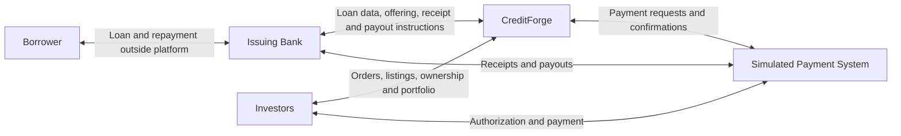
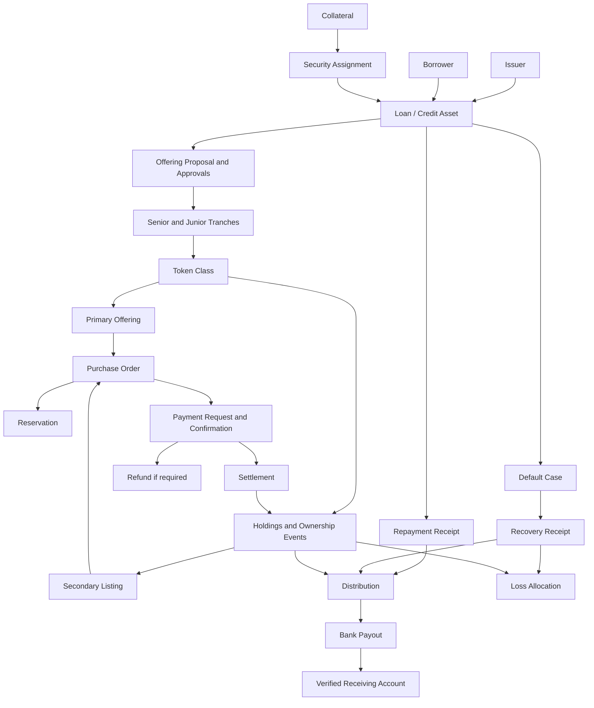

# CreditForge — Business Requirements Document (BRD)

**Version:** 0.2 — Gate 02-R1 confirmed; domain model draft  
**Baseline:** [Project Idea Specification v2.1](./PROJECT_IDEA_SPECIFICATION.md) (commit bbad1873c7d8221ea0d328035dfbf26237cacc65)  
**Phase:** 2 — Business Analysis  
**Coverage:** 2.1 Business Context & Objectives; 2.2 Stakeholder Analysis; 2.3 Business Domain Modeling.

Confirmed = inherited from approved baseline or explicitly approved review gate; Proposed = recommendation awaiting review. This draft does not change the approved baseline.

## 2.1 Business Context & Objectives

### 2.1.1 Context and scope

CreditForge is an independent, single-issuer credit investment marketplace. The issuer originates and disburses secured corporate loans outside CreditForge, registers eligible loans, and sells Senior rights. The issuer retains Junior and unsold Senior. Investors trade rights via the primary and fixed-price secondary markets. Money moves through simulated banking systems, never through a CreditForge cash wallet. Automatic bank payouts distribute actual available cash under the financial rules.

| Outside | Inside |
|---|---|
| Loan origination, credit assessment, valuation, contract, disbursement | Asset registration, eligibility review, tokenization, offerings |
| Borrower repayment and physical recovery | Repayment/default/recovery recording, waterfall, loss allocation |
| Bank account management and monetary transfers | Payment orchestration, verification, ownership settlement, payout tracking and reconciliation |

Borrower is not a direct user. One issuer does not imply only one payment bank. No actual funds or banking integration.

The diagram represents business interactions, not custody. Actual cash routes are Investor to Issuer, Buyer to Seller, Issuer to Investor, and authorized refund to original payer. CreditForge never receives these funds.

### 2.1.2 Business objectives

| ID | Objective | Beneficiary | Baseline mapping |
|---|---|---|---|
| BO-001 | Tái huy động vốn từ khoản vay đã giải ngân | Issuer | BR-001, 011, 027 |
| BO-002 | Số hóa và phân chia quyền lợi tín dụng | Issuer, Investor | BR-002–004 |
| BO-003 | Tiếp cận sản phẩm không phụ thuộc cùng ngân hàng thanh toán | Investor | BR-029 |
| BO-004 | Chuyển nhượng trước đáo hạn | Investor | BR-012–022 |
| BO-005 | Phân lớp và phân bổ rủi ro | Issuer, Investor | BR-005–010, 024 |
| BO-006 | Tự động tính dòng tiền và tổn thất | Issuer, Investor | BR-023–024, 038 |
| BO-007 | Điều phối thanh toán không giữ tiền | All | BR-032–037, 042–044 |
| BO-008 | Toàn vẹn tài chính và truy vết | All | BR-025–026, 037, 045 |
| BO-009 | Tự động chi trả qua ngân hàng | Investor | BR-039–041 |

BO-007 replaces the old loan-origination objective; BO-009 is added. IDs otherwise preserve the earlier analysis where practical.

### 2.1.3 Proposed success criteria

| ID | Observable result | Objective |
|---|---|---|
| SC-001 | Only eligible, uniquely referenced assets are issued; tranche principal equals issued principal | BO-002 |
| SC-002 | Confirmed primary proceeds match completed purchases; unsold Senior remains with issuer | BO-001 |
| SC-003 | Investor can purchase using a supported mock bank different from issuer | BO-003 |
| SC-004 | Secondary payment goes to seller; ownership changes exactly once after valid settlement | BO-004,007 |
| SC-005 | Concurrent orders do not oversell or over-reserve | BO-008 |
| SC-006 | Distribution does not exceed available receipts; no duplicated allocation | BO-006 |
| SC-007 | Junior absorbs loss first; total allocated loss equals confirmed loss | BO-005 |
| SC-008 | No customer cash wallet or funds held by CreditForge | BO-007 |
| SC-009 | Duplicate payment confirmation cannot complete a second transfer | BO-008 |
| SC-010 | Failed settlement remains traceable and is resolved or escalated without double-sale | BO-007,008 |
| SC-011 | Payout goes to verified mock bank account; failed payout remains outstanding | BO-009 |
| SC-012 | Full repayment and default/recovery demo scenarios reconcile independently | BO-005,006,008 |

These are product verification criteria, not validated market KPIs. No commercial ROI, demand, legal compliance or grade claim.

### 2.1.4 Constraints and assumptions

Confirmed: one issuer, independent operator, loan-centric, post-funding, limited-recourse, Senior/Junior, direct bank settlement, automatic bank payout, no borrower portal, no cash wallet, simulation only, TypeScript stack. Confirmed at Gate 02-R1: exclusive collateral, dual offering approval, manual repayment recording, combined Marketplace Operator. Proposed: one initial issuance per loan, no prior principal repayments at registration, detailed controls for sensitive financial facts. Exact financial conventions, eligibility, payment finality and role assignments remain open. Time, team and grading rubric not confirmed.

## 2.2 Stakeholder Analysis

### 2.2.1 Stakeholder register

| ID | Stakeholder | Interest | Influence (qualitative) |
|---|---|---|---|
| ST-001 | Issuing Bank | Refinance principal, retain residual, manage loan risk | High |
| ST-002 | Investor | Understand risk, acquire/transfer rights, receive payouts | High |
| ST-003 | CreditForge Operator | Market integrity, operations, traceability | High |
| ST-004 | Borrower | Existing loan obligations and confidentiality | Indirect |
| ST-005 | Payment Bank | Valid authorized account transfers | External dependency |
| ST-006 | Payment System | Reliable confirmation, reconciliation, payout/refund | External dependency |

Influence ratings are analyst assessments, not stakeholder interview results.

### 2.2.2 Proposed human roles

| ID | Role | Organization | Responsibilities |
|---|---|---|---|
| ACT-001 | Investor | Investor | Browse, buy, list/cancel own holdings, manage verified receiving account, monitor portfolio |
| ACT-002 | Issuer Officer | Issuing Bank | Register existing loan, evidence, propose tranche/terms, submit offering, record repayment/recovery facts |
| ACT-003 | Issuer Approver | Issuing Bank | Approve issuer submissions and sensitive financial facts; return/reject with reason |
| ACT-004 | Marketplace Reviewer | CreditForge | Independent publication eligibility review; approve/reject/suspend offering within policy |
| ACT-005 | Settlement Operator | CreditForge | Monitor payment/settlement/payout exceptions, reconcile, initiate permitted retry or refund request |
| ACT-006 | System Admin | CreditForge | Account, role, access and permitted configuration; no default financial authority |
| ACT-007 | Auditor (optional) | Authorized organization | Read-only, scoped financial and approval audit |

Payment System is an external system actor (ACT-008), not a human role. Borrower and bank credit-underwriting staff are not required direct actors. Financial Engine is an internal automated component, not an external actor.

Confirmed at Gate 02-R1: ACT-004 and ACT-005 are capability groups assigned to one Marketplace Operator role, with distinct action permissions and separation from issuer; ACT-003 remains separate from ACT-002. Auditor remains optional scoped read-only permission. Three portals can share code and layout.

### 2.2.3 Responsibility matrix (proposed)

| Operation | Responsible | Approval / control |
|---|---|---|
| Register existing loan and propose terms | Issuer Officer | Issuer Approver; Marketplace eligibility checks |
| Publish offering | Marketplace Reviewer or automated release after approval | Approved terms; no editing by reviewer |
| Record repayment/recovery facts | Issuer Officer | Issuer Approver for sensitive facts; unique external reference |
| Confirm default | Authorized issuer role | Evidence and policy; not arbitrary Marketplace decision |
| Create listing/order | Investor (issuer for primary offering) | Ownership, quantity and trading eligibility |
| Confirm external payment | Payment System | CreditForge verification; no manual paid-status override |
| Transfer ownership | Automated CreditForge settlement | Valid payment, reservation, eligibility and idempotency |
| Calculate distribution/loss | Financial Engine | Approved rules and confirmed inputs; no manual output override |
| Execute bank payout | Simulated Payment System on issuer instruction | Authorized instruction, confirmation, reconciliation |
| Resolve exceptions | Settlement Operator | Scoped authority, audit, no unilateral bank debit |
| Manage users/roles | System Admin | No implicit financial permissions or self-grant bypass |
| Audit | Authorized Auditor | Read-only, organization/record scope |

Approval of an offering is not approval of a loan. Marketplace checks consistency, eligibility and disclosure; cannot guarantee underlying data is true. Financial Engine and settlement cannot be bypassed by administrators.

### 2.2.4 Conflicts and controls

| Conflict | Risk | Proposed mitigation |
|---|---|---|
| Issuer vs Investor | Adverse selection; lower-quality assets distributed | Junior retention, verified input references, disclosure, eligibility review |
| Issuer vs Marketplace | Issuer seeks rapid publication; operator needs integrity | Separate submit/review permissions; record reasons and approved version |
| Seller vs Buyer | Seller may conceal worsening credit; liquidity asymmetry | Canonical loan data, no seller editing, trading suspension policy |
| Buyer vs Seller | Money transferred but ownership not transferred, or refund unavailable | Reservation, external confirmation, exception workflow and reconciliation |
| Operator vs Investor | Unilateral override or hidden correction | Automated rules, least privilege, audit, append-only corrections |
| Payout recipient vs operator | Wrong account or duplicate payout | Verified account, authorized instruction, confirmation and idempotency |

Junior retention reduces but does not eliminate moral hazard. Direct payment does not eliminate settlement risk.

### 2.2.5 Information visibility (proposed)

Investor sees approved asset summary, issuer, borrower business information permitted for publication, collateral summary, LTV, terms, tranche, status, risk, available listings and own transactions. Not full credit files, internal review notes, unrelated investor holdings or full bank details. Payment routing data is limited to necessary authorized participants. Seller cannot edit canonical loan data. Issuer accesses its assets and necessary servicing/payout information. Operator accesses records required for its assigned duties. Auditors have scoped read-only access. No real personal/bank data in public repo or demo.

### 2.2.6 Review Gate 02-R1 — confirmed decisions

| ID | Question | Recommendation | Trade-off |
|---|---|---|---|
| BD-006-R1 | Who approves offerings? | Issuer submits approved proposal; independent CreditForge reviewer approves publication | More workflow, but meaningful separation; simpler variant uses one issuer officer and Marketplace reviewer as maker/checker |
| BD-007-R1 | Can collateral secure multiple active registered loans? | Exclusive within simulated marketplace | Avoid priority and shared recovery complexity; cannot verify external liens |
| BD-013 | How is external repayment recorded? | Issuer records confirmed receipt; mock external reference and duplicate check; approval for sensitive records | Less integration scope than full mock Core Banking event system; still automatic waterfall/payout |
| BD-014 | How to scope operator roles? | One Marketplace Operator for review and exception monitoring, distinct System Admin, optional read-only auditor | Reduces screens; action permissions and financial controls remain separate |

BD-008 is superseded: agreement acceptance happens outside the platform. All four decisions in this table were confirmed by the project owner on 2026-11-27. The simpler alternatives are not the selected model.

Dual approval applies to the same version of offering terms. Proposed control: material changes invalidate prior approvals; reviewers return rather than edit submitted terms. Manual repayment recording means issuer records a confirmed external receipt, not a forecast or invented cash; unique reference and verification precede automatic allocation. Combined Marketplace Operator cannot approve issuer proposals on behalf of issuer or override calculated entitlements. Detailed approval of repayment/recovery facts remains open.

### 2.2.7 Collateral reuse research and rationale

Vietnamese Civil Code 2015 (Law 91/2015/QH13), Article 296 permits one asset to secure multiple obligations subject to value conditions and exceptions by agreement or law; disclosure to subsequent secured parties is required. Enforcement can affect other secured obligations. Article 308 governs payment priority, including effectiveness against third parties and possible agreements on priority. Sources: [Civil Code 2015](https://btllang.mod.gov.vn/van-ban/vbpq-do-nha-nuoc-ban-hanh/5001-bo-luat-dan-su-2015.html), [Article 308 text](https://thuvienphapluat.vn/van-ban/Quyen-dan-su/Bo-luat-Dan-su-2015-296215.aspx).

Public bank evidence checked 2026-11-27:
- [Hong Leong Bank Vietnam](https://www.hlbank.com.vn/vi/personal-banking/blog/vay-tieu-dung-co-tai-san-dam-bao.html): consumer lending guidance acknowledges concurrent use under value conditions.
- [Techcombank TOP UP](https://techcombank.com/thong-tin/thong-bao/top-up-da-tien-ich-nay-con-nhieu-uu-dai-hon): historical programme permitted reuse and additional collateral where needed; page marked expired. Not proof of current corporate policy.
- [Vietcombank loan FAQ](https://www.vietcombank.com.vn/vi-VN/KHCN/Lien-he-va-Ho-tro/Danh-sach-cau-hoi-theo-chu-de-Vay): insufficient public evidence for current corporate collateral reuse policy. Individual bank approval/contract conditions remain unknown.

BD-007-R1 is a CreditForge eligibility restriction, not Vietnamese law: each collateral asset may secure at most one registered loan with an outstanding secured obligation at a time. Sequential reuse after confirmed release is allowed in principle. Multiple assets securing one loan is a separate open decision. The platform must reject overlapping active pledges of the same asset and require issuer evidence of exclusivity; it cannot discover undisclosed external liens. If external shared security becomes known, flag for review and suspend new issuance/trading as appropriate; do not silently assume full recovery.

Example: asset 10bn secures Loan A 4bn and Loan B 2bn. Combined principal-to-value is 60%, but recovery 4bn cannot be counted twice. A cross-loan priority allocation would be needed before each loan's Senior/Junior waterfall. This complexity is excluded; cross-default and shared recovery are not modeled.

## 2.3 Business Domain Modeling — proposed

### 2.3.1 Ubiquitous language

| Domain concept | Meaning and responsibility |
|---|---|
| Issuer | Single originating and issuing bank; organization, not a staff account |
| Borrower | External company reference, not a platform login |
| Credit Asset / Loan | Registered existing loan; authoritative contractual terms and outstanding principal reference |
| Collateral | Identified physical asset and dated valuation evidence, not a tokenized ownership interest |
| Security Assignment | Association between collateral and loan with effective/released status; enforces exclusive active use |
| Offering Proposal / Approval | Versioned investment terms and decision evidence from issuer and marketplace |
| Tranche | Senior or Junior priority and outstanding principal rights |
| Token Class | Fungible units for one loan and tranche; face value, supply and contractual coupon/residual rule |
| Offering | Issuer primary sale of available Senior units |
| Holding | Owner's quantity and remaining principal rights in a token class |
| Ownership Event | Issuance, transfer or retirement with effective time; supports historical accrual |
| Listing | Seller's fixed-price offer backed by locked holdings |
| Purchase Order | Buyer commitment to quantity and price; primary or secondary source |
| Reservation | Temporary allocation of units to one order; distinct from listing lock |
| Payment Request | Authorized external money movement instruction/reference |
| Payment Confirmation | Evidence of external payment, not ownership transfer |
| Settlement | Completion of verified purchase and ownership transfer exactly once |
| Refund | Separate external return of money, not DB rollback |
| Receiving Account | Verified simulated bank destination; no cash balance in CreditForge |
| Repayment Receipt | Confirmed external borrower payment manually recorded by issuer |
| Interest Entitlement | Earned financial right for ownership interval; not necessarily paid |
| Distribution | Allocation of an available receipt to entitled holders |
| Payout | External bank execution/confirmation of allocated amount |
| Default Case | Confirmed credit event and status history |
| Recovery Receipt | Confirmed net recovery attributable to the loan |
| Loss Allocation | Recognized loss assigned to remaining rights according to waterfall |
| Ledger / Audit Event | Traceable financial facts and operational decisions; not a customer wallet |

### 2.3.2 Conceptual relationships

This is a business relationship diagram, not a database schema. Arrows do not represent cash custody or mandatory chronological order.

| Relationship | Cardinality / rule |
|---|---|
| Issuer to Loan | 1:N |
| Borrower to Loan | 1:N; no borrower user account |
| Collateral to Security Assignment | 1:N historical; at most one active loan per asset (confirmed) |
| Loan to Collateral | At least one eligible collateral; exact maximum pending |
| Loan to Tranche | Exactly two once issued |
| Tranche to Token Class | One per tranche proposed for MVP |
| Token Class to Holding | 1:N; bank retains Junior and initially owns issued Senior |
| Loan to issuance | One initial issuance proposed; top-ups excluded if accepted |
| Token Class to Offering | One primary offering proposed; closure/reopening policy pending |
| Holding to Listing | 1:N subject to available quantity |
| Order to source | Exactly one primary Offering OR secondary Listing |
| Order to Reservation | One logical reservation proposed; never double-count listing locks |
| Order to payment attempts | 1:N possible attempts, at most one accepted settlement; policy pending |
| Receipt to Distribution | One logical allocation run per receipt/version; multiple entitlement lines |
| Entitlement to Payout | One logical payable, potentially multiple attempts; retry never creates new entitlement |
| Loan to Repayment/Recovery Receipt | 1:N; recovery finality and partial recovery policy pending |

### 2.3.3 Domain boundaries

| Business domain | Owns | Does not own |
|---|---|---|
| Credit Asset & Issuance | Loan reference, collateral assignments, approved terms, tranche and issuance | Actual credit approval/disbursement |
| Marketplace | Offering, Listing, Order, Reservation | Bank money or financial allocation formulas |
| Ownership Registry | Holdings and historical ownership changes | Payment authorization |
| Payment & Settlement | Payment evidence, coordination, exception/refund and reconciliation | Bank account balances; unilateral debit |
| Loan Servicing & Finance | Receipts, accrual, distribution, default/recovery/loss | Physical recovery, external transfers |
| Payout | Payable instructions, attempts, confirmed execution | Creation of additional entitlement on retry |
| Identity & Governance | User roles, issuer identity, approvals, audit and receiving account verification | Arbitrary override of financial records |

Boundaries are logical; not a mandate for microservices.

### 2.3.4 Lifecycle distinctions (proposed)

- Credit Asset registration: Draft → Submitted → Reviewed/Rejected → Eligible. Loan servicing status is separate: Active, Overdue, Defaulted, Recovery, Closed.
- Offering proposal: Draft → Issuer Approved → Marketplace Approved → Published; return/reject and version changes handled separately.
- Offering: Scheduled/Open → Closed or Suspended. Closure does not cancel loan.
- Listing: Active → Filled/Cancelled/Expired/Suspended. Pending orders resolved before releasing their reservations.
- Order: Pending → Completed/Cancelled/Expired or exception; Payment and Settlement have independent states.
- Payment: Requested → Pending → Confirmed/Failed; late/ambiguous confirmation enters reconciliation. Refund is separate.
- Settlement: Pending → Completed or Exception; confirmed payment cannot be treated as unpaid.
- Distribution: Calculated/Posted; Payout: Pending/Confirmed/Failed. An allocated right is not cash available to spend.
- Collateral assignment: Active → Released only after evidence of release and no remaining secured obligation; loan registration closure and legal release are not identical.

Exact transitions, permissions, time cutoffs and exception conditions belong in 2.4 and 2.6.

### 2.3.5 Domain invariants and edge cases

- Unique external loan and receipt references in issuer scope; same collateral cannot be duplicated by cosmetic ID changes. Asset identity method remains to be specified.
- Approved terms must remain consistent with issued rights; approval version is proposed.
- Total issued principal = Senior + Junior; holding quantities reconcile to outstanding token supply. Bank holding is an actual recorded position, not inferred from offering sales.
- Reserved quantity is part of locked listing quantity where applicable, not an additional independent deduction. Seller remains owner until completed settlement.
- Payment confirmation does not change ownership by itself. Settlement applies at most once; external payment cannot be rolled back by the database.
- Repayment receipt, distribution and payout are separate facts; no duplicate allocation or disbursement. Failed payout remains payable.
- Ownership effective time determines future accrual; treatment of earned but unpaid interest remains open.
- Final recovery may create losses, but an interim recovery alone is not proof of final loss. Partial recovery/loss recognition policy remains open.
- Loan maturity is not equivalent to repayment or closure. Token retirement and unresolved payouts require separate rules.

### 2.3.6 Review Gate 03 — proposed decisions

| ID | Decision | Recommendation |
|---|---|---|
| BD-015 | Initial issuance model | One issuance and one primary offering per loan; no top-up or reopening in MVP |
| BD-016 | Collateral cardinality per loan | One asset per loan in MVP; retain historical assignment and release records |
| BD-017 | Eligible loan at registration | Already disbursed, current, no prior principal repayment; capture payment history needed for accrual |
| BD-018 | Listing fill model | Allow partial purchases by multiple buyers, with order-specific reservations |

All four are proposed, not confirmed. A borrower may still have multiple loans with distinct collateral. Financial rules and exact state machines remain pending.

## 2.4–2.8 Pending

- 2.4 Business Process Modeling
- 2.5 Business Use Cases
- 2.6 Business Rules Analysis
- 2.7 Financial Model Research (primary-source verification required)
- 2.8 BRD Consolidation & Review

No final MVP commitment, database schema or validated financial formulas in this draft.

## Revision history

| Version | Change |
|---|---|
| 0.1 | Re-baseline Business Context and Stakeholder Analysis against Idea Specification v2.1; Review Gate 02-R1 pending |
| 0.2 | Confirm Gate 02-R1; document collateral reuse research; add proposed Business Domain Model and Gate 03 |
