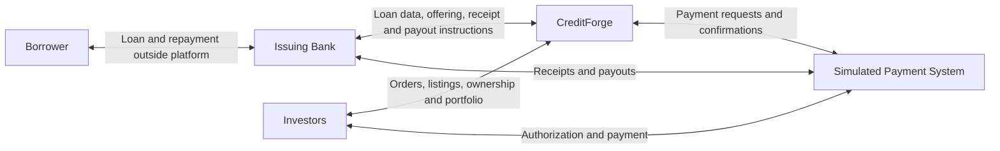
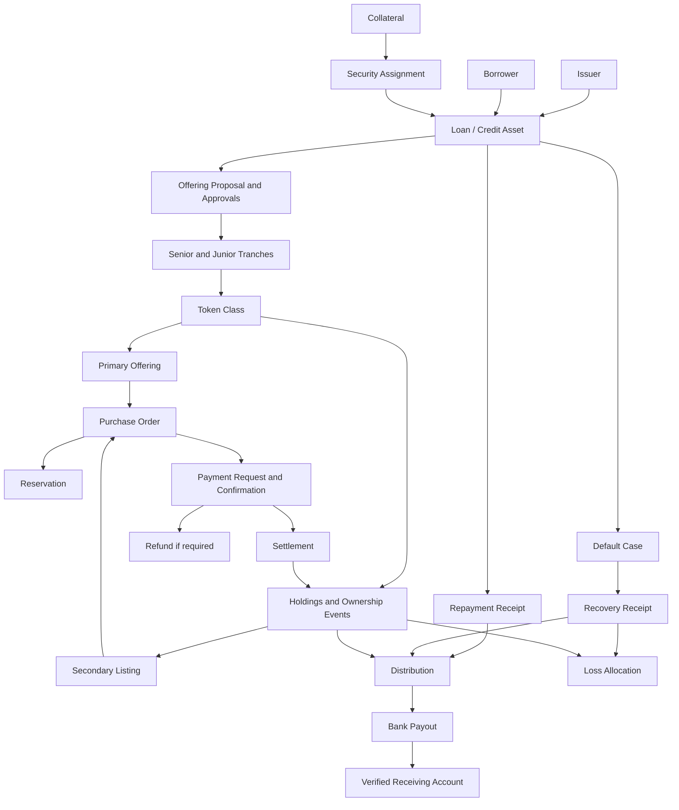
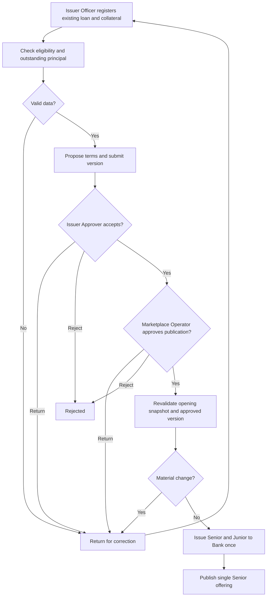
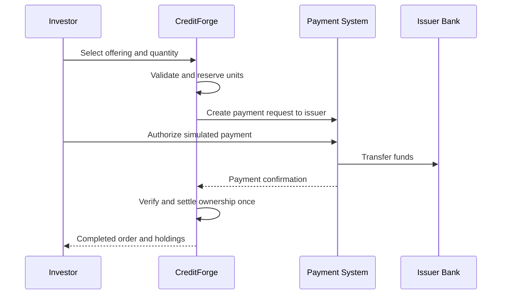
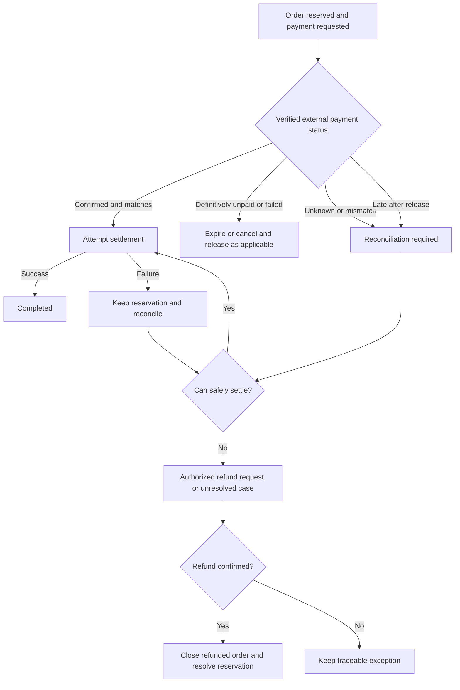
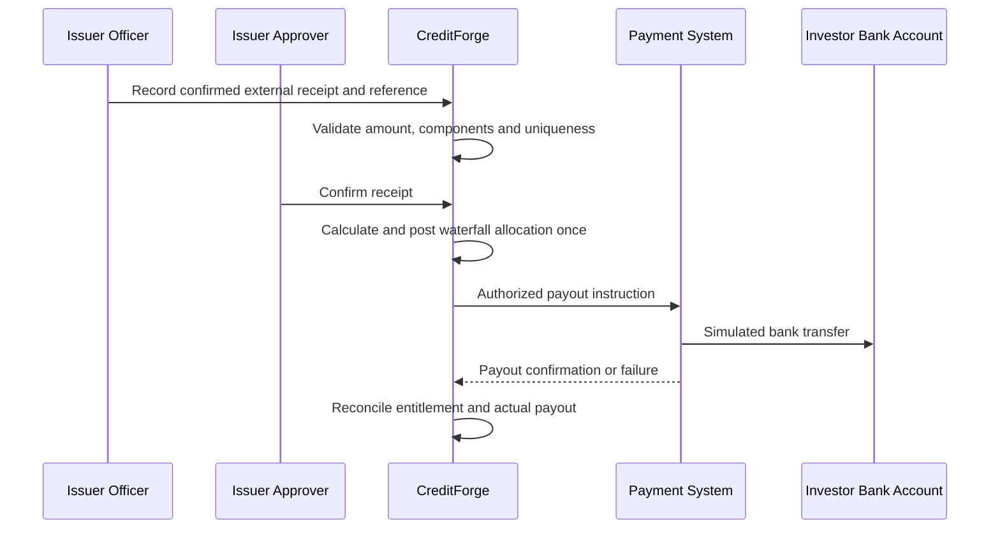

# CreditForge — Business Requirements Document (BRD)

**Version:** 0.4 — Gate 04 confirmed; business use cases draft  
**Baseline:** [Project Idea Specification v2.1](./PROJECT_IDEA_SPECIFICATION.md) (commit bbad1873c7d8221ea0d328035dfbf26237cacc65)  
**Phase:** 2 — Business Analysis  
**Coverage:** 2.1 Business Context & Objectives; 2.2 Stakeholder Analysis; 2.3 Business Domain Modeling; 2.4 Business Process Modeling; 2.5 Business Use Cases.

Confirmed = inherited from approved baseline or explicitly approved review gate; Proposed = recommendation awaiting review. This draft does not change the approved baseline.

## 2.1 Business Context & Objectives

### 2.1.1 Context and scope

CreditForge is an independent, single-issuer credit investment marketplace. The issuer originates and disburses secured corporate loans outside CreditForge, registers eligible loans, and sells Senior rights. The issuer retains Junior and unsold Senior. Investors trade rights via the primary and fixed-price secondary markets. Money moves through simulated banking systems, never through a CreditForge cash wallet. Automatic bank payouts distribute actual available cash under the financial rules.

| Outside | Inside |
|---|---|
| Loan origination, credit assessment, valuation, contract, disbursement | Asset registration, eligibility review, tokenization, offerings |
| Borrower repayment and physical recovery | Repayment/default/recovery recording, waterfall, loss allocation |
| Bank account management and monetary transfers | Payment orchestration, verification, ownership settlement, payout tracking and reconciliation |

Borrower is not a direct user. One issuer does not imply only one payment bank. No actual funds or banking integration.

The diagram represents business interactions, not custody. Actual cash routes are Investor to Issuer, Buyer to Seller, Issuer to Investor, and authorized refund to original payer. CreditForge never receives these funds.

### 2.1.2 Business objectives

| ID | Objective | Beneficiary | Baseline mapping |
|---|---|---|---|
| BO-001 | Tái huy động vốn từ khoản vay đã giải ngân | Issuer | BR-001, 011, 027 |
| BO-002 | Số hóa và phân chia quyền lợi tín dụng | Issuer, Investor | BR-002–004 |
| BO-003 | Tiếp cận sản phẩm không phụ thuộc cùng ngân hàng thanh toán | Investor | BR-029 |
| BO-004 | Chuyển nhượng trước đáo hạn | Investor | BR-012–022 |
| BO-005 | Phân lớp và phân bổ rủi ro | Issuer, Investor | BR-005–010, 024 |
| BO-006 | Tự động tính dòng tiền và tổn thất | Issuer, Investor | BR-023–024, 038 |
| BO-007 | Điều phối thanh toán không giữ tiền | All | BR-032–037, 042–044 |
| BO-008 | Toàn vẹn tài chính và truy vết | All | BR-025–026, 037, 045 |
| BO-009 | Tự động chi trả qua ngân hàng | Investor | BR-039–041 |

BO-007 replaces the old loan-origination objective; BO-009 is added. IDs otherwise preserve the earlier analysis where practical.

### 2.1.3 Proposed success criteria

| ID | Observable result | Objective |
|---|---|---|
| SC-001 | Only eligible, uniquely referenced assets are issued; tranche principal equals issued principal | BO-002 |
| SC-002 | Confirmed primary proceeds match completed purchases; unsold Senior remains with issuer | BO-001 |
| SC-003 | Investor can purchase using a supported mock bank different from issuer | BO-003 |
| SC-004 | Secondary payment goes to seller; ownership changes exactly once after valid settlement | BO-004,007 |
| SC-005 | Concurrent orders do not oversell or over-reserve | BO-008 |
| SC-006 | Distribution does not exceed available receipts; no duplicated allocation | BO-006 |
| SC-007 | Junior absorbs loss first; total allocated loss equals confirmed loss | BO-005 |
| SC-008 | No customer cash wallet or funds held by CreditForge | BO-007 |
| SC-009 | Duplicate payment confirmation cannot complete a second transfer | BO-008 |
| SC-010 | Failed settlement remains traceable and is resolved or escalated without double-sale | BO-007,008 |
| SC-011 | Payout goes to verified mock bank account; failed payout remains outstanding | BO-009 |
| SC-012 | Full repayment and default/recovery demo scenarios reconcile independently | BO-005,006,008 |

These are product verification criteria, not validated market KPIs. No commercial ROI, demand, legal compliance or grade claim.

### 2.1.4 Constraints and assumptions

Confirmed: one issuer, independent operator, loan-centric, post-funding, limited-recourse, Senior/Junior, direct bank settlement, automatic bank payout, no borrower portal, no cash wallet, simulation only, TypeScript stack. Confirmed at Gate 02-R1: exclusive collateral, dual offering approval, manual repayment recording, combined Marketplace Operator. Confirmed at Gate 03: one issuance and offering per loan, one collateral per loan, eligibility based on outstanding principal including partially repaid loans, partial listing fill. Confirmed at Gate 04: dual approval of repayment/recovery receipts, pause trading on verified overdue, honor eligible existing orders at offering closure, cancellation of unreserved listing remainder. Exact financial conventions, eligibility, payment finality and role assignments remain open. Time, team and grading rubric not confirmed.

## 2.2 Stakeholder Analysis

### 2.2.1 Stakeholder register

| ID | Stakeholder | Interest | Influence (qualitative) |
|---|---|---|---|
| ST-001 | Issuing Bank | Refinance principal, retain residual, manage loan risk | High |
| ST-002 | Investor | Understand risk, acquire/transfer rights, receive payouts | High |
| ST-003 | CreditForge Operator | Market integrity, operations, traceability | High |
| ST-004 | Borrower | Existing loan obligations and confidentiality | Indirect |
| ST-005 | Payment Bank | Valid authorized account transfers | External dependency |
| ST-006 | Payment System | Reliable confirmation, reconciliation, payout/refund | External dependency |

Influence ratings are analyst assessments, not stakeholder interview results.

### 2.2.2 Proposed human roles

| ID | Role | Organization | Responsibilities |
|---|---|---|---|
| ACT-001 | Investor | Investor | Browse, buy, list/cancel own holdings, manage verified receiving account, monitor portfolio |
| ACT-002 | Issuer Officer | Issuing Bank | Register existing loan, evidence, propose tranche/terms, submit offering, record repayment/recovery facts |
| ACT-003 | Issuer Approver | Issuing Bank | Approve issuer submissions and sensitive financial facts; return/reject with reason |
| ACT-004 | Marketplace Reviewer | CreditForge | Independent publication eligibility review; approve/reject/suspend offering within policy |
| ACT-005 | Settlement Operator | CreditForge | Monitor payment/settlement/payout exceptions, reconcile, initiate permitted retry or refund request |
| ACT-006 | System Admin | CreditForge | Account, role, access and permitted configuration; no default financial authority |
| ACT-007 | Auditor (optional) | Authorized organization | Read-only, scoped financial and approval audit |

Payment System is an external system actor (ACT-008), not a human role. Borrower and bank credit-underwriting staff are not required direct actors. Financial Engine is an internal automated component, not an external actor.

Confirmed at Gate 02-R1: ACT-004 and ACT-005 are capability groups assigned to one Marketplace Operator role, with distinct action permissions and separation from issuer; ACT-003 remains separate from ACT-002. Auditor remains optional scoped read-only permission. Three portals can share code and layout.

### 2.2.3 Responsibility matrix (proposed)

| Operation | Responsible | Approval / control |
|---|---|---|
| Register existing loan and propose terms | Issuer Officer | Issuer Approver; Marketplace eligibility checks |
| Publish offering | Marketplace Reviewer or automated release after approval | Approved terms; no editing by reviewer |
| Record repayment/recovery facts | Issuer Officer | Distinct Issuer Approver for repayment/recovery receipts; unique external reference |
| Confirm default | Authorized issuer role | Evidence and policy; not arbitrary Marketplace decision |
| Create listing/order | Investor (issuer for primary offering) | Ownership, quantity and trading eligibility |
| Confirm external payment | Payment System | CreditForge verification; no manual paid-status override |
| Transfer ownership | Automated CreditForge settlement | Valid payment, reservation, eligibility and idempotency |
| Calculate distribution/loss | Financial Engine | Approved rules and confirmed inputs; no manual output override |
| Execute bank payout | Simulated Payment System on issuer instruction | Authorized instruction, confirmation, reconciliation |
| Resolve exceptions | Settlement Operator | Scoped authority, audit, no unilateral bank debit |
| Manage users/roles | System Admin | No implicit financial permissions or self-grant bypass |
| Audit | Authorized Auditor | Read-only, organization/record scope |

Approval of an offering is not approval of a loan. Marketplace checks consistency, eligibility and disclosure; cannot guarantee underlying data is true. Financial Engine and settlement cannot be bypassed by administrators.

### 2.2.4 Conflicts and controls

| Conflict | Risk | Proposed mitigation |
|---|---|---|
| Issuer vs Investor | Adverse selection; lower-quality assets distributed | Junior retention, verified input references, disclosure, eligibility review |
| Issuer vs Marketplace | Issuer seeks rapid publication; operator needs integrity | Separate submit/review permissions; record reasons and approved version |
| Seller vs Buyer | Seller may conceal worsening credit; liquidity asymmetry | Canonical loan data, no seller editing, trading suspension policy |
| Buyer vs Seller | Money transferred but ownership not transferred, or refund unavailable | Reservation, external confirmation, exception workflow and reconciliation |
| Operator vs Investor | Unilateral override or hidden correction | Automated rules, least privilege, audit, append-only corrections |
| Payout recipient vs operator | Wrong account or duplicate payout | Verified account, authorized instruction, confirmation and idempotency |

Junior retention reduces but does not eliminate moral hazard. Direct payment does not eliminate settlement risk.

### 2.2.5 Information visibility (proposed)

Investor sees approved asset summary, issuer, borrower business information permitted for publication, collateral summary, LTV, terms, tranche, status, risk, available listings and own transactions. Not full credit files, internal review notes, unrelated investor holdings or full bank details. Payment routing data is limited to necessary authorized participants. Seller cannot edit canonical loan data. Issuer accesses its assets and necessary servicing/payout information. Operator accesses records required for its assigned duties. Auditors have scoped read-only access. No real personal/bank data in public repo or demo.

### 2.2.6 Review Gate 02-R1 — confirmed decisions

| ID | Question | Recommendation | Trade-off |
|---|---|---|---|
| BD-006-R1 | Who approves offerings? | Issuer submits approved proposal; independent CreditForge reviewer approves publication | More workflow, but meaningful separation; simpler variant uses one issuer officer and Marketplace reviewer as maker/checker |
| BD-007-R1 | Can collateral secure multiple active registered loans? | Exclusive within simulated marketplace | Avoid priority and shared recovery complexity; cannot verify external liens |
| BD-013 | How is external repayment recorded? | Issuer records confirmed receipt; mock external reference and duplicate check; approval for sensitive records | Less integration scope than full mock Core Banking event system; still automatic waterfall/payout |
| BD-014 | How to scope operator roles? | One Marketplace Operator for review and exception monitoring, distinct System Admin, optional read-only auditor | Reduces screens; action permissions and financial controls remain separate |

BD-008 is superseded: agreement acceptance happens outside the platform. All four decisions in this table were confirmed by the project owner on 2026-11-27. The simpler alternatives are not the selected model.

Dual approval applies to the same version of offering terms. Proposed control: material changes invalidate prior approvals; reviewers return rather than edit submitted terms. Manual repayment recording means issuer records a confirmed external receipt, not a forecast or invented cash; unique reference and verification precede automatic allocation. Combined Marketplace Operator cannot approve issuer proposals on behalf of issuer or override calculated entitlements. Gate 04 confirms distinct Issuer Approver review for repayment/recovery receipts.

### 2.2.7 Collateral reuse research and rationale

Vietnamese Civil Code 2015 (Law 91/2015/QH13), Article 296 permits one asset to secure multiple obligations subject to value conditions and exceptions by agreement or law; disclosure to subsequent secured parties is required. Enforcement can affect other secured obligations. Article 308 governs payment priority, including effectiveness against third parties and possible agreements on priority. Sources: [Civil Code 2015](https://btllang.mod.gov.vn/van-ban/vbpq-do-nha-nuoc-ban-hanh/5001-bo-luat-dan-su-2015.html), [Article 308 text](https://thuvienphapluat.vn/van-ban/Quyen-dan-su/Bo-luat-Dan-su-2015-296215.aspx).

Public bank evidence checked 2026-11-27:
- [Hong Leong Bank Vietnam](https://www.hlbank.com.vn/vi/personal-banking/blog/vay-tieu-dung-co-tai-san-dam-bao.html): consumer lending guidance acknowledges concurrent use under value conditions.
- [Techcombank TOP UP](https://techcombank.com/thong-tin/thong-bao/top-up-da-tien-ich-nay-con-nhieu-uu-dai-hon): historical programme permitted reuse and additional collateral where needed; page marked expired. Not proof of current corporate policy.
- [Vietcombank loan FAQ](https://www.vietcombank.com.vn/vi-VN/KHCN/Lien-he-va-Ho-tro/Danh-sach-cau-hoi-theo-chu-de-Vay): insufficient public evidence for current corporate collateral reuse policy. Individual bank approval/contract conditions remain unknown.

BD-007-R1 is a CreditForge eligibility restriction, not Vietnamese law: each collateral asset may secure at most one registered loan with an outstanding secured obligation at a time. Sequential reuse after confirmed release is allowed in principle. Gate 03 additionally limits each registered loan to one collateral asset. The platform must reject overlapping active pledges of the same asset and require issuer evidence of exclusivity; it cannot discover undisclosed external liens. If external shared security becomes known, flag for review and suspend new issuance/trading as appropriate; do not silently assume full recovery.

Example: asset 10bn secures Loan A 4bn and Loan B 2bn. Combined principal-to-value is 60%, but recovery 4bn cannot be counted twice. A cross-loan priority allocation would be needed before each loan's Senior/Junior waterfall. This complexity is excluded; cross-default and shared recovery are not modeled.

## 2.3 Business Domain Modeling — reviewed; detailed model remains proposed

### 2.3.1 Ubiquitous language

| Domain concept | Meaning and responsibility |
|---|---|
| Issuer | Single originating and issuing bank; organization, not a staff account |
| Borrower | External company reference, not a platform login |
| Credit Asset / Loan | Registered existing loan; authoritative contractual terms and outstanding principal reference |
| Collateral | Identified physical asset and dated valuation evidence, not a tokenized ownership interest |
| Security Assignment | Association between collateral and loan with effective/released status; enforces exclusive active use |
| Offering Proposal / Approval | Versioned investment terms and decision evidence from issuer and marketplace |
| Tranche | Senior or Junior priority and outstanding principal rights |
| Token Class | Fungible units for one loan and tranche; face value, supply and contractual coupon/residual rule |
| Offering | Issuer primary sale of available Senior units |
| Holding | Owner's quantity and remaining principal rights in a token class |
| Ownership Event | Issuance, transfer or retirement with effective time; supports historical accrual |
| Listing | Seller's fixed-price offer backed by locked holdings |
| Purchase Order | Buyer commitment to quantity and price; primary or secondary source |
| Reservation | Temporary allocation of units to one order; distinct from listing lock |
| Payment Request | Authorized external money movement instruction/reference |
| Payment Confirmation | Evidence of external payment, not ownership transfer |
| Settlement | Completion of verified purchase and ownership transfer exactly once |
| Refund | Separate external return of money, not DB rollback |
| Receiving Account | Verified simulated bank destination; no cash balance in CreditForge |
| Repayment Receipt | Confirmed external borrower payment manually recorded by issuer |
| Interest Entitlement | Earned financial right for ownership interval; not necessarily paid |
| Distribution | Allocation of an available receipt to entitled holders |
| Payout | External bank execution/confirmation of allocated amount |
| Default Case | Confirmed credit event and status history |
| Recovery Receipt | Confirmed net recovery attributable to the loan |
| Loss Allocation | Recognized loss assigned to remaining rights according to waterfall |
| Ledger / Audit Event | Traceable financial facts and operational decisions; not a customer wallet |

### 2.3.2 Conceptual relationships

This is a business relationship diagram, not a database schema. Arrows do not represent cash custody or mandatory chronological order.

| Relationship | Cardinality / rule |
|---|---|
| Issuer to Loan | 1:N |
| Borrower to Loan | 1:N; no borrower user account |
| Collateral to Security Assignment | 1:N historical; at most one active loan per asset (confirmed) |
| Loan to Collateral | Exactly one eligible collateral for issuance (confirmed) |
| Loan to Tranche | Exactly two once issued |
| Tranche to Token Class | One per tranche proposed for MVP |
| Token Class to Holding | 1:N; bank retains Junior and initially owns issued Senior |
| Loan to issuance | One issuance; no top-ups (confirmed) |
| Token Class to Offering | One primary offering for Senior; no reopening after closure (confirmed) |
| Holding to Listing | 1:N subject to available quantity |
| Order to source | Exactly one primary Offering OR secondary Listing |
| Order to Reservation | One logical reservation proposed; never double-count listing locks |
| Order to payment attempts | 1:N possible attempts, at most one accepted settlement; policy pending |
| Receipt to Distribution | One logical allocation run per receipt/version; multiple entitlement lines |
| Entitlement to Payout | One logical payable, potentially multiple attempts; retry never creates new entitlement |
| Loan to Repayment/Recovery Receipt | 1:N; recovery finality and partial recovery policy pending |

### 2.3.3 Domain boundaries

| Business domain | Owns | Does not own |
|---|---|---|
| Credit Asset & Issuance | Loan reference, collateral assignments, approved terms, tranche and issuance | Actual credit approval/disbursement |
| Marketplace | Offering, Listing, Order, Reservation | Bank money or financial allocation formulas |
| Ownership Registry | Holdings and historical ownership changes | Payment authorization |
| Payment & Settlement | Payment evidence, coordination, exception/refund and reconciliation | Bank account balances; unilateral debit |
| Loan Servicing & Finance | Receipts, accrual, distribution, default/recovery/loss | Physical recovery, external transfers |
| Payout | Payable instructions, attempts, confirmed execution | Creation of additional entitlement on retry |
| Identity & Governance | User roles, issuer identity, approvals, audit and receiving account verification | Arbitrary override of financial records |

Boundaries are logical; not a mandate for microservices.

### 2.3.4 Lifecycle distinctions (proposed)

- Credit Asset registration: Draft → Submitted → Reviewed/Rejected → Eligible. Loan servicing status is separate: Active, Overdue, Defaulted, Recovery, Closed.
- Offering proposal: Draft → Issuer Approved → Marketplace Approved → Published; return/reject and version changes handled separately.
- Offering: Scheduled/Open → Closed or Suspended. Closure does not cancel loan.
- Listing: Active → Filled/Cancelled/Expired/Suspended. Pending orders resolved before releasing their reservations.
- Order: Pending → Completed/Cancelled/Expired or exception; Payment and Settlement have independent states.
- Payment: Requested → Pending → Confirmed/Failed; late/ambiguous confirmation enters reconciliation. Refund is separate.
- Settlement: Pending → Completed or Exception; confirmed payment cannot be treated as unpaid.
- Distribution: Calculated/Posted; Payout: Pending/Confirmed/Failed. An allocated right is not cash available to spend.
- Collateral assignment: Active → Released only after evidence of release and no remaining secured obligation; loan registration closure and legal release are not identical.

Exact transitions, permissions, time cutoffs and exception conditions belong in 2.4 and 2.6.

### 2.3.5 Domain invariants and edge cases

- Unique external loan and receipt references in issuer scope; same collateral cannot be duplicated by cosmetic ID changes. Asset identity method remains to be specified.
- Approved terms must remain consistent with issued rights; approval version is proposed.
- Total issued principal = Senior + Junior; holding quantities reconcile to outstanding token supply. Bank holding is an actual recorded position, not inferred from offering sales.
- Reserved quantity is part of locked listing quantity where applicable, not an additional independent deduction. Seller remains owner until completed settlement.
- Payment confirmation does not change ownership by itself. Settlement applies at most once; external payment cannot be rolled back by the database.
- Repayment receipt, distribution and payout are separate facts; no duplicate allocation or disbursement. Failed payout remains payable.
- Ownership effective time determines future accrual; treatment of earned but unpaid interest remains open.
- Final recovery may create losses, but an interim recovery alone is not proof of final loss. Partial recovery/loss recognition policy remains open.
- Loan maturity is not equivalent to repayment or closure. Token retirement and unresolved payouts require separate rules.

### 2.3.6 Review Gate 03 — confirmed decisions

| ID | Decision | Confirmed selection |
|---|---|---|
| BD-015 | Initial issuance model | One issuance and one primary offering per loan; no top-up or reopening in MVP |
| BD-016 | Collateral cardinality per loan | One asset per loan in MVP; retain historical assignment and release records |
| BD-017 | Eligible loan at registration | Already disbursed, current, positive outstanding principal; prior principal repayment allowed; remaining repayment schedule must be compatible |
| BD-018 | Listing fill model | Allow partial purchases by multiple buyers, with order-specific reservations |

Gate 03 confirmed by project owner: BD-015, BD-016 and BD-018 follow the selected screenshot options; BD-017 follows the revised Outstanding Principal option discussed immediately before confirmation. A borrower may still have multiple loans with distinct collateral. Financial rules and exact state machines remain pending.

BD-017 requires an issuer-confirmed opening snapshot at issuance: original principal, outstanding principal, remaining schedule, maturity, effective date, and separation of pre-issuance interest from subsequent token rights. Example: original principal VND 6bn, repaid VND 2bn, outstanding VND 4bn; illustrative 80/20 tranche at VND 100,000 face value gives 32,000 Senior and 8,000 Junior units. Do not tokenize repaid principal or replay historical receipts as distributable cash. Refresh and revalidate snapshot before issuance if principal or material terms change; prior approvals must not silently authorize a changed issuance amount. This does not decide whether future amortizing schedules are supported: repayment structure and treatment of post-issuance principal payments remain Phase 3 decisions.

## 2.4 Business Process Modeling — reviewed; detailed transitions pending

### 2.4.1 Process inventory

| ID | Process | Trigger | Business outcome |
|---|---|---|---|
| BP-001 | Asset registration and dual approval | Issuer proposes existing loan | Approved offering proposal or returned/rejected case |
| BP-002 | Issuance and primary publication | Valid final approval and opening snapshot | One token issuance and one Senior offering |
| BP-003 | Primary purchase | Investor selects quantity | Direct payment to Bank and settled ownership |
| BP-004 | Secondary listing and purchase | Holder lists or Buyer selects quantity | Partial/full fill, direct payment to Seller, transfer |
| BP-005 | Payment exception and reconciliation | Timeout, mismatch, duplicate or settlement failure | Resolved or traceable outstanding obligation |
| BP-006 | Repayment and distribution | Bank records confirmed receipt | Allocated rights and automatic payout instructions |
| BP-007 | Payout execution | Posted external payable | Confirmed bank payout or outstanding payable |
| BP-008 | Default and recovery | Verified credit event / recovery receipt | Loss allocation and recovery payout under rules |
| BP-009 | Closure and collateral release | Contractual obligations resolved | Closed rights, resolved obligations, evidence of release separately recorded |

These processes describe business responsibilities, not endpoints, database schema or service deployment. Financial calculations and exact timing remain pending.

### 2.4.2 BP-001–002 — Registration, approval and issuance

Preconditions: existing disbursed current loan, positive eligible outstanding principal, one collateral, no overlapping active registered pledge, compatible remaining repayment schedule, unique reference. Prior principal repayments allowed. Issuer Officer submits; distinct Issuer Approver approves; Marketplace Operator checks eligibility/disclosure, not underwriting. Rejection records reason. Material changes require new approval (proposed control). Issuance is idempotent; Bank initially owns all issued units, retains Junior. No second issuance or reopening closed offering. Publication and issuance failures must not generate duplicate units; retry the same approved issuance. Opening snapshot distinguishes historical receipts from post-issuance entitlement.

### 2.4.3 BP-003 — Primary purchase

Price and quantity fixed in order; total verified against payment evidence. Payment bank can differ from issuer. Reservation reduces available offering quantity, not ownership. Only successful settlement moves units and begins Investor accrual. Unsold Senior stays with Bank. Offering closure prevents new orders; existing eligible orders retain their original payment deadline under BD-021.

### 2.4.4 BP-004 — Secondary listing and partial fill

Seller selects available Senior units, sets price and quantity, confirms listing. System locks listed units. Buyer selects integer quantity up to available listing quantity; system reserves units for that order. Buyer authorizes payment directly to verified Seller receiving account. Verified confirmation permits settlement; ownership moves once and listing remaining quantity reduces. Other buyers may purchase remaining units.

Example: list 1,000 units; order A reserves 300, order B reserves 200. Before settlement: 500 available, 500 reserved, Seller still owns all 1,000. After A settles: 300 sold, 200 reserved, 500 available; after B settles: 500 sold, 0 reserved, 500 available. Reservation is a subset of listing lock, not a second deduction. Cancelling a listing must not release units backing unresolved paid/pending orders. Cancellation of unreserved remainder is confirmed under BD-022; price amendment policy remains pending; order price/payee snapshot must not silently change.

### 2.4.5 BP-005 — Payment exception and reconciliation

Duplicate callback must not trigger another transfer. Timeout alone is not proof of nonpayment; verify finality before release. A late payment after release cannot displace other completed purchases. Refund is a separate banking operation and not guaranteed if Seller already received money. Marketplace Operator may reconcile and initiate permitted retry/refund; cannot fabricate confirmations, debit accounts or override ownership manually. Ambiguous external status is an exception, not a successful payment. Exact deadlines, retry counts and refund authorization remain open.

### 2.4.6 BP-006–007 — Manual repayment recording and automatic payout

Bank manually records actual receipts, not expected amounts. Record loan, external reference, effective date, principal/interest breakdown, evidence. Validation rejects duplicate receipts and pre-issuance receipts as new distributable funds. Once accepted, engine calculates allocation using approved terms and ownership history. Bank retained entitlement need not generate a transfer. Automatic payout uses verified receiving account and authorized issuer instruction; no claim or withdraw. A failed or unknown payout stays outstanding; retry only after status verification and without creating another distribution. No manual editing of calculated entitlements.

Confirmed under BD-019: a distinct Issuer Approver verifies each repayment/recovery receipt before posting; this is separate from dual offering approval. Exact principal/lãi priority, day count, accrued interest, rounding and partial receipts remain Phase 3.

### 2.4.7 BP-008 — Default and recovery

Detect missing expected receipt → issuer verifies actual overdue status → grace if applicable → authorized issuer confirms default → stop new trading under BD-020 → issuer performs recovery outside platform → records confirmed net recovery and references → Financial Engine distributes available funds → recognize losses only when appropriate under final loss policy → payout → closure review.

A missed schedule or missing manual record is not by itself proof of default. Interim recovery is not necessarily final loss. No physical liquidation in CreditForge. Existing pending or paid orders must be resolved without silently dropping obligations. No new interest/principal guarantees; Junior first-loss and Senior pari passu under approved financial rules. Default trading policy is confirmed under BD-020; grace, impairment, recovery finality and exact waterfall remain Phase 3.

### 2.4.8 BP-009 — Closure and release

Maturity is a date, not proof of payment. Verify outstanding principal and interest rights, final distributions, recognized losses, ownership retirement, unpaid payouts and unresolved settlement/refund cases. Loan servicing closure, token trading closure and payment reconciliation may occur at different times; do not discard open obligations. Collateral release requires evidence of release and no outstanding secured obligation before subsequent reuse. Exact closure criteria and retirement states are pending.

### 2.4.9 Review Gate 04 — confirmed process decisions

| ID | Decision | Confirmed selection and rationale |
|---|---|---|
| BD-019 | Repayment/recovery fact approval | Issuer Officer records, distinct Issuer Approver verifies before distribution; financial facts directly trigger payouts, so maker-checker is valuable |
| BD-020 | Trading during overdue/default/maturity | Pause new primary and secondary orders on confirmed overdue; resume only after verified cure and eligibility; default/maturity stop new trades; existing orders resolved separately |
| BD-021 | Offering closure with pending orders | Stop new orders immediately; honor pre-existing valid reservations through original payment deadline if loan remains eligible; otherwise reconcile and refund as required; never reopen closed offering |
| BD-022 | Listing cancellation with pending orders | Allow cancellation of unreserved remainder; existing reservations remain until definitively unpaid, settled or otherwise resolved; no cancellation that strands paid Buyer |

All four decisions confirmed by project owner. BD-020 is a project-specific risk and scope policy, not a universal RWA industry standard. Reservation duration, payment finality, late confirmations, dispute resolution, price amendment, default grace and exact payout/settlement retry rules remain open. No new technical architecture commitment.

### 2.4.10 BD-020 reference research

Reviewed 2026-11-27. Distinguish suspension of new subscriptions, secondary transfers, borrower drawdowns and redemption; these mechanisms are not interchangeable.

| Reference | Evidence | Relevance / limitation |
|---|---|---|
| [Centrifuge access and permissions](https://developer.centrifuge.io/user/concepts/access-permissions/) and [token compliance](https://docs.centrifuge.io/developer/vault-development-kit/compliance/token-compliance/) | Share-class restrictions and address freezes can control transfers. | No verified automatic blanket transfer freeze on individual loan delinquency. Current share-class docs are not historical Tinlake rules. |
| [Maple defaults and impairments](https://docs.maple.finance/legal/syrupusdc-and-syrupusdt-defaults-and-impairments), [pool mechanics](https://docs.maple.finance/technical-resources/pools/pools) | Impairment may recognize expected deterioration before technical default; pool shares have their own transfer mechanics. | Pooled valuation differs from fixed-price, loan-specific transfers. No verified blanket overdue transfer ban. |
| [Goldfinch V1 borrower mechanics](https://github.com/goldfinch-eng/community-docs/blob/main/protocol-mechanics/borrowers.md), [default process](https://docs.goldfinch.finance/goldfinch/goldfinch-v1/protocol-mechanics/default-process) | Late borrowers cannot draw further; default has a separate remediation process. | Borrowing restriction is not an investor secondary-transfer restriction. |
| [Mintos overdue funds](https://help.mintos.com/hc/en-us/articles/31119284582929-What-are-overdue-funds), [secondary sale eligibility](https://help.mintos.com/hc/en-us/articles/7221077647633-How-to-sell-loan-investments-on-the-Secondary-market), [exit investments](https://help.mintos.com/hc/en-us/articles/7221175394961-How-can-I-exit-my-investments), [risk statuses](https://help.mintos.com/hc/en-us/articles/360014829478-What-are-three-statuses-in-the-Mintos-Risk-Score) | Overdue-funds guidance distinguishes primary restrictions from continued secondary trading; sale eligibility and formal lending-company suspension/default guidance describe exclusions. | Traditional credit marketplace, not blockchain RWA protocol. Borrower delinquency, lender remittance delay and formal suspension differ. Public guidance is not uniform across product/status; do not infer universal pause. |

Evidence limitation: Mintos overdue-funds article was read in full; some other official pages were available through indexed extracts but direct retrieval failed (cache or Markdown content-type). No contract-level audit or complete product-policy verification was performed.

**Decision:** retain BD-020. Pause new primary and secondary orders for the affected loan on issuer-confirmed overdue; stop new orders on default or maturity. Continue servicing, distributions, payout and reconciliation. Resume after verified cure only if otherwise eligible; closed primary offerings never reopen. Trade suspension is distinct from loss recognition and does not guarantee recovery. Existing reservations/payments must be resolved separately, not silently cancelled. Detailed cutoff and already-paid order treatment remain open. A missing manual receipt alone is not proof of delinquency. This policy reduces distressed-credit trading scope but restricts investor exit.

## 2.5 Business Use Cases — draft for review

### 2.5.1 Actor and use-case inventory

Business use cases express actor goals and outcomes, not screens or endpoints. Marketplace Operator combines ACT-004/005; Issuer Officer and Approver remain distinct. External Payment System ACT-008 is a supporting actor. Borrower has no login or direct use case. Automation is an internal responsibility, not a human actor.

| ID | Use case | Primary actor | Process / objective |
|---|---|---|---|
| UC-001 | Register and submit credit asset/terms | Issuer Officer | BP-001 / BO-002 |
| UC-002 | Approve issuer proposal | Issuer Approver | BP-001 / BO-008 |
| UC-003 | Review publication eligibility | Marketplace Operator | BP-001 / BO-008 |
| UC-004 | Issue rights and publish offering | Issuer / authorized workflow | BP-002 / BO-001,002 |
| UC-005 | Browse and inspect investment | Investor | BP-003,004 / BO-003 |
| UC-006 | Verify receiving bank account | Investor | BP-004,007 / BO-007,009 |
| UC-007 | Purchase primary units | Investor | BP-003 / BO-001,003,007 |
| UC-008 | Create secondary listing | Investor (Seller) | BP-004 / BO-004 |
| UC-009 | Purchase all or part of listing | Investor (Buyer) | BP-004 / BO-004,007 |
| UC-010 | Cancel unreserved listing remainder | Investor (Seller) | BP-004 / BO-004,008 |
| UC-011 | Close primary offering | Authorized issuer / scheduled workflow | BP-003 / BO-001 |
| UC-012 | Resolve payment/settlement exception | Marketplace Operator | BP-005 / BO-007,008 |
| UC-013 | Record external repayment receipt | Issuer Officer | BP-006 / BO-006 |
| UC-014 | Verify repayment/recovery receipt | Issuer Approver | BP-006,008 / BO-006,008 |
| UC-015 | Monitor automatic payout and resolve failure | Marketplace Operator | BP-007 / BO-009 |
| UC-016 | Update verified overdue/cure/default status | Authorized issuer role | BP-008 / BO-005 |
| UC-017 | Record external recovery receipt | Issuer Officer | BP-008 / BO-005,006 |
| UC-018 | Review final settlement and collateral release | Authorized issuer role | BP-009 / BO-005,008 |
| UC-019 | View own portfolio and financial history | Investor | BP-003–009 / BO-003,008 |
| UC-020 | Manage accounts and permissions | System Admin | Cross-cutting / BO-008 |
| UC-021 | Inspect financial audit and reconciliation evidence | Authorized operator/auditor | BP-005–009 / BO-008 |

### 2.5.2 Use-case specifications

| ID | Preconditions | Main flow | Outcome and exceptions |
|---|---|---|---|
| UC-001 | Authorized Officer; existing disbursed loan | Enter external reference, one collateral, original/outstanding principal, remaining schedule and proposed terms; validate and submit version | Submitted; reject duplicate/overlapping security, ineligible loan or incompatible schedule; partial pre-issuance principal repayment allowed |
| UC-002 | Submitted version; distinct Approver | Inspect evidence; approve, return or reject with reason | Issuer-approved version; no self-approval; material changes require review |
| UC-003 | Issuer-approved version | Check eligibility, data consistency, disclosure; approve/return/reject | Publication approval, not credit underwriting; no reviewer modification of approved terms |
| UC-004 | Both approvals for same version, valid opening snapshot | Revalidate, issue Senior/Junior once to Bank, publish one Senior offering | Bank owns initial rights; failure retry does not mint twice; no second issuance/reopening |
| UC-005 | Published product visible to eligible viewer | View loan, terms, collateral summary, risk, available units/listings | Informed decision; suspended items clearly marked, no order creation if ineligible |
| UC-006 | Authenticated Investor | Submit simulated bank destination; verify identity/account under chosen policy | Verified receiving account; failed verification prevents dependent transaction; no credentials/PIN/OTP stored |
| UC-007 | Eligible Investor, open eligible offering, available units | Choose quantity, reserve, authorize bank payment to Issuer, verify confirmation, settle | Ownership and accrual begin on completion; handle duplicate, mismatch, timeout and settlement failure via UC-012 |
| UC-008 | Seller owns available transferable Senior units; verified receiving account | Set integer quantity and fixed price; validate and lock units | Active listing; reject oversell, ineligible loan or invalid price |
| UC-009 | Eligible Buyer, active eligible listing and available quantity | Select partial/full quantity; reserve; authorize direct transfer to Seller; verify and settle | Buyer owns purchased units, remaining listing stays available; price/coupon distinction preserved; exceptions UC-012 |
| UC-010 | Seller owns listing | Cancel unreserved remainder; preserve order-specific reservations | No new orders for cancelled remainder; reserved units resolved independently |
| UC-011 | Authorized issuer or scheduled closure condition | Close offering to new orders; honor existing valid reservations within original deadline if still eligible | Unsold Senior remains Bank; no reopening; unsafe pending cases UC-012 |
| UC-012 | Payment mismatch, unknown, late, duplicate or settlement failure | Query trusted evidence; reconcile; retry safe settlement or request authorized refund | Completed, refunded or unresolved case; no manual paid override or unauthorized debit; no double-sale |
| UC-013 | Officer; confirmed external receipt evidence | Enter loan, unique reference, actual date, amount and components; submit | Pending approval; no allocation yet; duplicate/history mismatch rejected |
| UC-014 | Submitted receipt; distinct Approver | Verify evidence and amounts; approve or return/reject | Approved receipt triggers one distribution run and authorized payout instructions; reject incorrect or duplicate input |
| UC-015 | Posted payable or payment exception | Inspect instruction and bank status; reconcile; retry safely if permitted | Confirmed payout or outstanding obligation; no second distribution, no wallet credit |
| UC-016 | Evidence of actual loan condition | Verify overdue/cure/default and effective date; record authorized decision; apply trading restrictions | Affected loan pauses/stops new trading; cure may resume eligible trading; missing record alone insufficient |
| UC-017 | Authorized Officer, actual recovery received externally | Enter net receipt, source, reference and evidence; submit to UC-014 | Verified recovery input; interim receipt not automatic final loss |
| UC-018 | Loan obligations resolved or final loss recognized under policy | Review principal, allocations, payouts, pending trades/refunds, retirement and release evidence | Closure status and separate release record; unresolved obligations retained; no automatic closure solely on maturity |
| UC-019 | Authenticated Investor | View own holdings, acquisition cost, rights, payments, pending/received payouts and losses | Traceable portfolio; pending payout is not spendable cash |
| UC-020 | Authorized System Admin | Create/manage staff access and permission assignments with audit | Least privilege; no implicit financial override or self-grant bypass |
| UC-021 | Scoped audit/operations access | Inspect approval versions, ownership, receipts, distributions, payouts, exception history | Reconciled evidence or identified discrepancy; audit role read-only |

### 2.5.3 Cross-cutting automated subflows

- Reservation and ownership settlement (UC-007/009): validate availability and eligibility; reserve once; verify external payment; transfer once; record event and update source. External bank transfer cannot be rolled back by DB.
- Distribution and loss allocation (UC-014/017): use approved receipts, ownership intervals and financial rules; validate available cash and loss conservation; persist allocation once. Exact calculations Phase 3.
- Automatic payout (UC-014/015): issuer-authorized instruction to external simulator, verified destination, confirm/reconcile. No manual investor claim.
- Trading eligibility (UC-005/007/008/009/011/016): check loan state and source status independently; enforce BD-020/021/022; preserve in-flight obligations.
- Audit: record actor, action, timestamp, source references and decisions; corrections traceable.

### 2.5.4 Acceptance scenarios (proposed business-level checks)

| Scenario | Expected result |
|---|---|
| Existing loan 6bn, repaid 2bn before issuance | Issue no more than eligible 4bn; historical repayment not distributed |
| Officer tries to approve own proposal or receipt | Denied |
| Marketplace review of modified approved proposal | Prior approvals invalidated under proposed version control |
| Two buyers request more than remaining listed units | Only valid reservations accepted; no oversell |
| Listing 1,000, order reserves 300, seller cancels | 700 unlocked; 300 preserved until resolved |
| Offering closes while eligible order still valid | No new orders; existing valid order may settle before its deadline |
| Verified overdue while order pending | No new orders; existing case reconciled; no automatic release of paid reservation |
| Same payment confirmation received twice | One ownership transfer |
| Payment confirmed but settlement fails | Traceable exception; preserve obligation, no duplicate transfer |
| Receipt approved twice or duplicate external reference | One accepted receipt/distribution |
| Distribution posted, payout fails | Investor payable remains outstanding; no duplicate allocation |
| Final recovery below principal | Junior-first and pari passu loss, sum reconciles under financial rules |

### 2.5.5 Review Gate 05 — proposed operational decisions

| ID | Decision | Recommendation |
|---|---|---|
| BD-023 | Can Investor buy own secondary listing? | Prohibit self-purchase; no economic ownership change, avoids artificial volume and needless transfer |
| BD-024 | Can Seller change listing price? | Cancel unreserved remainder and create new listing; preserve price of reserved orders; no in-place amendment in MVP |
| BD-025 | Can receiving account change during pending payout/trade? | Verify new account for future instructions only; snapshot destination for existing instructions; exceptions require reconciliation |
| BD-026 | Who confirms overdue/cure/default status? | Officer submits evidence; Approver confirms status before trading restriction or resumption; missing data flagged for review, not automatically default |

These four are recommendations awaiting review. Business use cases are a draft inventory, not final MVP scope. Exact eligibility, authentication, payment expiry, in-flight suspension handling, repayment schedules, financial calculation and recovery finality remain open.

## 2.6–2.8 Pending

- 2.6 Business Rules Analysis
- 2.7 Financial Model Research (primary-source verification required)
- 2.8 BRD Consolidation & Review

No final MVP commitment, database schema or validated financial formulas in this draft.

## Revision history

| Version | Change |
|---|---|
| 0.1 | Re-baseline Business Context and Stakeholder Analysis against Idea Specification v2.1; Review Gate 02-R1 pending |
| 0.2 | Confirm Gate 02-R1; document collateral reuse research; add proposed Business Domain Model and Gate 03 |
| 0.3 | Confirm Gate 03 with Outstanding Principal eligibility; draft BP-001–009 and Gate 04 |
| 0.4 | Confirm Gate 04; add RWA/credit marketplace research for BD-020 and UC-001–021; draft Gate 05 |
