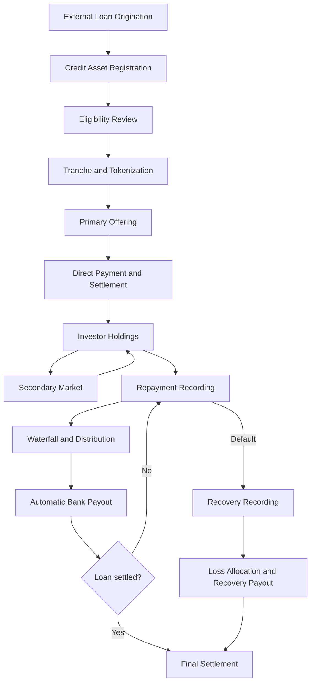

# CreditForge — Project Idea Specification v2.1

**Status:** Revised Idea Approved; detailed requirements pending  
**English title:** Independent Asset-Backed Credit Investment Marketplace  
**Vietnamese title:** Nền tảng đầu tư và chuyển nhượng quyền lợi tín dụng từ các khoản vay có tài sản bảo đảm  
**Project:** Full-stack Graduation Project | FinTech | TypeScript  
**Current phase:** Phase 2 — Business Analysis (re-baseline)

Tài liệu hợp nhất Idea Specification v1.0 và Baseline Revision v2.0–v2.1, thay thế nội dung mâu thuẫn của các bản cũ. Các ví dụ, đề xuất và quyết định còn mở không phải yêu cầu đã được phê duyệt. Đây chưa phải BRD, SRS hoặc thiết kế kỹ thuật cuối cùng.

## 1. Project Overview

CreditForge là Marketplace độc lập cho phép một ngân hàng giả lập phát hành quyền lợi kinh tế từ khoản vay doanh nghiệp có tài sản bảo đảm đã được thẩm định và giải ngân bên ngoài nền tảng. Bank chào bán Senior Token để tái huy động một phần vốn; Investor mua, nắm giữ, nhận dòng tiền và chuyển nhượng quyền lợi. Bank giữ Junior chịu first-loss và Senior chưa bán.

Investor không bắt buộc dùng cùng ngân hàng với Issuer. Tiền mua/bán, gốc, lãi và recovery đi trực tiếp qua hệ thống ngân hàng được mô phỏng.

**Money stays in the banking system. Credit rights are managed by CreditForge.**

Không ví VNĐ nội bộ, không nạp/rút tiền, không tiền thật hoặc smart contract. Toàn bộ dữ liệu, tài sản và giao dịch được mô phỏng. Stack: TypeScript, Next.js, NestJS, PostgreSQL, Node.js.

## 2. Problem Statement

- Bank: vốn đã giải ngân được thu hồi theo kỳ hạn; phân phối quyền lợi cho nhiều Investor đòi hỏi quản lý sở hữu, dòng tiền và rủi ro. Tái huy động vốn không mặc nhiên giảm yêu cầu vốn pháp định hoặc loại khoản vay khỏi bảng cân đối kế toán.
- Investor: khoản vay lớn, khó tiếp cận quyền lợi nhỏ lẻ, theo dõi dòng tiền và chuyển nhượng trước hạn. Marketplace hỗ trợ tiếp cận nhưng không bảo đảm lợi nhuận/thanh khoản.
- Borrower: vay và trả nợ theo quy trình ngân hàng hiện hữu; lợi ích gián tiếp về khả năng cung cấp tín dụng không đồng nghĩa cam kết giảm lãi suất.
- Accessibility: tách Issuer và Payment Bank; không yêu cầu mở tài khoản tại ngân hàng phát hành.
- Liquidity: tập trung listing và Investor trên một thị trường chung thay vì thị trường tách biệt trong từng Banking App.
- Cash custody: tránh trực tiếp giữ tiền khách hàng, giảm phạm vi quản lý ví; đổi lại cần xử lý settlement liên hệ thống.

Nhu cầu thực tế tại Việt Nam chưa được kiểm chứng.

## 3. Proposed Solution

| Domain | Nghiệp vụ |
|---|---|
| Credit Asset Management | Đăng ký khoản vay, hồ sơ tham chiếu, điều kiện phát hành |
| Tokenization | Tranche, mệnh giá, tổng cung, ownership registry |
| Marketplace | Primary offering, secondary listing, purchase order |
| Payment & Settlement | Reservation, payment verification, transfer, refund, reconciliation |
| Financial Engine | Interest, repayment, waterfall, distribution, loss allocation |
| Payout | Chỉ thị chi trả, xác nhận và nghĩa vụ chưa hoàn tất |
| Portfolio | Holdings, giá vốn, dòng tiền, hiệu quả và tổn thất |
| Governance & Risk | Offering review, default, recovery, ledger, audit, stress test |

Marketplace là giao diện sản phẩm; financial engine, ownership registry và settlement management là phần cốt lõi.

## 4. Product Positioning

- Standalone Marketplace, không tích hợp bắt buộc vào Banking App.
- Single Issuer — Multiple Payment Banks. Một ngân hàng giả lập vừa cấp khoản vay vừa phát hành, nhiều Borrower và Investor, nhiều nguồn thanh toán giả lập.
- Direct Payment — Non-custodial Cash Model. CreditForge không giữ tiền Investor nhưng quản lý sổ đăng ký Credit Token tập trung; không tuyên bố non-custodial đối với mọi tài sản.
- Loan-centric: token class gắn với khoản vay xác định.
- Limited-recourse: quyền lợi phụ thuộc dòng tiền và waterfall; Bank không mặc nhiên bảo lãnh toàn bộ gốc/lãi.

Không phải ngân hàng số, P2P lending thuần túy, sàn crypto, ví điện tử, sàn tài sản thế chấp, nền tảng tiết kiệm hoặc crowdfunding.

## 5. Core Business Model

**Post-funding:** Bank giải ngân trước khi chào bán; Borrower nhận vốn không phụ thuộc tỷ lệ bán token. Borrower trả nợ Bank, không vay trực tiếp Investor. Investor không mặc nhiên sở hữu cổ phần hay tài sản bảo đảm.

**Bank economics:** A là borrower rate, B là Senior coupon. Bank hưởng lãi Senior còn giữ và residual Junior. Thu nhập gộp đơn giản hóa = lãi thực nhận trừ lãi phân bổ cho Investor ngoài Bank. Không phải lợi nhuận ròng; chưa tính chi phí vốn, thuế, vận hành, tổn thất.

**Marketplace economics:** phí phát hành, giao dịch hoặc dịch vụ Issuer là phương án nghiên cứu; chưa chốt. Ví dụ giả định phí bằng 0.

## 6. Business Participants

| Participant | Trách nhiệm |
|---|---|
| Issuing Bank | Cấp tín dụng ngoài hệ thống; đăng ký khoản vay; cung cấp dữ liệu; cấu hình phát hành; giữ Junior/Senior chưa bán; ghi nhận trả nợ/default/recovery; chi trả theo điều khoản |
| Investor | Đăng ký, nghiên cứu, mua bán, cung cấp tài khoản nhận tiền, theo dõi danh mục, chịu rủi ro |
| Borrower | External Stakeholder; vay và trả nợ Bank; không tài khoản CreditForge |
| CreditForge Operator | Vận hành thị trường, kiểm soát công bố, ownership, giao dịch, tính toán, đối soát, audit |
| Payment Bank | Cung cấp tài khoản thanh toán/nhận tiền; có thể khác Issuer |
| Payment System | Mô phỏng authorization, transfer, confirmation, refund, payout, reconciliation |

Role nội bộ chi tiết chưa chốt. System Admin không mặc nhiên có quyền tài chính. Tên ngân hàng nếu dùng chỉ minh họa, không phải đối tác thật.

## 7. System Boundary

| Outside CreditForge | Inside CreditForge |
|---|---|
| Đăng ký vay, thẩm định, định giá, đàm phán | Credit Asset Registration, Eligibility Review |
| Phê duyệt, ký hợp đồng, giải ngân | Tokenization, Tranche, Offering |
| Thu tiền Borrower | Repayment Recording, Distribution |
| Chuyển tiền ngân hàng thực tế | Payment Orchestration, Verification, Settlement |
| Thu hồi nợ và xử lý tài sản vật lý | Default/Recovery Recording, Loss Allocation |
| Core Banking | Marketplace, Ownership, Portfolio, Payout Tracking, Ledger, Risk, Audit |

Ngân hàng có thể nhận hồ sơ trực tiếp hoặc qua kênh hiện hữu; không bắt buộc offline. CreditForge không xây dựng lại Core Banking.

## 8. Credit Tokenization

Token hóa **quyền lợi kinh tế từ khoản vay có tài sản bảo đảm**, không phải quyền sở hữu tài sản thế chấp. Credit Token là đơn vị ghi nhận tập trung; không yêu cầu blockchain, không dùng làm tiền thanh toán, không mặc nhiên là chứng khoán hay tài sản mã hóa được pháp luật công nhận.

Thuộc tính: token class ID, underlying loan, issuer, tranche, face value, initial/outstanding principal entitlement, supply, issue price, coupon/residual rule, issue/maturity date, repayment terms, payment/loss priority, transfer rules, trading status.

Một Borrower có thể có nhiều Loan; quyền lợi mỗi Loan độc lập.

### Ví dụ xuyên suốt (không phải thông số bắt buộc)

| Thuộc tính | Giá trị |
|---|---:|
| Tài sản bảo đảm | 10 tỷ VNĐ |
| Gốc khoản vay/dư nợ lúc phát hành | 6 tỷ VNĐ |
| LTV | 60% |
| Borrower rate | 12%/năm |
| Senior coupon | 8%/năm |
| Kỳ hạn | 12 tháng (ví dụ 365 ngày) |
| Mệnh giá | 100.000 VNĐ |
| Tổng token | 60.000 |

## 9. Senior & Junior Tranche

Senior: coupon mục tiêu cố định, ưu tiên thanh toán theo waterfall, chào bán cho Investor, có thể chuyển nhượng, vẫn có nguy cơ mất gốc/lãi.

Junior: Bank giữ toàn bộ, chịu first-loss, hưởng residual. Không chào bán cho Investor trong mô hình hiện tại.

| Tranche | Tỷ lệ minh họa | Gốc | Token |
|---|---:|---:|---:|
| Senior | 80% | 4,8 tỷ | 48.000 |
| Junior | 20% | 1,2 tỷ | 12.000 |
| Tổng | 100% | 6 tỷ | 60.000 |

Junior retention gắn lợi ích Bank với chất lượng khoản vay, hạn chế moral hazard và tạo lớp hấp thụ tổn thất. 80/20 là minh họa, chưa hiệu chỉnh theo rủi ro. Senior của Bank và Investor pari passu; không đổi tranche theo danh tính chủ sở hữu.

## 10. Credit Asset Registration

Đăng ký khoản vay đã tồn tại, không tạo khoản vay mới.

Dữ liệu: external loan reference duy nhất, Borrower, ngành, mục đích, original/outstanding principal, lãi suất, ngày giải ngân/đáo hạn, lịch trả nợ, trạng thái, tài sản bảo đảm, giá trị/ngày định giá, hồ sơ tham chiếu (hợp đồng, xác nhận giải ngân, định giá, tóm tắt thẩm định).

Điều kiện đề xuất: đã giải ngân, chưa tất toán, hồ sơ đầy đủ, dư nợ hợp lệ, không trùng khoản vay/quyền lợi, phát hành không vượt quyền lợi đủ điều kiện. Kiểm tra nội bộ không xác minh được pháp lý tài sản thật.

Ví dụ: khoản vay ban đầu 6 tỷ, đã trả 2 tỷ gốc thì không thể token hóa 6 tỷ quyền lợi gốc khi dư nợ còn 4 tỷ.

Đề xuất MVP (chưa chốt): chỉ nhận khoản vay chưa hoàn trả gốc; một tài sản bảo đảm cho một khoản vay còn nghĩa vụ tại một thời điểm; không cross-default. Maker–Checker cho đăng ký/phát hành thay vì phê duyệt cấp tín dụng.

## 11. Primary Market

Bank công bố Senior Offering gồm Issuer, Borrower, mục đích, gốc, collateral, LTV, tóm tắt đánh giá được phép công bố, tranche, coupon, mệnh giá/giá phát hành, kỳ hạn, lượng chào bán/đã bán/còn lại, ngày mở/đóng, cảnh báo rủi ro.

Flow: chọn số lượng → kiểm tra → Purchase Order → reserve token → Payment Request → Investor xác nhận thanh toán qua ngân hàng → xác minh → chuyển ownership → cập nhật Offering và Ledger → hoàn tất.

Tiền chuyển trực tiếp đến Issuer. Định hướng phát hành tại mệnh giá, chưa chốt chính sách giá chính thức. Không bán vượt Senior khả dụng.

## 12. Partial Subscription & Unsold Token

Khoản vay tiếp tục nếu không bán hết. Bank giữ toàn bộ Junior và Senior chưa bán; không chuyển Senior chưa bán thành Junior.

Ví dụ bán 50% Senior:

| Owner / Tranche | Gốc |
|---|---:|
| Investor Senior | 2,4 tỷ |
| Bank Senior | 2,4 tỷ |
| Bank Junior | 1,2 tỷ |

Bank thu hồi 2,4 tỷ tại mệnh giá, còn tài trợ 3,6 tỷ. Offering đóng thì không tạo order mới; cần chính sách cho order đang thanh toán.

## 13. Secondary Market

Fixed-price: Seller đặt số lượng và giá chào; Buyer chấp nhận hoặc không mua. Không AMM, order book nâng cao, DEX hay bắt buộc Bank mua lại.

Flow: tạo Listing → khóa token → Buyer đặt Order/reserve → Payment Request → Buyer thanh toán trực tiếp Seller → xác minh → chuyển ownership → cập nhật Listing/Ledger.

Listing không đổi chủ. Seller hưởng quyền lợi và chịu rủi ro đến khi settlement hoàn tất. Không bảo đảm có Buyer.

Giá độc lập mệnh giá (discount/at par/premium). Chuyển nhượng không đổi Issuer, loan, coupon, face value, maturity, tranche, priority, supply, nghĩa vụ Borrower. Đổi owner, giá vốn, giá giao dịch, quyền hưởng dòng tiền tương lai và lợi suất.

Ví dụ token 100.000 VNĐ, coupon 8%, còn sáu tháng và 4.000 lãi dự kiến:

| Giá mua | Dòng tiền dự kiến | Lãi/lỗ | Holding-period return |
|---:|---:|---:|---:|
| 95.000 | 104.000 | +9.000 | 9,47% |
| 100.000 | 104.000 | +4.000 | 4% |
| 105.000 | 104.000 | -1.000 | -0,95% |

Giả định ngay sau kỳ trả lãi, trả đủ, không phí/thuế, sáu tháng đơn giản hóa; return không phải annualized yield.

UI định hướng asset-centric: xem khoản vay trước rồi so sánh listing. Trading suspension khi overdue/default/maturity/dispute/pending settlement còn cần chốt.

## 14. Direct Payment Model

| Operation | Payer | Payee |
|---|---|---|
| Loan disbursement (outside) | Bank | Borrower |
| Loan repayment (outside) | Borrower | Bank |
| Primary purchase | Investor | Issuer |
| Secondary purchase | Buyer | Seller |
| Interest/principal/recovery payout | Issuer | Investor |
| Refund | Bên nhận ban đầu hoặc đơn vị được ủy quyền | Người trả ban đầu |

CreditForge không trực tiếp giữ tiền trong bất kỳ luồng nào. Không cash wallet, deposit, withdrawal, internal fiat transfer.

Investor phải xác nhận hoặc ủy quyền hợp lệ; CreditForge không tự trích tiền. Payment Bank có thể khác Issuer nếu được phương thức thanh toán hỗ trợ. Tài khoản nhận tiền được xác minh giả lập. Quy tắc đổi tài khoản/nguồn thanh toán khác còn mở. Không lưu PIN, OTP, mật khẩu hoặc thông tin đăng nhập ngân hàng.

## 15. Trade Settlement Management

Tiền và ownership thuộc hai hệ thống khác nhau. PostgreSQL không thể rollback chuyển khoản đã hoàn tất. Hướng đến nguyên tắc Delivery versus Payment, không tuyên bố DvP nguyên tử với ngân hàng thật.

Purchase Order: ID, market, buyer/seller, offering/listing, token class, quantity, price, total, payment reference, expiry, status. Phân biệt khóa Listing với reserve Order; không over-reserve.

Luồng đề xuất: ORDER_CREATED → TOKEN_RESERVED → AWAITING_PAYMENT → PAYMENT_CONFIRMED → SETTLING → COMPLETED.

Ngoại lệ: CANCELLED, EXPIRED, PAYMENT_FAILED, SETTLEMENT_FAILED, RECONCILIATION_REQUIRED, REFUND_PENDING, REFUNDED. Order, payment, settlement cần chuẩn hóa trạng thái riêng.

Xác minh reference, transaction ID, amount, currency, payer/payee, status, timestamp từ nguồn đáng tin cậy. Không chỉ dựa ảnh chuyển khoản. Một payment không được dùng hoàn tất nhiều order.

| Ngoại lệ | Kiểm soát đề xuất |
|---|---|
| Nhiều Buyer cùng mua | Reservation + concurrency control |
| Không thanh toán, hết hạn | Đối chiếu trạng thái rồi release |
| Thiếu/thừa/sai người nhận | Reconciliation; không tự hoàn tất |
| Thanh toán muộn | Đối soát, refund hoặc xử lý hợp lệ |
| Callback lặp | Idempotency |
| Đã trả nhưng chuyển token lỗi | Giữ reservation, retry/exception handling |
| Đình chỉ token trong khi pending | Giải quyết nghĩa vụ đang tồn tại |
| Refund lỗi | Giữ nghĩa vụ mở, đối soát |

Không tự giải phóng token đã xác nhận thanh toán nếu nghĩa vụ chưa giải quyết. Late payment sau release cần xử lý riêng. Refund là giao dịch riêng; CreditForge không mặc nhiên được trích lại tiền Seller đã nhận. Cần phối hợp/quyền hạn hợp lệ; đồ án mô phỏng.

Reconciliation đối chiếu order, payment, settlement, refund, payout; phát hiện thiếu xác nhận, trùng, sai số tiền, không xác định order và nghĩa vụ còn mở.

## 16. Interest Accrual & Ownership History

Investor bắt đầu tích lũy lãi khi mua hoàn tất (BD-003), không hưởng hồi tố từ giải ngân. Trước đó quyền lợi Senior thuộc Bank/Seller tương ứng.

Lưu owner, token class, quantity, ownership start/end, acquisition/transfer reference, principal entitlement. Lãi đã trả không chuyển giao lại; lãi tương lai thuộc Buyer; lãi tích lũy chưa trả cần quy tắc rõ.

Ví dụ 100.000 VNĐ, 8%/năm, 365 ngày, mua ngày 60 kể từ khi Senior bắt đầu accrual:

| Owner | Ngày | Lãi mục tiêu |
|---|---:|---:|
| Bank | 60 | ~1.315 VNĐ |
| Investor | 305 | ~6.685 VNĐ |
| Tổng | 365 | 8.000 VNĐ |

ACT/365 Fixed minh họa, gốc không đổi, trả đủ. Accrued interest policy chưa chốt: ghi riêng quyền lợi Seller hoặc chuyển coupon entitlement kèm điều chỉnh giá nhất quán với BD-003. Không tạo thêm lãi do giao dịch. Cần chốt cutoff, thiếu dòng tiền, chuyển nhượng sát kỳ trả lãi.

## 17. Financial Engine

**LTV = Loan Principal / Collateral Value × 100%.** Ví dụ 6/10 = 60%. Dùng cho công bố rủi ro/điều kiện phát hành, không quyết định cấp tín dụng. Phân biệt original/current LTV.

Với giả định toàn bộ dư nợ đủ điều kiện được token hóa:

- Total Supply = Eligible Principal / Face Value.
- Senior Principal = Eligible Principal × Senior Ratio.
- Junior Principal = Eligible Principal × Junior Ratio.
- Supply tranche = Principal tranche / Face Value.
- Senior Principal + Junior Principal = Eligible Principal.

Quy tắc lượng nguyên, làm tròn, phần dư chưa chốt.

**Interest = Outstanding Principal × Annual Rate × Actual Days / 365.** ACT/365 Fixed là đề xuất. Khi gốc đổi, chia khoảng gốc tương ứng; Senior Investor còn phụ thuộc thời gian sở hữu.

Định hướng MVP: fixed rate, monthly interest, bullet principal. Lịch trả nợ, prepayment, ngày nghỉ và rounding cần chuẩn hóa.

Repayment Recording: Bank xác nhận tiền thực nhận; external payment reference, loan, ngày, amount, principal/interest components. Manual recording hay mock banking event chưa chốt.

Ví dụ 365 ngày, trả đủ, Senior bán hết đầu kỳ: Borrower 6 tỷ × 12% = 720 triệu; Senior 4,8 tỷ × 8% = 384 triệu; Junior residual = 336 triệu (gộp trước chi phí/tổn thất).

Coupon feasibility dựa trên dòng tiền, tổng gốc Senior, kỳ hạn, lịch trả và chi phí; không chỉ so sánh A với B. Không tạo dòng tiền để bù thiếu hụt.

## 18. Cash Flow Distribution & Automatic Payout

Waterfall chỉ phân bổ dòng tiền khả dụng; Senior ưu tiên theo điều khoản, Junior residual, cùng tranche pari passu. Chi tiết thứ tự chi phí/gốc/lãi/nghĩa vụ tồn đọng chưa chốt.

**Distribution:** tính quyền lợi. **Payout:** thực hiện và xác nhận chi trả. Hai trạng thái khác nhau.

Flow: Borrower trả Bank → xác nhận receipt → Repayment Recording → Waterfall → Distribution Records → Payout Instructions → ngân hàng mô phỏng chuyển khoản → xác minh → đối soát.

Automatic Bank Payout đã chốt: không Claim Interest/Withdraw. Gốc, lãi, recovery trực tiếp về tài khoản Investor đã xác minh. Phần Bank được hưởng có thể giữ lại.

Ví dụ 1.000 token × 100.000 VNĐ, coupon 8%, nắm đủ năm, trả đủ, gốc không đổi: 8 triệu lãi mục tiêu/năm; trung bình ~666.667/tháng. Số thực tế theo day count, quyền sở hữu, waterfall.

Payout lỗi: nghĩa vụ vẫn còn, không đánh dấu đã nhận, không tái phân phối receipt, kiểm tra trạng thái trước retry. Pending Payout không phải cash balance. Gốc đã phân phối làm giảm quyền lợi gốc tương ứng; redemption/retirement cần chuẩn hóa.

## 19. Default & Recovery

Vòng đời tham chiếu: Active → Overdue → Grace (nếu có) → Defaulted → Recovery → Settled/Closed. Trả đủ: Active → Settled. Loan, Offering, token, order, payout cần trạng thái riêng.

Phát hiện kỳ đến hạn chưa ghi nhận; Bank xác minh thực tế; grace nếu có; xác nhận default theo thẩm quyền; Bank thu hồi bên ngoài; ghi nhận net recovery; phân bổ dòng tiền/loss; payout và đóng khoản vay.

Không tự thanh lý tài sản vật lý tức thời; thiếu dữ liệu không đồng nghĩa default. Grace (ví dụ 7 ngày), lãi phạt, impairment, recovery còn mở.

## 20. First-loss & Loss Allocation

Mô hình đơn giản **chỉ cho gốc**, giả định net recovery R được dành trả gốc và loss đã xác nhận:

- P = dư nợ gốc; J = quyền lợi gốc Junior còn lại.
- q = tỷ lệ quyền lợi gốc Senior do Investor ngoài Bank giữ.
- L = max(0, P − R).
- LJ = min(L, J).
- LS = max(0, L − LJ).
- Bank Loss = LJ + LS × (1 − q).
- Investor Loss = LS × q.
- Invariant: Bank Loss + Investor Loss = L.

Nếu không còn Senior, không có Senior loss, không cần q. Thu hồi gốc không vượt quyền lợi gốc; phần thu vượt và lãi thiếu cần quy tắc riêng.

Ví dụ P = 6 tỷ, J = 1,2 tỷ, Senior = 4,8 tỷ, R = 4 tỷ: loss 2 tỷ; Junior loss 1,2 tỷ; Senior loss 800 triệu.

| Senior bán được | Bank Loss | Investor Loss |
|---:|---:|---:|
| 0% | 2 tỷ | 0 |
| 25% | 1,8 tỷ | 200 triệu |
| 50% | 1,6 tỷ | 400 triệu |
| 75% | 1,4 tỷ | 600 triệu |
| 100% | 1,2 tỷ | 800 triệu |

Khi bán 50%:

| Quyền lợi | Gốc | Thu hồi | Lỗ |
|---|---:|---:|---:|
| Bank Junior | 1,2 tỷ | 0 | 1,2 tỷ |
| Bank Senior | 2,4 tỷ | 2 tỷ | 400 triệu |
| Investor Senior | 2,4 tỷ | 2 tỷ | 400 triệu |

Nếu R = 5 tỷ, Junior lỗ 1 tỷ, Senior không lỗ gốc. Buyer sau settlement chịu rủi ro gốc từ token đã mua; listing chưa chuyển chủ. Principal loss khác lãi/lỗ đầu tư theo giá mua.

Đây là adaptation đơn giản hóa, không phải công thức nguyên bản của reference. Partial recovery, impairment, interest shortfall, loss recognition cần nghiên cứu.

## 21. Investor Portfolio

Holdings, available/locked/reserved, giá vốn, mệnh giá/outstanding principal entitlement, coupon, kỳ hạn, expected cash flow, accrued interest, distributed, pending payout, received interest/principal, realized return, loss, lịch sử payment/payout/trade, cảnh báo rủi ro.

Không cộng token/pending payout vào số dư ngân hàng khả dụng. Không cash wallet, deposit, withdraw, claim interest.

## 22. Financial Ledger & System Integrity

Ledger truy vết issuance, ownership, payment confirmation, repayment receipt, distribution, payout, refund, recovery, loss, settlement. Giải ngân chỉ là tham chiếu ngoài. Ledger không phải ví.

Financial invariants:

- Không phát hành vượt quyền lợi đủ điều kiện; tổng tranche khớp gốc phát hành.
- Không âm số lượng/quyền lợi trái quy tắc; không bán vượt holdings khả dụng.
- Không double-sale; tổng holding khớp supply còn hiệu lực; transfer không tăng supply.
- Secondary không đổi nghĩa vụ Borrower, coupon, tranche.
- Không transfer khi payment chưa xác minh; mỗi order chỉ hoàn tất một lần.
- Không xử lý payment event/payout trùng.
- Distribution không vượt dòng tiền khả dụng; đối soát đã phân bổ/đã chi/chưa chi.
- Tổng loss phân bổ bằng loss xác nhận.
- Không đánh dấu payout đã nhận khi thiếu confirmation.
- Không tự ý sửa/xóa giao dịch hoàn tất; điều chỉnh phải có quyền hạn và truy vết.

Invariants là cơ sở kiểm thử tự động và concurrency tests; accounting detail và rounding thuộc thiết kế.

## 23. Risk Management

Credit risk, collateral depreciation, liquidity, single issuer concentration, dữ liệu sai/chậm, settlement, payout, operational risk.

Stress test đề xuất: thay đổi LTV, collateral decline, recovery cost, junior ratio, tỷ lệ Senior bán được. Net recovery = collateral value × (1 − decline rate) × (1 − recovery cost rate), sau đó áp dụng loss gốc trong giới hạn nghĩa vụ và giả định phù hợp. Không phải mô hình PD hay định giá thị trường đã kiểm chứng.

Seller không tự sửa dữ liệu tài chính khoản vay trên Listing. Công bố trạng thái/rủi ro nhất quán; hồ sơ nội bộ và thông tin nhạy cảm không mặc nhiên công khai.

## 24. Product Structure

| Portal | Module dự kiến |
|---|---|
| Investor | Auth, Primary/Secondary, Asset Details, Orders, Holdings, Listings, Portfolio, Bank Account, Payment/Distribution/Payout History, Risk |
| Issuer | Dashboard, Credit Assets, Tokenization, Tranche, Offerings, Subscriptions, Repayment, Default/Recovery, Distribution/Payout Monitoring, Reports |
| CreditForge Admin | Users/Roles, Issuer Management, Offering Review, Market Oversight, Settlement/Payment Monitoring, Reconciliation, Financial Audit, Settings |

Không cần ba ứng dụng riêng. Không Borrower Portal. Tách quyền Issuer/Operator; Maker–Checker và Risk/Audit role là đề xuất, chưa chốt số role.

## 25. Key Differentiating Features

Credit Tokenization và ownership registry; Tranche Engine (first-loss, retained Senior, pari passu); Waterfall Engine; Primary/Fixed-price Secondary; Payment Settlement (reservation, verification, idempotency, retry, refund, reconciliation); Automatic Payout; Risk Stress Test; Simulation Clock; Financial Auditability.

Risk simulator/clock và mức xử lý ngoại lệ cần ưu tiên theo MVP.

## 26. Reference Projects

| Reference | Hướng nghiên cứu |
|---|---|
| [Centrifuge](https://centrifuge.io/) — Tinlake lịch sử | Senior DROP / Junior TIN, first-loss, asset-backed financing, subscription/NAV |
| [Goldfinch V1](https://docs.goldfinch.finance/) | Private credit, borrower pools, repayment waterfall |
| [Maple Finance](https://docs.maple.finance/) | Loan lifecycle, interest, default, impairment |
| [Mintos](https://www.mintos.com/) | Retail credit marketplace, secondary pricing, portfolio, accrued interest |

Reference là hướng nghiên cứu, không tích hợp trực tiếp hay xác nhận công thức hiện tại. Phase 2/3 cần đối chiếu phiên bản tài liệu gốc, phân biệt cơ chế nguồn với adaptation.

## 27. Technology Stack

TypeScript (toàn bộ mã nguồn ứng dụng tự phát triển), Next.js, NestJS, PostgreSQL, Node.js.

Mock Payment Gateway đề xuất: payment request, authorization, transfer giữa tài khoản giả lập, callback, status query, refund, payout, reconciliation. Mô phỏng success/failure/duplicate/late/settlement failure. Không chuyển tiền thật hoặc QR thanh toán thật.

API-first là định hướng; không yêu cầu Banking App integration. ORM, auth, cache, jobs, queue, architecture, deployment, testing chưa chốt. Không mặc định microservices. Tiền và phép tính tài chính cần độ chính xác; kỹ thuật thuộc System Design.

## 28. Preliminary Project Scope

**Core concept (chưa cam kết toàn bộ MVP):** auth, credit asset registration/review, tokenization, tranche, primary/secondary, ownership history, direct payment/settlement, repayment, interest, waterfall, automatic payout, default/recovery/loss, ledger, portfolio.

**Extended:** risk simulator, clock, advanced reports, Maker–Checker mở rộng, reconciliation dashboard, notifications, advanced audit UI.

**Out of scope:** Borrower Portal, loan application/underwriting/approval/disbursement execution, Core Banking hoàn chỉnh, Banking App integration, multi-issuer, multi-currency, tiền thật/custody, internal cash wallet/nạp/rút, manual claim, AMM/advanced order book/DEX, AI credit scoring, multi-asset pool, thanh lý vật lý tự động, blockchain/smart contract deployment, production-level compliance.

## 29. Business Decision Register

| ID | Decision | Status |
|---|---|---|
| BD-001-R1 | Independent Marketplace, Single Issuer, Multiple Payment Banks | Confirmed |
| BD-002-R1 | External assessment; internal issuance eligibility | Confirmed |
| BD-003 | Accrual từ lúc mua hoàn tất | Confirmed |
| BD-004 | Loan-centric | Confirmed |
| BD-005 | Limited-recourse, Senior/Junior, Bank giữ Junior và unsold Senior | Confirmed |
| BD-006 | Role structure | Review required |
| BD-007 | Collateral reuse | Review required |
| BD-008 | Loan agreement acceptance | Superseded: outside system |
| BD-009 | Direct Payment, no cash wallet | Confirmed |
| BD-010 | External Loan Origination, no Borrower Portal | Confirmed |
| BD-011 | Tiền bán chuyển trực tiếp Seller | Confirmed |
| BD-012 | Automatic Bank Payout gốc/lãi/recovery | Confirmed |

Review Gate 02 cũ chưa xác nhận. BD-001 và BD-002 cũ được thay thế.

## 30. Preliminary Business Rules

Giữ mã BR cũ khi còn phù hợp; bổ sung mã mới. Chi tiết vận hành cần review, không mặc nhiên đã phê duyệt.

| ID | Rule |
|---|---|
| BR-001 | Chỉ chào bán sau khi khoản vay giải ngân ngoài hệ thống |
| BR-002 | Token hóa quyền lợi kinh tế từ khoản vay có tài sản bảo đảm |
| BR-003 | Token không mặc nhiên là sở hữu collateral |
| BR-004 | Senior và Junior |
| BR-005 | Bank giữ toàn bộ Junior |
| BR-006 | Junior chịu loss trước Senior |
| BR-007 | Unsold Senior thuộc Bank |
| BR-008 | Senior pari passu |
| BR-009 | Loss cùng tranche theo quyền lợi còn lại |
| BR-010 | Không tùy ý đổi tranche sau phát hành |
| BR-011 | Primary: Bank bán Senior |
| BR-012 | Secondary: Investor chuyển nhượng |
| BR-013 | Seller đặt giá chào |
| BR-014 | Coupon không đổi khi transfer |
| BR-015 | Giá giao dịch độc lập mệnh giá |
| BR-016 | Transfer không đổi supply |
| BR-017 | Transfer không đổi nghĩa vụ Borrower |
| BR-018 | Quyền lợi tương lai và rủi ro chuyển sau settlement |
| BR-019 | Accrued interest theo chính sách định trước |
| BR-020 | Listing chưa settlement thuộc Seller |
| BR-021 | Không bảo đảm thanh khoản |
| BR-022 | Bank không mặc nhiên mua lại |
| BR-023 | Distribution không vượt tiền khả dụng |
| BR-024 | Tổng loss phân bổ bằng loss xác nhận |
| BR-025 | Không xử lý giao dịch tài chính trùng |
| BR-026 | Mọi giao dịch tài chính truy vết được |
| BR-027 | Khoản vay không hủy vì bán không hết |
| BR-028 | Dữ liệu và dòng tiền mô phỏng |
| BR-029 | Một Issuer; Payment Bank có thể khác Issuer |
| BR-030 | Không cấp tín dụng trong CreditForge |
| BR-031 | Không phát hành trùng/vượt quyền lợi đủ điều kiện |
| BR-032 | Không cash wallet, deposit, withdraw |
| BR-033 | Payment cần authorization hợp lệ |
| BR-034 | Tiền Primary đến Issuer |
| BR-035 | Tiền Secondary đến Seller |
| BR-036 | Transfer sau payment hợp lệ và đáp ứng điều kiện settlement |
| BR-037 | Không over-reserve/double-sale |
| BR-038 | Investor accrual từ khi mua hoàn tất |
| BR-039 | Bank chi gốc/lãi/recovery trực tiếp Investor đã xác minh |
| BR-040 | Distribution khác Payout; pending payout không phải cash balance |
| BR-041 | Chỉ ghi đã chi khi có confirmation |
| BR-042 | Payment/refund/payout đối soát và idempotent |
| BR-043 | Không tự release token đã thanh toán khi nghĩa vụ chưa giải quyết |
| BR-044 | Không lưu PIN, OTP, mật khẩu ngân hàng |
| BR-045 | Không tùy ý sửa/xóa giao dịch hoàn tất; điều chỉnh có truy vết |

BR-031, BR-036–037, BR-041–045 là kiểm soát đề xuất cần chi tiết hóa; BR-019 chưa chốt phương pháp.

## 31. Graduation Project Objectives

Academic: business analysis, domain modeling, state machine, TypeScript full-stack, data design, authorization, concurrency, financial invariant testing, integration simulation, visualization.

Product: hoàn thành luồng marketplace, phân phối đúng quyền lợi, công bố rủi ro, xử lý giao dịch bất thường.

Personal: đồ án chất lượng, demo dễ nhớ, phát triển Software/Financial Engineering và portfolio. Không dự đoán điểm giảng viên.

## 32. Demonstration Concept

1. Bank đăng ký khoản vay 6 tỷ, collateral 10 tỷ đã giải ngân.
2. Kiểm tra, cấu hình 80/20, 60.000 token.
3. Công bố Offering, Investor trả từ ngân hàng khác Issuer.
4. Bán một phần Senior, hiển thị Bank retained capital.
5. A đăng bán, B mua, tiền trực tiếp về A; ownership đổi sau settlement.
6. Mô phỏng duplicate callback, concurrent reservation hoặc settlement failure.
7. Mô phỏng thời gian, repayment, waterfall và direct payout.
8. Distribution thành công nhưng payout lỗi; retry an toàn.
9. Nhánh A: trả đủ gốc/lãi và tất toán.
10. Nhánh B độc lập: default, recovery 4 tỷ, Junior first-loss, Senior pari passu.
11. Đối soát ledger, holdings, distribution và loss invariants.

Demo cuối tùy MVP.

## 33. Risks & Limitations

- Scope creep; tập trung Financial Engine, Marketplace, Settlement.
- Financial correctness: công thức cần nguồn, giả định và test; nghiên cứu chưa hoàn tất.
- Settlement: chuyển tiền ngoài DB không nguyên tử; refund phụ thuộc quyền hạn và bên nhận.
- Data trust: không xác minh được tài sản/receipt thật từ mô phỏng.
- Credit/liquidity/issuer concentration: mất vốn, thiếu lãi, không bán được.
- Legal: Direct Payment giảm phạm vi giữ tiền nhưng không chứng minh tuân thủ pháp luật. Phát hành, phân phối, chuyển nhượng và trung gian thanh toán có thể cần giấy phép/quyền hạn. Không khẳng định mọi app tư nhân bị cấm custody hoặc Credit Token được pháp luật công nhận.
- Real integration: chưa có API ngân hàng thật hoặc quyền trích/chi tiền.
- Market validation, nhân lực, thời gian, rubric chưa xác nhận.

## 34. Project Development Roadmap

| Phase | Deliverable |
|---|---|
| 1 Idea Discovery & Validation | Baseline v2.1; idea chốt, market validation chưa thực hiện |
| 2 Business Analysis | Context, Stakeholders, Domain, Processes, Use Cases, Rules, Reference Research, BRD; cập nhật theo baseline mới |
| 3 Financial Rules | Công thức, accrued interest, waterfall, loss, edge cases |
| 4 Requirements | FR/NFR, stories, acceptance criteria |
| 5 MVP Scope | Ưu tiên, nguồn lực, milestones |
| 6 UI/UX | IA, flows, wireframes, design system, prototype |
| 7 System Design | Architecture, DB, API, states, ledger, security |
| 8 Development | Frontend, backend, financial engine, mock integration |
| 9 Testing & Deployment | Unit, integration, E2E, invariants, concurrency, security |
| 10 Presentation & Defense | Docs, slides, demo, bảo vệ |

## 35. Open Decisions

- Eligibility, collateral reuse, cross-default, kiểm tra hồ sơ/trùng quyền lợi.
- Offering approval, Maker–Checker, role Issuer/Operator/Admin/Risk/Audit, công bố thông tin.
- Tranche ratio, coupon, issue pricing, face value, rounding, fee.
- Repayment, day count, cutoff, accrued interest, prepayment, shortfall, waterfall, impairment, grace/default, partial recovery, redemption.
- Manual repayment recording hay mock event; trading suspension, pending order khi đóng Offering/đáo hạn.
- Payment method, verification, authorization, reservation expiry, confirmation finality, callback, refund, retry, reconciliation, payout failure, đổi tài khoản nhận.
- Auth, security, ORM, architecture, deployment, test strategy, simulation clock.
- MVP, nhân lực, thời gian và rubric.

## 36. Project Principles

Business first, technology second. Financial correctness first. Không tự sáng tạo công thức thiếu cơ sở. Phân biệt reference và adaptation. Không đánh đồng token với collateral hoặc bảo đảm lợi nhuận/thanh khoản. Không giữ tiền Investor. Tách distribution/payout và payment/ownership transfer. Truy vết, concurrency control, idempotency. Tránh overengineering; tập trung đồ án tốt nghiệp.

## 37. Version History

| Version | Changes |
|---|---|
| 1.0 | End-to-end credit platform, Borrower Portal, cấp tín dụng trong hệ thống |
| 2.0 | Independent Marketplace, Single Issuer, External Loan Origination, Direct Payment |
| 2.1 | Direct Bank Settlement khi bán, Automatic Bank Payout, hợp nhất baseline |

Banking App integration và multi-issuer đã được cân nhắc nhưng không thuộc phạm vi hiện tại. Các đề xuất chưa xác nhận vẫn mở.

## 38. Final Project Statement

CreditForge mô phỏng phát hành, đầu tư và chuyển nhượng quyền lợi tín dụng từ khoản vay doanh nghiệp có tài sản bảo đảm đã giải ngân. Một Bank bán Senior để tái huy động vốn, giữ Junior chịu first-loss và unsold Senior. Investor giao dịch trên thị trường chung, không bắt buộc cùng ngân hàng phát hành. Tiền đi trực tiếp qua ngân hàng, CreditForge quản lý quyền lợi.

Điểm khác biệt là Financial Engine, ownership, Senior/Junior waterfall và settlement bất đồng bộ có kiểm soát. TypeScript, Next.js, NestJS, PostgreSQL. Không tiền thật; không tuyên bố sẵn sàng thương mại.

**Current baseline:** v2.1.  
**Next deliverable:** BRD theo ranh giới hệ thống mới.

---

End of Document — CreditForge Project Idea Specification v2.1.
